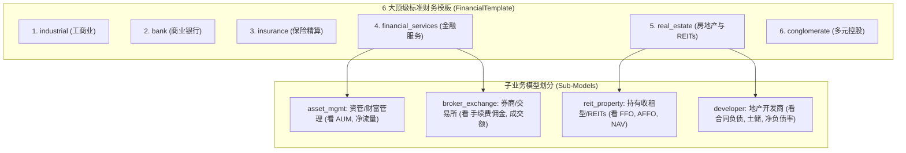
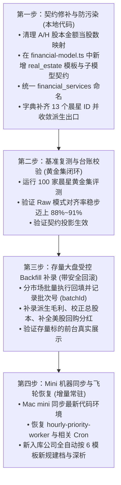

# 财务数据与模型体系深度审阅与实施规约 (DATA.md)

> **版本**：v2.2 (2026-10-17 全库回填收官与全生命周期架构版)  
> **定位**：全站财务数据工程的顶层设计与实施宪章。以公司详情页 6 大 Tab 的最终展示和深度分析需求为导向，确立 6 大标准财务模板及其子模型，划定公共科目与行业专属科目，建立股数/拆股/并购/分红/季报生命周期的防污染机制，并指导全库数据治理与 Mac mini 自动化飞轮运转。  
> **关联文档**：[GOLDEN.md](file:///Users/rafael/R129/buffett-tribe/GOLDEN.md)（黄金测试集与全量回填/收官治理总台账） ｜ [cron.md](file:///Users/rafael/R129/buffett-tribe/cron.md)（Mini 每小时 Cron 与 Onboard 重构计划）

---

## 目录

1. [执行摘要与核心架构决断](#一执行摘要与核心架构决断)
2. [数据防污染底线：六大高风险口径勘误与治理契约](#二数据防污染底线六大高风险口径勘误与治理契约)
3. [从详情页 6 大 Tab 倒推数据需求（四象限全景分析）](#三从详情页-6-大-tab-倒推数据需求四象限全景分析)
4. [6 大标准财务模板与子业务模型正交契约](#四6-大标准财务模板与子业务模型正交契约)
5. [全行业公共科目与行业专属科目的严密划定](#五全行业公共科目与行业专属科目的严密划定)
6. [需求 vs 实际获取数据的 Gap 深度剖析（附可复现命令）](#六需求-vs-实际获取数据的-gap-深度剖析附可复现命令)
7. [分阶段实施路线图、安全回退机制与量化验收标准](#七分阶段实施路线图安全回退机制与量化验收标准)

---

## 一、执行摘要与核心架构决断

全系统财务数据闭环的演进逻辑确定为：**“先定规矩与地基 $\rightarrow$ 严格防污染清洗 $\rightarrow$ 存量受控 Backfill 补录 $\rightarrow$ 收官治理（拆股/并购/次新股/季报瘦身） $\rightarrow$ 恢复 mini cron 自动化飞轮”**。

在本次重构中，我们确立以下五大核心决断：

### 决断 1：模板代码统一与 6 大标准模板 Schema 落地
* **代码标识全项目统一**：
  * 原文档曾混用 `capital_markets`，即日起全项目（Schema、代码、字典、文档）统一收敛为既有代码标识：**`financial_services`**。
  * 6 大标准财务模板标识严格冻结为：`industrial`、`bank`、`insurance`、`financial_services`、`real_estate`、`conglomerate`。
* **地产独立为第 6 大基础模板 (`real_estate`)**：
  * **现状**：代码目前为 5 类，地产被作为 `industrial` 的 modifier 挂靠，但强行关闭工商业造血现金流（`showIndustrialCashFlow = false`）、替换估值锚为 `nav_ffo`，导致前端充斥着 `if (financialModel.modifiers.includes("real_estate"))` 等特判补丁。
  * **目标**：在 `src/lib/financial-model.ts` 中正式将 `real_estate` 提升为顶级 `FinancialTemplate`，为持有型 REITs 与项目开发商赋予独立的 Schema 骨架，彻底清除修饰符特判技术债。

### 决断 2：坚守巴菲特式“完整五大资本配置框架”（内生 CapEx + 外延并购 M&A + 回购 + 分红），剔除虚假因果判断
* **打通完整资本配置拼图**：资本配置 Tab（`CapitalAllocationView`）的核心价值是穿透呈现：**企业经营现金流（OCF）如何分配至内生资本开支（CapEx，形成自由现金流 FCF = OCF - CapEx）、外延并购（`PurchaseSaleOfBusinessNet`）与股东直接回报（现金分红 + 股票回购）**，并联动解释期末股本变动（回购注销 vs 并购增发，如博通 `AVGO` FY24 支付 259.8 亿美元现金并购 VMware 同时增发约 5.5 亿股）。
* **剔除主观归因断言**：当 $\text{FCF} < \text{并购} + \text{回购} + \text{分红}$ 时，只客观陈述“当期自由现金流未能完全覆盖并购与股东回报支出”，**严禁在无证据时直接判定企业是在“举债掏空”**。资金可能来源于历史沉淀的期初现金余额、资产处置现金流或外部筹资。

### 决断 3：坚守金融终端级 UI 呈现，坚决杜绝“免责声明”与“张冠李戴”
* **不输出程序员视角的丑陋免责文案**：禁止在 UI 上出现“该指标提取失败”、“请查阅年报附注”等技术占位符。
* **不搞虚假替代（严禁张冠李戴）**：**账面“权益/总资产 (`ShareholdersEquity / TotalAssets`)”绝对不是银行的 CET1（核心一级资本充足率）！** 严禁用账面比率冒充监管资本指标。
* **专业解法**：数据未接入时直接隐藏相关非必要卡片（Graceful Omission）；若为行业核心架构，展示内敛的“未披露”或待更新状态，绝不拿风马牛不相及的指标顶替。

### 决断 4：报告期生命周期契约——“历史年报 (`FY`) 永久锚定，当期季报 YTD 滚动暂存，年报就绪即清理”
* **拒绝历史季报永久堆积**：长期价值投资聚焦 5–10 年完整会计年度（`FY`）。已完结历史财年的单季/半年度数据（`Q1~Q4`、`H1~H2`）不具长线复利分析价值，且人为用累计值做减法拆单季极易引入重述与摊薄失真。
* **最新未完结财年滚动窗口**：仅对尚未披露年报的**最新未完结财年**（`periodEnd > 最新 FY periodEnd`）以**原生年初至今累计（YTD：一季报 3M、中报 6M、三季报 9M）**口径导入并暂存季报/中报（用于当期最新进展展示与 LLM 阶段性跟踪）。一旦该财年的正式年报（`FY`）披露入库，自动触发垃圾回收（GC）清理该财年及以前的所有非 `FY` 季报记录。

### 决断 5：场外 ADR 与新近 IPO 次新股的“三级数据源 Waterfall + 独立季报快照通道”
* **导入端三级 Waterfall**：① 优先提取 SEC 10-K/20-F/40-F 官方 XBRL 年报；② 若遇场外豁免 ADR（HTTP 404）或刚上市尚无 10-K 的次新股，自动 fallback 至标准字典对齐后的 `yfinance` 财报通道补录（强制写入真实记账币种 `financialCurrency` 并对齐 ADR 换股比例）；③ 若仍无 `FY` 年报，自动提取最新 `10-Q` 季报与 `424B4/S-1` 招股书文本。
* **查询端严格分流（严防单季数据污染年化指标）**：`getCompanyFinancials()` 严格只返回 `FY` 序列（确保 5 年均 ROE 与历史 PE 分位不被单季数据扭曲 4 倍）；新增独立 `getLatestInterimFinancial()` 通道读取最新未完结财年（或无 `FY` 次新股）的最新季报快照，在报表看板最右侧明确标注报告期（如 `2026 Q2`）独立展示。

---

## 二、数据防污染底线：六大高风险口径勘误与治理契约

在数据工程中，**“缺失数据”远比“假数据”危害小**。以下六项是审阅定位到的核心数据污染隐患，确立为硬性防线：

### 1. 股数的三项分立契约（严禁把加权股数与股本金额当成期末股数）
* **现状隐患**：
  1. `canonical-financial-dictionary.json` 曾将 A 股报表中的“股本”、“实收资本”映射为 `CommonStockSharesOutstanding`。在资产负债表中，“实收资本”是**金额（元）**，当单位为万元/亿元、或港股股票非 1 元面值时，导致股数产生数万至数亿倍的灾难性放大；
  2. 曾建议“用 $\frac{\text{NetIncome}}{\text{EPS}}$ 反向校验期末股数”。**这是会计学上的严重概念错误！** 在所有会计准则下，$\text{EPS}$ 的分母**必然是“期间加权平均股数 (Weighted Average Shares)”**，绝不是“期末发行在外股数 (Period-End Shares)”。当年内存在增发、配股或回购时，两者存在巨大差额。
* **治理契约**：
  1. 字典与模型必须将三者严格物理拆分：
     * `CommonStockSharesOutstanding`：期末发行在外普通股总数（时点指标 Instant，单位：股）。
     * `WeightedAverageSharesDiluted`：稀释加权平均股数（时段指标 Duration，单位：股，专用于与 EPS 联动）。
     * `ShareCapital`：资产负债表注册资本/实收资本金额（金额指标 Money，单位：元，严禁当股数用）。
  2. 立即从采集脚本中彻底删除将“股本/实收资本金额”映射到期末股数的别名；
  3. $\frac{\text{NetIncome}}{\text{EPS}}$ 仅用于同币种下推导或校验“期间加权平均股数”，**严禁直接赋值给期末股数**用于计算估值基准日的市值。

### 2. 拆股（Stock Split）两阶段同源复权与同年锚点对齐契约
* **现状隐患**：
  SEC 10-K 强制利润表回溯 3 年（$T, T-1, T-2$），而资产负债表仅回溯 2 年（$T, T-1$）。当第 $T$ 年发生 $1:k$ 拆股时，$T-2$ 年的利润表科目（`WeightedAverageSharesDiluted`、`EPSDiluted`）已被第 $T$ 年 10-K 重述为拆股后口径，但 $T-2$ 年的资产负债表期末股数（`CommonStockSharesOutstanding`）仍停留在拆股前旧 10-K 的未复权口径，造成 $T-2$ 年**同年内股数相差 $k$ 倍**；此外，`valuation-metrics.ts` 旁路直查未复权 EPS 会导致拆股前历史 PE 分位算小 $k$ 倍（详见 [GOLDEN.md](file:///Users/rafael/R129/buffett-tribe/GOLDEN.md) 第四节）。
* **治理契约**：
  1. 数据库 `Financial` 表保持 SEC 原始披露值不变（确保对账可追溯）；
  2. 在统一数据读取出口 `getCompanyFinancials()`、`valuation-metrics.ts` 及 Agent 工具出口执行**两阶段复权**：先在利润表内部用同源的加权股数与同币种 EPS 完成跨年拆股复权（建立全历史 Post-Split 锚点），再用同年复权后的加权股数锚点去对齐同年的 `CommonStockSharesOutstanding`，既消除拆股断崖，又 100% 保留期末真实股本变动。

### 3. 分红、回购与外延并购的“零值 vs 缺失”及符号防污染契约
* **现状隐患**：
  1. 数据库未采到回购，不等于公司未发生回购；粗暴填 0 会把历史大量低频回购的企业洗成“零回购”假数据；
  2. A 股/港股现金流量表中“分配股利、利润或偿付利息支付的现金”包含利息与少数股东分红，在没有附注数据源时，任何比例拆借都是虚构数据；
  3. 外延并购 `PurchaseSaleOfBusinessNet` 在 SEC 中以正数表示并购流出，而在 `yfinance`/港股中以负数表示并购流出、正数表示出售子公司回笼，若无脑取 `Math.abs()` 会把变卖资产回血误判为并购支出。
* **治理契约**：
  1. **只有财报原始披露明确列示为“0”，或者该财年已披露 `OperatingCashFlow`（表征现金流量表已入库）时，才允许对可选资本配置项做零值默认**；未采到现金流表时一律保留为 `null`；
  2. 现金流量表分红合并项**绝不私自倒推拆分**；
  3. **外延并购符号契约**：入库与读取层统一规定 `PurchaseSaleOfBusinessNet` **正数（`> 0`）= 外延并购净现金支出，负数（`< 0`）= 剥离出售业务净现金回笼**（`yfinance` 入库时对 `Net Business Purchase And Sale` 取反 `-val`）。

### 4. 监管指标不可替代契约
* **治理契约**：
  1. `ShareholdersEquity / TotalAssets` 严格命名为“账面权益资产比”，反映普通会计杠杆，绝不冠以“资本充足率”或替代 CET1；
  2. 银行的 CET1、不良贷款率（NPL）、拨备覆盖率，保险的综合成本率、内含价值（EV），必须直接来自监管报告或年报附注；未建立结构化解析前，不显示该特定指标，绝不拿其他比率移花接木。

### 5. 派生指标溯源与唯一出口契约
* **现状隐患**：
  目前在 A/H 导入代码、快速建档脚本和黄金集测试集中，存在分散的毛利等派生逻辑，口径与溯源格式不一致。
* **治理契约**：
  全库所有派生指标计算逻辑**唯一收敛至 `scripts/lib/derived-metrics.ts`**，禁止任何导入脚本自行推导。所有派生行统一带 `mappingRule = "derived:<公式>"` 与 `confidence = 0.9` 溯源标记。

### 6. 季报防做差污染与滚动清理契约
* **治理契约**：
  1. 严禁在采集脚本中对历史已完结财年的累计流量指标（特别是 `EPS` 等比率/每股指标）人为相减拼凑 `Q2/Q3/Q4`；
  2. 已完结财年只保留 `FY` 记录；当期未完结财年季报统一以**年初至今累计（YTD）**原生口径暂存，一旦 `FY` 年报入库立即自动清理对应财年的过往季报，并同步由黄金测试集 D5 门禁守护历史财年零冗余季报残留。

---

## 三、从详情页 6 大 Tab 倒推数据需求（四象限全景分析）

---

### 1. Tab 1: 价值线 (Value Line - 核心全景)

* **【现状 Current】**：
  * 已上线基于 P/E 锚点的样条内在价值线（$\text{EPS} \times \text{BenchmarkPE}$）；四宫格已上线 ROE 均值、现金转化率、5年股本变化率、资产负债率；
  * 金融股（银行/保险）因未上线历史 BPS 回溯计算，未绘制参考线，显示“专项估值模型尚未接入”。
* **【目标 Target】**：
  * 工商业标的：5–10 年连续内在价值线拟合率 $\ge 95\%$；四宫格完整呈现率 $\ge 90\%$；
  * 金融/重资产标的：上线基于 P/B 锚点的内在价值线（$\text{BPS} \times \text{BenchmarkPB}$），彻底消除留白。
* **【依赖数据 Dependencies】**：
  * `EPSDiluted`、`WeightedAverageSharesDiluted`、`Revenue`、`NetIncome`、`OperatingCashFlow`、`CapEx`、`ShareholdersEquity`、`TotalAssets`、`CashAndCashEquivalents`、`ShortTermInvestments`、`ShortTermDebt`、`LongTermDebt`、`CommonStockSharesOutstanding`。
* **【计算逻辑与验收 Formulas & Verification】**：
  * **工商业价值线**：$\text{ValuePoint}_t = \text{EPS}_t \times \text{BenchmarkPE}$
  * **金融/资产型价值线**：$\text{ValuePoint}_t = \left(\frac{\text{ShareholdersEquity}_t}{\text{CommonStockSharesOutstanding}_t}\right) \times \text{BenchmarkPB}$
  * **5年 ROE 均值**：$\text{ROE}_{\text{avg5Y}} = \frac{1}{n} \sum_{t=1}^n \frac{\text{NetIncome}_t}{(\text{ShareholdersEquity}_{t-1} + \text{ShareholdersEquity}_t) / 2}$（要求连续 5 年净资产为正）。
  * **现金转化率**：$\text{CashConversion} = \frac{\text{OperatingCashFlow}}{\text{NetIncome}}$（仅在净利润 $>0$ 且非金融模式时有效）。
  * **净现金**：$\text{NetCash} = (\text{CashAndCashEquivalents} + \text{ShortTermInvestments}) - (\text{ShortTermDebt} + \text{LongTermDebt})$。
  * **验收方式**：运行 `npx vitest run tests/value-line.test.ts`，验证极端值截断与拆股平滑。

---

### 2. Tab 2: 商业模式 (Business Canvas)

* **【现状 Current】**：九宫格依赖研报切片，缺少底层三张表量化结构联动。
* **【目标 Target】**：画布质性描述与财务结构联动展示（毛利率带、研发/销售费用率、应收应付周转天数对比）。
* **【依赖数据 Dependencies】**：`Revenue`、`CostOfRevenue`、`GrossProfit`、`RnDExpense`、`SellingExpense`、`AccountsReceivable`、`AccountsPayable`。
* **【计算逻辑与验收 Formulas & Verification】**：
  * $\text{GrossMargin} = \frac{\text{GrossProfit}}{\text{Revenue}}$（毛利缺失走统一派生出口）。
  * $\text{RnDRatio} = \frac{\text{RnDExpense}}{\text{Revenue}}$。
  * **验收方式**：校验生成研报与底层财务事实一致性，杜绝定性与定量结论自相矛盾。

---

### 3. Tab 3: 竞争优势 (Moat & Capital Return)

* **【现状 Current】**：十维雷达图已上线，杜邦与 ROIC 遇缺失年份有断点。
* **【目标 Target】**：杜邦三因子 100% 连乘闭环；ROIC 增加极端边界保护。
* **【依赖数据 Dependencies】**：`NetIncome`、`Revenue`、`TotalAssets`、`ShareholdersEquity`、`OperatingIncome` (EBIT)、`IncomeTaxExpense`、`TotalProfit`、`ShortTermDebt`、`LongTermDebt`、`CashAndCashEquivalents`。
* **【计算逻辑与验收 Formulas & Verification】**：
  * **杜邦拆解**：$\text{ROE} = \frac{\text{NetIncome}}{\text{Revenue}} \times \frac{\text{Revenue}}{\text{AvgAssets}} \times \frac{\text{AvgAssets}}{\text{AvgEquity}}$。
  * **ROIC 边界保护（采纳 GPT 意见）**：
    $$\text{Effective Tax Rate } t = \begin{cases} \frac{\text{IncomeTaxExpense}}{\text{TotalProfit}}, & \text{if } 0 \le \frac{\text{IncomeTax}}{\text{TotalProfit}} \le 0.5 \\ 0.25, & \text{otherwise (常态税率归一)} \end{cases}$$
    $$\text{Invested Capital (IC)} = \text{ShortTermDebt} + \text{LongTermDebt} + \text{ShareholdersEquity} - \text{CashAndCashEquivalents}$$
    * **极端条件判定**：当 $\text{IC} \le 0$（轻资产负营运资本企业或债务掏空净资产为负），ROIC 标识为 `N/A`，并在前台切换为展示现金回报率，严禁直接除以负数算出一个毫无意义的负回报率。
  * **验收方式**：杜邦三项乘积与报告期 ROE 误差 $\le 0.01\%$。

---

### 4. Tab 4: 财务分析 (Financial Analysis / Dashboard)

* **【现状 Current】**：5 类展示，地产被塞在工商业中。
* **【目标 Target】**：全面按 **6 大标准财务模板及其子模型** 渲染，彻底消除地产特判。
* **【依赖数据 Dependencies】**：详见第四、五节。
* **【计算逻辑与验收 Formulas & Verification】**：
  * 同比增速仅在连续财年且基数 $>0$ 时计算，不跨年补算，不以零填补。
  * 严格区分三态语义（Missing / Zero / N/A）。

---

### 5. Tab 5: 资本配置 (Capital Allocation)

* **【现状 Current】**：已上线 OCF、CapEx、FCF、回购、分红与期末股本曲线，尚未将库内已采集的外延并购净现金支出（`PurchaseSaleOfBusinessNet`）接入展示。
* **【目标 Target】**：美股展示率达 **75%~85%**，A/H 股分红展示率达 **70%~80%**；完整呈现巴菲特五大资本配置去向（内生 CapEx + 外延并购 M&A + 股票回购 + 现金分红 + 股本净变动），并确保拆股标的期末股数 100% 复权平滑。
* **【依赖数据 Dependencies】**：`OperatingCashFlow`、`CapEx`、`PurchaseSaleOfBusinessNet`（外延并购净现金）、`ShareRepurchaseAmt`、`DividendsPaid`、`CommonStockSharesOutstanding`、`WeightedAverageSharesDiluted`、`ShareholdersEquity`。
* **【计算逻辑与验收 Formulas & Verification】**：
  * $\text{FCF} = \text{OperatingCashFlow} - |\text{CapEx}|$
  * $\text{Capital Allocation Waterfall}$：客观展示 FCF 与外延并购（$\text{Acquisitions}$）及股东回报总和（$|\text{Repurchase}| + |\text{Dividends}|$）的覆盖对比，联动解释股本增减（回购注销 vs 并购增发），不强加虚假资金来源判断。
  * **验收方式**：抽样博通（`AVGO` 拆股 + 259.8 亿并购 VMware）、英伟达（`NVDA` 多次拆股）、苹果、贵州茅台等典型企业，验证并购列、分红回购瀑布流与复权股本曲线准确无误。

---

### 6. Tab 6: 估值分析 (Valuation Analysis)

* **【现状 Current】**：金融股估值禁用；情景推演现金流未折现直接累加。
* **【目标 Target】**：情景预测指标规范化；金融标的自适应切至 PB/ROE 通道。
* **【依赖数据 Dependencies】**：`EPSDiluted`、`ShareholdersEquity`、`CommonStockSharesOutstanding`、`DividendPerShare`、`StockPrice`、`MarketCap`。
* **【计算逻辑与验收 Formulas & Verification】**：
  * **真实股息率**：优先使用同口径 $\frac{\text{DividendPerShare}}{\text{StockPrice}}$（ADR 必须经比例折算）。
  * **情景推演年化回报（采纳 GPT 意见，规范命名）**：
    $$\text{Target Price}_n = \text{EPS}_0 \times (1 + g)^n \times \text{ExitPE}$$
    $$\text{Projected Annualized Return} = \left(\frac{\text{Target Price}_n + \sum_{t=1}^n \text{DPS}_t}{\text{Current Price}}\right)^{1/n} - 1$$
    明确标注此指标为“情景预期年化回报率”，而非严格的内含报酬率（IRR），消除学术误导。
  * **验收方式**：验证当前股价变动对年化回报的单调响应。

---

## 四、6 大标准财务模板与子业务模型正交契约



### 1. 模板与子模型规范契约表

| 顶级模板代码 (`FinancialTemplate`) | 子模型 (`subModel`) | 适用的 13 行业类型 | 必需与核心专属科目 | 专属估值锚与分析逻辑 |
| :--- | :--- | :--- | :--- | :--- |
| **`industrial`** | 通用工商业 | 消费品牌、医药、软件平台、半导体、工业制造、周期能源材料、公用事业、电信 | `Revenue`、`CostOfRevenue`、`GrossProfit`、`OperatingIncome`、`OCF`、`CapEx`、`FCF`、`PurchaseSaleOfBusinessNet`、`Short/LongTermDebt` | PE、FCF Yield；以毛利率、净利率、自由现金流、资本配置（内生 CapEx vs 外延 M&A）为核心。 |
| **`bank`** | 商业借贷 | 商业银行、信贷机构 | `NetInterestIncome`、`NonInterestIncome`、`TotalDeposits`、`GrossLoans`、`NetLoans`、`ProvisionForCreditLosses`、`LoanLossAllowance` | PB-ROE 框架、股息率；核心看存贷差利差、资产负债结构与资产质量。无毛利与工商业 FCF。 |
| **`insurance`** | 人身险 / 财险 | 人身险、财产险、再保险 | `NetPremiumsEarned`、`PolicyClaimsAndBenefits`、`NetInvestmentIncome`、`InsuranceContractLiabilities`、`ChangeInInsuranceReserves` | 内含价值 P/EV、PB；承保端与投资端双轮驱动。**严格限定财险展示直接赔付率，寿险展示准备金增量与综合给付**。 |
| **`financial_services`** | `asset_mgmt` (资管/财富管理) | 基金资管、财富管理机构 | `AUM`、`NetClientFlows`、`InvestmentManagementFeeIncome`、`NetIncome` | Fee-based PE；**平均管理费率必须用 $\frac{\text{管理费收入}}{\text{期间平均 AUM}}$**，消除期末冲量偏差。 |
| **`financial_services`** | `broker_exchange` (券商/交易所) | 券商投行、交易所、金融数据服务 | `NetFeeAndCommissionIncome`、`InvestmentIncome`、`OperatingIncome`、`NetIncome` | **严禁给券商交易所强加 AUM 考核**；看手续费及佣金净收入、自营投资收益与高经营杠杆 ROE。 |
| **`real_estate`** | `reit_property` (持有运营/REITs) | 收租型商业不动产、物流地产、REITs | `RentalIncome`、`InvestmentProperty`、`FFO` (派生)、`AFFO` (派生)、`DividendsPaid` | **P/FFO、NAV 折价率、股息率**；会计净利润因巨额不动产折旧严重失真，以 FFO 为收益核心，AFFO 扣除维持性 CapEx。 |
| **`real_estate`** | `developer` (地产开发商) | 住宅与综合地产开发商 | `Revenue`、`ContractLiabilities` (预售房款)、`Inventory` (土地储备与开发成本)、`TotalDebt` | **合同负债锁定度、净负债率、土储货值**；严禁套用工商业 FCF 瀑布（因拿地存货现金流导致 OCF 巨幅失真）。 |
| **`conglomerate`** | 多元控股 | 跨行业投资控股集团（伯克希尔、长和等） | `SegmentOperatingIncome`、`HoldingCompanyDebt`、`ShareholdersEquity`、`FCF` | **SOTP（分部估值加总）、账面净资产（BPS）增长率**；评估母公司债务安全与集团控股折价。 |

---

## 五、全行业公共科目与行业专属科目的严密划定

### 1. 全行业公共科目（15 项统一定义）
所有标准法人财报均定义、用于构建跨行业公共分析与大盘看板的基石科目：

1. **收入基石**：`Revenue`（营业总收入 / 营业额）
2. **利润基石**：`OperatingIncome`（营业利润）、`TotalProfit`（利润总额）、`IncomeTaxExpense`（所得税费用）、`NetIncome`（归属于母公司净利润）、`EPSDiluted`（稀释每股收益）、`EPSBasic`（基本每股收益）
3. **资产负债基石**：`TotalAssets`（总资产）、`TotalLiabilities`（总负债）、`ShareholdersEquity`（归母股东权益 / 净资产）、`CommonStockSharesOutstanding`（期末已发行总股本）、`WeightedAverageSharesDiluted`（稀释加权平均股数）
4. **资本配置、股东回报与流动性基石**：`DividendsPaid`（现金分红总额）、`ShareRepurchaseAmt`（股票回购总额）、`PurchaseSaleOfBusinessNet`（外延并购与处置业务净现金）、`CashAndCashEquivalents`（期末现金及现金等价物）

---

## 六、需求 vs 实际获取数据的 Gap 深度剖析（附可复现命令）

### Gap 1: A 股/港股股数与金额的混淆（P0 级数据污染风险）
* **现状证据**：
  检查 `scripts/fetch-cn-hk-financials-ak.py` 第 135–147 行与 `canonical-financial-dictionary.json` 第 1528–1556 行，资产负债表“实收资本”被配置为 `CommonStockSharesOutstanding` 别名。
* **治理对策**：
  1. 彻底清空该别名映射；
  2. 建立股数三立字段（`CommonStockSharesOutstanding`、`WeightedAverageSharesDiluted`、`ShareCapital`）；
  3. 无法从官方证券主档获取可靠期末股数的标的，宁可保留 `null`，严禁拿注册资本金额充当股数。

### Gap 2: 真实公司分红覆盖率与事实行比例的脱节（P0 级口径勘误）
* **可复现审计命令**（终端运行查看真实公司覆盖率与行记录比例）：
  ```bash
  bun -e '
  const { PrismaClient } = require("@prisma/client");
  const prisma = new PrismaClient();
  async function main() {
    const totalCompanies = (await prisma.financial.groupBy({ by: ["entityId"] })).length;
    const divCompanies = (await prisma.financial.groupBy({ by: ["entityId"], where: { lineItem: "DividendsPaid" } })).length;
    const repCompanies = (await prisma.financial.groupBy({ by: ["entityId"], where: { lineItem: "ShareRepurchaseAmt" } })).length;
    console.log(`总公司数: ${totalCompanies}`);
    console.log(`具备分红记录的公司: ${divCompanies} (${(divCompanies/totalCompanies*100).toFixed(1)}%)`);
    console.log(`具备回购记录的公司: ${repCompanies} (${(repCompanies/totalCompanies*100).toFixed(1)}%)`);
  }
  main().finally(() => prisma.$disconnect());
  '
  ```
* **治理对策**：
  * 美股通过补齐 `PaymentsForRepurchaseOfCommonStock` 等 Inline XBRL 标签，把美股分红回购公司覆盖率拉升至 80%+；
  * 中港市场未发生回购的标的保留 `null`，前端在分红存在时平滑渲染纯分红总账。

### Gap 3: 晨星黄金集 1:N 冲突与契约投影（P1 级基准对账）
* **现状证据**：
  查看 `tests/evals/model-audit/model-audit.md`，晨星 `IFBS000350` 是现金与短期投资合并行，我方拆为两项；`IFIS001700` 是 SGA 费用合并行，我方拆为两项。
* **治理对策**：
  * 确立契约投影规则（Rollup Projection）：底层存储明细，对账时按 `sum_of` 投影（如 `Cash + ShortTerm = IFBS000350`）；
  * 补齐 13 项确认的晨星 ID，修正 CapEx 毛额映射（台账 VF-05）。

### Gap 4: 派生指标逻辑分散与回填风险（P1 级工程规范）
* **治理对策**：
  * 废除所有导入脚本的私有派生计算，唯一收敛到 `scripts/lib/derived-metrics.ts`；
  * 执行回填时强制使用指定参数与安全回滚设计。

---

## 七、分阶段实施路线图、安全回退机制与量化验收标准

### 1. 实施路线图



---

### 2. 回填执行命令与安全回滚方案（Rollback Plan）

为防止全量回填污染历史数据，制定以下执行与回滚规范：

```bash
# 1. 单元测试校验
npx vitest run tests/derived-metrics.test.ts

# 2. 全库回填（必须先 dry-run 抽样核验）
npm run backfill:derived-metrics -- --all --dry-run

# 3. 确认无误后执行写入，指定批次标记
npm run backfill:derived-metrics -- --all --execute --batch-id "bf-20261015-v2"
```

* **精准安全回滚方案**：
  严禁用宽泛的 `DELETE WHERE mappingRule LIKE 'derived:%'` 误删历史数据。回滚脚本必须精准匹配批次号：
  ```bash
  # 紧急回滚单次写入记录
  bun -e '
  const { PrismaClient } = require("@prisma/client");
  const prisma = new PrismaClient();
  async function rollback() {
    const res = await prisma.financial.deleteMany({
      where: { mappingRule: { contains: "batch:bf-20261015-v2" } }
    });
    console.log(`已精准回滚批次记录: ${res.count} 行`);
  }
  rollback().finally(() => prisma.$disconnect());
  '
  ```

---

### 3. 谨慎量化验收标准

| 考核维度 | 当前基线 | 治理后可达到的谨慎标准 | 为什么不能定在 100%？（谨慎现实边界） |
| :--- | :--- | :--- | :--- |
| **模板与架构收敛** | 5 模板 + 地产修饰特判 | **6 大标准模板与子模型彻底解耦**，特判代码清零 | 工程确定性指标，100% 达成。 |
| **A 股总股本数据安全** | 存在金额当股数的严重量级风险 | **量级风险彻底清零**，股数三立物理分立 | 剔除不可靠别名后，无法验证的标的宁缺毋滥，保持 `null`。 |
| **美股工商业资本配置展示率** | 全库仅 **15%** 公司有效展示 | 提升至 **75%~85%**（公司维度统计） | 部分公司历史上确实长周期无回购、重度亏损无分红，属客观事实。 |
| **晨星黄金集对齐率 (Raw)** | **84.0%** (7,357/8,758) | 稳步提升至 **88.0% ~ 91.0%** | 剩余未对齐中，**35.1% 是跨期微小重述 (≤10%)**，**19.0% 是晨星营业利润扣除项的系统性口径差**。强求 100% 只能靠偷看答案作弊，破坏系统真实性。 |
| **关键科目可审计追溯率** | 库内 `rawXbrlTag` 为空率 100% | 新入库数据关键科目 **100%** 具备 Tag 或派生溯源标记 | 历史旧数据通过 Backfill 逐步修补，新管线具备硬性完整性校验。 |
| **单点致命抓取异常率** | 偶发（如 CAT 营业成本突降千分之一） | **降至 < 0.1%** | 跨年同比突变熔断器生效（突降 >80% 触发预警并拒绝入库）。 |
