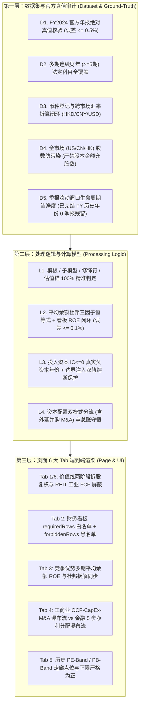

# 黄金测试集与财务数据体系全链路治理总纲 (golden.md)

> **版本**：v2026-10-17 (统一收口版：融合原 `golden.md` + `handoff.md` + `fix.md` + `bug.md`)  
> **核心定位**：**测试驱动（Eval-Driven）的全站财务数据质量宪章与工程总台账**。未来一切财务数据采集、模型演进、资本配置与估值逻辑修改，均以本测试集的 **23 标杆（18 正交核心 + 5 修饰符扩展）三层穿透门禁** 为唯一放行标准。  
> **关联文档**：[DATA.md](file:///Users/rafael/R129/buffett-tribe/DATA.md)（顶层数据与模型字典宪章） ｜ [cron.md](file:///Users/rafael/R129/buffett-tribe/cron.md)（下一步：Mini 每小时 Cron 增量飞轮与 Onboard 重构计划）  
> **核心实现**：[scripts/eval-golden-18.ts](file:///Users/rafael/R129/buffett-tribe/scripts/eval-golden-18.ts) ｜ [tests/golden-benchmark-18.test.ts](file:///Users/rafael/R129/buffett-tribe/tests/golden-benchmark-18.test.ts)

---

## 目录

1. [设计定位、安全红线与五大测试铁律](#一设计定位安全红线与五大测试铁律)
2. [23 家黄金标的遴选矩阵与官方年报真值台账](#二23-家黄金标的遴选矩阵与官方年报真值台账)
   - [2.1 核心正交矩阵 (3 市场 × 6 模板 = 18 家)](#21-核心正交矩阵-3-市场--6-模板--18-家)
   - [2.2 工业行业修饰符扩展包 (5 家专属修饰符与估值锚)](#22-工业行业修饰符扩展包-5-家专属修饰符与估值锚)
   - [2.3 官方年报真值基准台账 (FY2024 Ground-Truth Ledger)](#23-官方年报真值基准台账-fy2024-ground-truth-ledger)
3. [三层穿透审计指标体系与零假绿灯门禁](#三三层穿透审计指标体系与零假绿灯门禁)
   - [3.1 第一层：数据集与官方真值审计 (D1–D5)](#31-第一层数据集与官方真值审计-d1d5)
   - [3.2 第二层：处理逻辑与计算模型审计 (L1–L4)](#32-第二层处理逻辑与计算模型审计-l1l4)
   - [3.3 第三层：页面 6 大 Tab 端到端渲染验收 (U1–U5)](#33-第三层页面-6-大-tab-端到端渲染验收-u1u5)
   - [3.4 缺陷分级与零假绿灯门禁标准](#34-缺陷分级与零假绿灯门禁标准)
4. [四大财务模型与资本配置收官治理架构（原 fix.md）](#四四大财务模型与资本配置收官治理架构原-fixmd)
   - [4.1 专项一：拆股（Stock Split）历史股数与每股指标两阶段同源复权](#41-专项一拆股stock-split历史股数与每股指标两阶段同源复权)
   - [4.2 专项二：外延并购（M&A）纳入巴菲特五大资本配置框架](#42-专项二外延并购ma纳入巴菲特五大资本配置框架)
   - [4.3 专项三：场外 ADR 与次新股三级 Waterfall + 独立季报快照通道](#43-专项三场外-adr-与次新股三级-waterfall--独立季报快照通道)
   - [4.4 专项四：季报滚动窗口生命周期（年报接管即 GC）与全库瘦身](#44-专项四季报滚动窗口生命周期年报接管即-gc与全库瘦身)
5. [全库 3,678 家公司（Phase 1 & 2）回补总账与批次精准回滚（原 handoff.md）](#五全库-3678-家公司phase-1--2回补总账与批次精准回滚原-handoffmd)
   - [5.1 Phase 1 & Phase 2 全库回补全景战报](#51-phase-1--phase-2-全库回补全景战报)
   - [5.2 批次追踪（`--batch-id`）与精准回滚技术方案](#52-批次追踪--batch-id与精准回滚技术方案)
6. [远程主机 (mini) 运维监控与数据库故障自愈手册](#六远程主机-mini-运维监控与数据库故障自愈手册)
7. [全量穿透验收结果与历史缺陷/Review 修复总台账（原 bug.md）](#七全量穿透验收结果与历史缺陷review-修复总台账原-bugmd)

---

## 一、设计定位、安全红线与五大测试铁律

### 1. 四大工程安全红线
1. **不可回滚，严禁全量写入**：任何带有 `--all --execute` 的批量派生写入必须携带显式 `--batch-id` 定界标签（`|batch:<id>|`），支持通过 [`scripts/rollback-batch-financials.ts`](file:///Users/rafael/R129/buffett-tribe/scripts/rollback-batch-financials.ts) 一键精准回滚。
2. **区分三级股数用途，严禁金额当股数**：彻底物理隔离期末披露股数（`CommonStockSharesOutstanding`）、期间稀释加权股数（`WeightedAverageSharesDiluted`）与实收资本金额（`ShareCapital`）。
3. **保持 `getCompanyFinancials()` 年度序列纯粹性**：`getCompanyFinancials()` 严格只返回 `periodType = "FY"`，绝不将 3M/6M/9M 季报伪装混入年度序列（防止 PE 虚高 4 倍、ROE 缩水至 1/4）；最新未完结季报统一通过独立通道 `getLatestInterimFinancial()` 承载。
4. **港股 40% 非港币报表零容忍假兜底**：港股币种解析严禁静默 `assume HKD`；必须经过种子表、实体登记币种、已存事实单位、年报正文高频词及 `yfinance` 五级核验。

### 2. 黄金测试集五大工程铁律
1. **100% 分类学全覆盖（18 正交核心 + 5 修饰符扩展 = 23 旗舰标杆）**：
   完整覆盖 **3 市场（US / CN / HK）** $\times$ **6 大标准模板（`industrial`, `bank`, `insurance`, `financial_services`, `real_estate`, `conglomerate`）** + **6 大子模型** + **7 大工业修饰符** + **13 类核心估值锚**。
2. **锚定官方年报绝对真值（Ground-Truth Exact Match）**：
   每家标杆内置 FY2024 法定年报（10-K / A 股年报 / 港股年报）的 4~7 项核心绝对金额真值，库内实际数值与官方真值相对误差必须 $\le 0.5\%$。
3. **废除代数重言式假测试，执行真实函数闭环**：
   - 杜邦分析强制使用**期初期末平均总资产**与**期初期末平均股东权益**计算真实三因子，并与 [`calculateReturnOnAverageBalance`](file:///Users/rafael/R129/buffett-tribe/src/lib/financial-math.ts#L9-L18) 及看板渲染的 `ROE` 行闭环校验（误差 $\le 0.1\%$）；
   - ROIC 熔断采取**“库内真实负投入资本年份扫描（如广发证券 `000776.SZ` FY21/FY22） + 确定性边界注入自检（`verifyRoicSafetyBoundaries`）”**双轨制。
4. **双向契约断言（正向白名单 `requiredDashboardRows` + 反向黑名单 `forbiddenDashboardRows`）**：
   不仅验证禁用行（如银行毛利率、REITs 工业 FCF、寿险财险赔付率、券商 AUM）被严格屏蔽，还强制断言行业高价值专属行 100% 渲染出数。
5. **零假绿灯严格门禁（P0 / P1 Zero-Tolerance）**：
   任何 P0 或 P1 缺陷一律判定 `FAIL` 并以 `exit 1` 阻断，严禁降级为 `WARN` 放行。

---

## 二、23 家黄金标的遴选矩阵与官方年报真值台账

### 2.1 核心正交矩阵 (3 市场 × 6 模板 = 18 家)

| 模板 (`FinancialTemplate`) | 市场 | 标的代码及名称 | 子模型 / 修饰符 | 核心估值锚 (`valuationAnchor`) | 典型业务特征与全链路极限检验点 |
| :--- | :---: | :--- | :---: | :---: | :--- |
| **`industrial`**<br>*(工商业制造/消费/科技)* | **US** | **AAPL**<br>Apple Inc. | `consumer_brand` | `earnings_quality` | • 巨额回购、净资产近零/负向边界、10-K 毛利润恒等式推导<br>• 研发费用率 (`RnDToRevenue`) 与合同负债 (`ContractLiabilities`) 核验 |
| | **CN** | **600519.SS**<br>贵州茅台 | `consumer_brand` | `earnings_quality` | • 超高毛利（90%+）、经销商打款合同负债、基酒存货<br>• 已完结历史财年 0 冗余季报残留（D5 滚动生命周期核验） |
| | **HK** | **0700.HK**<br>腾讯控股 | `software_platform` | `growth_cashflow` | • 港币（HKD）股价与人民币（CNY）财报跨币种汇率折算<br>• 回购 + 分红双轮驱动与跨市场估值对齐 |
| **`bank`**<br>*(商业银行)* | **US** | **JPM**<br>JPMorgan Chase | — | `pb_roe` | • **严禁展示毛利率与工商业 FCF**；正向必现净利息收入、拨备、存贷款<br>• Tab 4 切换为 5 步金融净利润分配瀑布流，Tab 5 切换为 PB-Band 走廊 |
| | **CN** | **600036.SS**<br>招商银行 | — | `pb_roe` | • 零售银行标杆，利息净收入、手续费及佣金、信用减值损失核验<br>• 账面净资产 (PB-ROE) 5 年 TSR 综合回报推演器验证 |
| | **HK** | **2388.HK**<br>中银香港 | — | `pb_roe` | • 港股成熟商业信贷体系，高派息与信贷周期<br>• 港币（HKD）原生报表币种自洽与存贷款规模核验 |
| **`insurance`**<br>*(保险精算)* | **US** | **PGR**<br>Progressive Corp | `property_casualty` | `embedded_value_pb` | • 美股纯财产险（P&C）标杆<br>• **正向必现净已赚保费与赔付率（`ClaimsRatio`）**，屏蔽工业存货/毛利 |
| | **CN** | **601318.SS**<br>中国平安 | `life_health` | `embedded_value_pb` | • 寿险与综合金控标杆，IFRS 17 营业收入、给付及投资收益双引擎<br>• **反向严格屏蔽财险专属赔付率（`ClaimsRatio`）** |
| | **HK** | **1299.HK**<br>友邦保险 | `life_health` | `embedded_value_pb` | • 跨国纯寿险巨头，保单准备金负债与万亿投资资产组合<br>• 跨币种归一化核验（实体登记 USD、底层事实 CNY $\to$ 交易币种 HKD） |
| **`financial_services`**<br>*(非银金融/资管/交易所)* | **US** | **BX**<br>Blackstone Inc. | `asset_mgmt` | `fee_earnings` | • 另类资管旗舰，**正向必现管理费收入与投资收益**<br>• 轻资产手续费盈利估值锚 (`fee_earnings`) 与高分红返还 |
| | **CN** | **000776.SZ**<br>广发证券 | `broker_exchange` | `fee_earnings` | • 综合券商投行，手续费及佣金净收入 + 投资收益双支柱<br>• **FY2021/FY2022 真实负投入资本（$\text{IC} < 0$）触发 ROIC 熔断保护** |
| | **HK** | **0388.HK**<br>香港交易所 | `broker_exchange` | `fee_earnings` | • 特许垄断交易所，极高净利率、高派息率（90%+）<br>• 反向严格屏蔽资管 `AssetsUnderManagement` 与银行存贷款科目 |
| **`real_estate`**<br>*(房地产/REITs)* | **US** | **SPG**<br>Simon Property | `reit_property` | `nav_ffo` | • 商业持有型 REITs 标杆，正向必现营业利润率与净负债率<br>• **看板与价值线双重屏蔽受折旧扭曲的传统工业 `CapEx` 与 `FreeCashFlow`** |
| | **CN** | **000069.SZ**<br>华侨城 A | `developer` | `nav_ffo` | • 典型开发商模式，**正向必现预售合同负债、存货与净负债率**<br>• 反向屏蔽工业毛利率与失真自由现金流 |
| | **HK** | **0016.HK**<br>新鸿基地产 | `developer` | `nav_ffo` | • 港股地产旗舰（开发销售 + 收租物业双轮驱动）<br>• 正向必现投资性物业（`InvestmentProperty`）、存货、合同负债与净负债率 |
| **`conglomerate`**<br>*(多元控股实业)* | **US** | **BRK-B**<br>Berkshire Hathaway | — | `sotp` | • 巴菲特多元控股旗舰（保险浮存金 + 铁路能源 + 制造零售 + 巨额投资组合）<br>• A/B 双重股权结构（1:1500）下每股净资产 BPS 与 PB-Band 自动对齐 |
| | **CN** | **000009.SZ**<br>中国宝安 | — | `sotp` | • A 股多元实业控股（新材料 + 医药并表）<br>• 合并经营现金流、资本开支与投资收益跨板块总账核验 |
| | **HK** | **0001.HK**<br>长和 | — | `sotp` | • 跨国多元控股旗舰（港口 + 零售 + 基建 + 电讯）<br>• SOTP 分部加总估值锚与 PB-Band 历史走廊核验 |

### 2.2 工业行业修饰符扩展包 (5 家专属修饰符与估值锚)

| 修饰符 (`Modifier`) | 市场 | 标的代码及名称 | 核心估值锚 (`valuationAnchor`) | 估值走廊模式 | 专属检验点 |
| :--- | :---: | :--- | :---: | :---: | :--- |
| **`healthcare`**<br>*(医药健康)* | **US** | **MRK**<br>Merck & Co. (默沙东) | `pipeline_earnings`<br>*(管线与盈利)* | PE-Band | • 创新药研发管线驱动，FY2024 研发投入 $17.94B（研发费用率 ~28%）<br>• 检验 `RnDExpense`、`RnDToRevenue`、`FreeCashFlow` 与 PE 走廊 |
| **`semiconductor_hardware`**<br>*(半导体与硬件)* | **US** | **NVDA**<br>NVIDIA Corp. (英伟达) | `cycle_adjusted_earnings`<br>*(周期调整后盈利)* | PB-Band | • 2021 年 1:4 与 2024 年 1:10 两次拆股后历史股数与 EPS 两阶段同源复权 (`normalizeFinancialYearsStockSplits`)<br>• 半导体周期调整估值锚与超高 ROE/FCF 闭环核验 |
| **`energy_materials`**<br>*(能源与材料周期)* | **CN** | **601899.SS**<br>紫金矿业 | `normalized_earnings`<br>*(周期中枢盈利)* | PB-Band | • 强周期资源矿业标杆，0.1 元面值下股数防实收资本污染校验<br>• 周期中枢盈利锚自动切换至 PB-ROE 估值走廊 |
| **`utilities`**<br>*(受监管公用事业)* | **CN** | **600900.SS**<br>长江电力 | `regulated_assets`<br>*(监管资产与核准回报)* | PB-Band | • 水电公用事业标杆，充沛经营现金流（FY24 OCF 596.5亿）与高额分红<br>• 监管资产估值锚与 `LiabilitiesToAssets` 核验 |
| **`telecommunications`**<br>*(电信运营)* | **HK** | **0941.HK**<br>中国移动 | `cashflow_yield`<br>*(现金流与资本开支)* | PB-Band | • 电信运营商旗舰，高强度网络 CapEx 与千亿级自由现金流、高分红<br>• 港币（HKD）股价与人民币（CNY）报表折算闭环 |

> **注：与旧版 30 家 / 100 家测试集的关系说明**：
> - `scripts/lib/morningstar-benchmark-suite.json`（100 家）供 `eval-financials-against-morningstar.ts` 进行底层 XBRL 字段映射回归；
> - `scripts/lib/golden-benchmark-30.json`（30 家）为早期过渡验收集；
> - **日常研发与 CI 放行以本 23 标杆全链路穿透测试（`scripts/eval-golden-18.ts` + `tests/golden-benchmark-18.test.ts`）为唯一最高权威准绳**。

### 2.3 官方年报真值基准台账 (FY2024 Ground-Truth Ledger)

| 市场 | 代码 | 名称 | 真值基准报告 | 报表数据币种 | 核心对账科目与官方年报真值 (FY2024) |
| :---: | :--- | :--- | :--- | :---: | :--- |
| **US** | `AAPL` | Apple Inc. | FY2024 Form 10-K | `USD` | `Revenue`: $391.035B \| `NetIncome`: $93.736B \| `OCF`: $118.254B \| `Assets`: $364.980B \| `Equity`: $56.950B \| `EPSDiluted`: $6.08 |
| **US** | `JPM` | JPMorgan Chase | FY2024 Form 10-K | `USD` | `Revenue`: $177.556B \| `NII`: $92.583B \| `NetIncome`: $58.471B \| `Assets`: $4,002.814B \| `Deposits`: $2,406.032B \| `Equity`: $344.758B |
| **US** | `PGR` | Progressive Corp | FY2024 Form 10-K | `USD` | `Revenue`: $75.340B \| `NetPremiumsEarned`: $70.810B \| `NetIncome`: $8.480B \| `Assets`: $105.745B \| `Equity`: $25.587B |
| **US** | `BX` | Blackstone Inc. | FY2024 Form 10-K | `USD` | `Revenue`: $13.14266B \| `NetIncome`: $2.77675B \| `Assets`: $43.46148B \| `Equity`: $7.83585B |
| **US** | `SPG` | Simon Property | FY2024 Form 10-K | `USD` | `Revenue`: $5.96134B \| `NetIncome`: $2.36790B \| `OCF`: $3.96365B \| `Assets`: $32.28562B \| `Equity`: $2.70778B |
| **US** | `BRK-B` | Berkshire Hathaway | FY2024 Form 10-K | `USD` | `Revenue`: $424.232B \| `NetIncome`: $88.995B \| `OCF`: $30.720B \| `Assets`: $1,153.881B \| `Equity`: $649.368B |
| **CN** | `600519.SS` | 贵州茅台 | 2024 年年度报告 | `CNY` | `Revenue`: 1,708.99亿 \| `NetIncome`: 862.28亿 \| `OCF`: 924.64亿 \| `Assets`: 2,989.45亿 \| `Equity`: 2,331.06亿 \| `ContractLiab`: 95.92亿 \| `Shares`: 12.562亿股 |
| **CN** | `600036.SS` | 招商银行 | 2024 年年度报告 | `CNY` | `Revenue`: 3,371.21亿 \| `NII`: 2,112.77亿 \| `NetIncome`: 1,483.91亿 \| `Assets`: 12.1520万亿 \| `Deposits`: 9.2597万亿 \| `Equity`: 1.2153万亿 \| `Shares`: 252.20亿股 |
| **CN** | `601318.SS` | 中国平安 | 2024 年年度报告 | `CNY` | `Revenue`: 10,289.25亿 \| `NetIncome`: 1,266.07亿 \| `Assets`: 12.9578万亿 \| `Equity`: 9,286.00亿 \| `Shares`: 182.10亿股 |
| **CN** | `000776.SZ` | 广发证券 | 2024 年年度报告 | `CNY` | `Revenue`: 271.99亿 \| `NetIncome`: 96.37亿 \| `Assets`: 7,587.45亿 \| `Equity`: 1,476.02亿 \| `Shares`: 76.06亿股 |
| **CN** | `000069.SZ` | 华侨城 A | 2024 年年度报告 | `CNY` | `Revenue`: 544.07亿 \| `NetIncome`: -86.62亿 \| `OCF`: 53.62亿 \| `Assets`: 3,365.40亿 \| `Equity`: 532.39亿 \| `ContractLiab`: 280.17亿 \| `Shares`: 80.38亿股 |
| **CN** | `000009.SZ` | 中国宝安 | 2024 年年度报告 | `CNY` | `Revenue`: 202.28亿 \| `NetIncome`: 1.726亿 \| `OCF`: 16.624亿 \| `Assets`: 537.75亿 \| `Equity`: 99.15亿 \| `Shares`: 25.79亿股 |
| **HK** | `0700.HK` | 腾讯控股 | 2024 年年度报告 | `CNY` | `Revenue`: 6,602.57亿 \| `NetIncome`: 1,940.73亿 \| `OCF`: 2,585.21亿 \| `Assets`: 17,809.95亿 \| `Equity`: 9,735.48亿 |
| **HK** | `2388.HK` | 中银香港 | 2024 年年度报告 | `HKD` | `Revenue`: 774.29亿 \| `NII`: 582.59亿 \| `NetIncome`: 382.33亿 \| `Assets`: 4.1944万亿 \| `Deposits`: 2.7556万亿 \| `Equity`: 3,388.96亿 |
| **HK** | `1299.HK` | 友邦保险 | 2024 年年度报告 | `CNY` | `Revenue`: 2,906.87亿 \| `NetPremiumsEarned`: 1,508.67亿 \| `NetIncome`: 495.55亿 \| `Assets`: 2.1502万亿 \| `Equity`: 2,869.06亿 |
| **HK** | `0388.HK` | 香港交易所 | 2024 年年度报告 | `HKD` | `Revenue`: 221.53亿 \| `NetIncome`: 130.50亿 \| `Assets`: 3,795.44亿 \| `Equity`: 539.32亿 |
| **HK** | `0016.HK` | 新鸿基地产 | 2024 财年年报 | `HKD` | `Revenue`: 656.83亿 \| `NetIncome`: 173.83亿 \| `OCF`: 221.37亿 \| `Assets`: 7,472.71亿 \| `Equity`: 5,537.38亿 |
| **HK** | `0001.HK` | 长和 | 2024 年年度报告 | `HKD` | `Revenue`: 2,813.51亿 \| `NetIncome`: 170.88亿 \| `OCF`: 439.96亿 \| `Assets`: 11,264.81亿 \| `Equity`: 5,367.27亿 |
| **US** | `MRK` | Merck & Co. | FY2024 Form 10-K | `USD` | `Revenue`: $64.168B \| `NetIncome`: $17.117B \| `OCF`: $21.468B \| `RnDExpense`: $17.938B \| `CapEx`: $3.372B \| `Assets`: $117.106B \| `Equity`: $46.313B |
| **US** | `NVDA` | NVIDIA Corp. | FY2024 Form 10-K | `USD` | `Revenue`: $60.922B \| `NetIncome`: $29.760B \| `OCF`: $28.090B \| `Assets`: $65.728B \| `Equity`: $42.978B |
| **CN** | `601899.SS` | 紫金矿业 | 2024 年年度报告 | `CNY` | `Revenue`: 3,036.40亿 \| `NetIncome`: 320.51亿 \| `OCF`: 488.60亿 \| `Assets`: 3,966.11亿 \| `Equity`: 1,397.86亿 |
| **CN** | `600900.SS` | 长江电力 | 2024 年年度报告 | `CNY` | `Revenue`: 844.92亿 \| `NetIncome`: 324.96亿 \| `OCF`: 596.48亿 \| `Assets`: 5,665.85亿 \| `Equity`: 2,103.49亿 |
| **HK** | `0941.HK` | 中国移动 | 2024 年年度报告 | `CNY` | `Revenue`: 8,894.68亿 \| `NetIncome`: 1,383.73亿 \| `OCF`: 3,157.41亿 \| `Assets`: 2.1081万亿 \| `Equity`: 1.3920万亿 |

---

## 三、三层穿透审计指标体系与零假绿灯门禁



### 3.1 第一层：数据集与官方真值审计 (D1–D5)
- **D1. 官方年报绝对真值核验 (`GROUND_TRUTH_VALUE_MISMATCH` - P0)**：
  逐一核对每家公司 FY2024 的 4~7 项核心绝对财务数据，相对偏差 $> 0.5\%$ 立即判 `P0` 阻断。
- **D2. 多期连续财年法定科目覆盖度 (`INSUFFICIENT_ANNUAL_YEARS` / `MISSING_REQUIRED_FACT` - P0)**：
  每家公司必须至少具备 5 个年度 `FY` 财报，且近 3 个完整财年（2022–2024）必须完整包含该模板必需的底层科目。
- **D3. 币种登记与汇率折算闭环 (`CURRENCY_MISMATCH` / `FX_CONVERSION_UNAVAILABLE` - P0)**：
  核验 `getFinancialsCurrency` 与 `convertCurrency` 在跨币种标的（如 `0700.HK`、`0941.HK`、`1299.HK`）上的汇率可用性与折算一致性。
- **D4. 全市场股数防污染审计 (`SHARE_CAPITAL_POLLUTION` / `ABNORMAL_SHARE_COUNT` - P0)**：
  覆盖 US / CN / HK 全部市场：严禁 `CommonStockSharesOutstanding` 混入 `ShareCapital`（实收资本/股本金额），且股数必须在合理量级区间。
- **D5. 季报滚动窗口生命周期洁净度门禁 (`OBSOLETE_QUARTERLY_RESIDUE` - P0)**：
  验证“年报永久锚定、当期季报 YTD 滚动暂存、年报就绪即清理”契约：凡已具备 `FY` 年报的历史财年（`periodEnd <= max_fy_date`），库内不得残留任何 `Q1~Q4 / H1~H2` 冗余记录；若存在最新未完结财年（`periodEnd > max_fy_date`）的暂存季报，必须为合法的 YTD 累计快照。

### 3.2 第二层：处理逻辑与计算模型审计 (L1–L4)
- **L1. 模板、子模型、修饰符与估值锚 100% 精准判定 (`TEMPLATE_MISMATCH` / `SUBMODEL_MISMATCH` / `MODIFIER_MISMATCH` / `VALUATION_ANCHOR_MISMATCH` - P0)**：
  调用 [`resolveFinancialModel`](file:///Users/rafael/R129/buffett-tribe/src/lib/financial-model.ts#L283-L395) 对 23 家标杆逐一验证四元组 100% 精确命中。
- **L2. 平均余额杜邦三因子恒等式与看板 ROE 闭环 (`DUPONT_IDENTITY_VIOLATION` / `DUPONT_DASHBOARD_ROE_DESYNC` - P0)**：
  按期初期末平均总资产 $\overline{\text{Assets}}_t = \frac{A_{t-1}+A_t}{2}$ 与平均股东权益 $\overline{\text{Equity}}_t = \frac{E_{t-1}+E_t}{2}$ 计算杜邦三因子乘积，验证其与 [`calculateReturnOnAverageBalance`](file:///Users/rafael/R129/buffett-tribe/src/lib/financial-math.ts#L9-L18) 误差 $\le 0.1\%$，且与 Tab 2 看板 `ROE` 行 `rawValues[year]` 完全相等。
- **L3. 投入资本 ($\text{IC} \le 0$) 与 ROIC 双轨熔断保护 (`ROIC_SAFETY_FUSE_FAILED` - P0)**：
  1. **确定性边界自检**：通过 [`verifyRoicSafetyBoundaries`](file:///Users/rafael/R129/buffett-tribe/scripts/eval-golden-18.ts#L1097-L1150) 注入 $\text{IC} < 0$、$\text{IC} = 0$、期初 $\text{IC} \le 0$ 用例，断言 `calculateROIC` 100% 安全返回 `null`；
  2. **库内真实负资本年份扫描**：遍历 23 家标杆历史财年，当真实财年 $\text{IC} \le 0$（如广发证券 `000776.SZ` FY2021/FY2022）时，强制验证 `calculateROIC` 触发安全熔断返回 `null`。
- **L4. 资本配置双模式分流与总账守恒 (`CAPITAL_ALLOCATION_BROKEN` - P0)**：
  工商业校验 `OCF - CapEx = FCF` 及外延并购 `PurchaseSaleOfBusinessNet` 扣减闭环；金融/地产校验 5 步净利润分配恒等式：$\text{cumNetIncome} \equiv \text{retainedEarnings} + \text{shareholderReturnAmt}$。

### 3.3 第三层：页面 6 大 Tab 端到端渲染验收 (U1–U5)
- **U1 (Tab 1 价值线 & Tab 6 商业模式)**：验证 [`normalizeFinancialYearsStockSplits`](file:///Users/rafael/R129/buffett-tribe/src/lib/financial-math.ts) 两阶段拆股复权后的历史股数 / EPS / ROE / 股东权益序列无断崖、无 `NaN` 或 `Infinity`；持有型 REITs 屏蔽受折旧扭曲的净利润增长与工业 FCF 增长。
- **U2 (Tab 2 财务看板)**：验证 `requiredDashboardRows` 正向白名单 100% 存在、`forbiddenDashboardRows` 反向黑名单 0 泄漏，且无 `"NaN"`、`"undefined"` 或废弃“尚未接入”横幅。
- **U3 (Tab 3 竞争优势)**：验证多期平均余额 ROE 与杜邦三因子分解表完全同步。
- **U4 (Tab 4 资本配置)**：验证工商业 OCF $\to$ CapEx $\to$ FCF $\to$ 外延并购 (M&A) $\to$ 回购/分红瀑布流与金融 5 步净利润分配瀑布流精准渲染。
- **U5 (Tab 5 估值分析)**：调用 [`buildHistoricalPeSeries`](file:///Users/rafael/R129/buffett-tribe/src/lib/valuation-analysis-metrics.ts) / [`buildHistoricalPbSeries`](file:///Users/rafael/R129/buffett-tribe/src/lib/valuation-analysis-metrics.ts)，强制断言生成的估值走廊点位数 $> 0$ 且历史通道下限 `peMin > 0` / `pbMin > 0`。

### 3.4 缺陷分级与零假绿灯门禁标准

| 级别 | 门禁动作 | 定义与判定依据 | 典型拦截代码 (`AuditFinding.code`) |
| :---: | :---: | :--- | :--- |
| **P0 (阻断级)** | **立即阻断 (`FAIL`, `exit 1`)** | • 官方年报真值误差 $> 0.5\%$<br>• 模板/子模型/修饰符/估值锚识别错误<br>• 看板缺失正向必现行或泄漏反向禁用行<br>• 历史已完结财年残留过时季报行<br>• 杜邦恒等式失衡或 $\text{IC} \le 0$ 未熔断<br>• Tab 4 瀑布流断链或 Tab 5 估值走廊为空 | `GROUND_TRUTH_VALUE_MISMATCH`<br>`REQUIRED_ROW_MISSING`<br>`FORBIDDEN_ROW_LEAKAGE`<br>`OBSOLETE_QUARTERLY_RESIDUE`<br>`DUPONT_IDENTITY_VIOLATION`<br>`ROIC_SAFETY_FUSE_FAILED`<br>`VALUATION_PB_BAND_INVALID` |
| **P1 (严重级)** | **立即阻断 (`FAIL`, `exit 1`)** | • 跨市场汇率折算缺失或币种登记错误<br>• 股数混入股本金额或拆股未复权跳变<br>• 前台出现废弃占位横幅 | `CURRENCY_MISMATCH`<br>`SHARE_CAPITAL_POLLUTION`<br>`DEPRECATED_PLACEHOLDER_BANNER` |
| **P2 (体验级)** | **警告提示 (`WARN`)** | • 非核心次要辅助字段说明文字微调 | `MINOR_FORMAT_NOTE` |

---

## 四、四大财务模型与资本配置收官治理架构（原 fix.md）

在完成全库 3,678 家公司全量回填后，针对生产库与消费链路定位到的四大结构性问题，已完成以下收官治理（`v0.47.10` / Commit `dfb51397`）：

### 4.1 专项一：拆股（Stock Split）历史股数与每股指标两阶段同源复权
* **第一性原理根因**：SEC 10-K **利润表回溯 3 年**（$T, T-1, T-2$ 已按拆股后重述），而**资产负债表仅回溯 2 年**（$T, T-1$ 已复权，$T-2$ 停留在旧 10-K 未复权），导致 `AVGO`（1:10）、`NVDA`（1:4 + 1:10）、`AMZN`（1:20）、`DECK`（1:6）在第 $T-2$ 年必现**同年内期末股数未复权、加权股数与 EPS 已复权**的 10x/20x 断崖；且 [`src/lib/valuation-metrics.ts`](file:///Users/rafael/R129/buffett-tribe/src/lib/valuation-metrics.ts) 直查未复权 EPS 导致历史 PE 分位算小 $k$ 倍。
* **两阶段同源复权方案（[`src/lib/financial-math.ts`](file:///Users/rafael/R129/buffett-tribe/src/lib/financial-math.ts) `normalizeFinancialYearsStockSplits`）**：
  1. **阶段 1（利润表自洽复权）**：从最新财年向历史回溯，使用同属 3 年回溯期的 `(WeightedAverageSharesDiluted, EPSDiluted, NetIncome)` 检测正向拆股与逆向合股因子 $k$，建立全历史 Post-Split 加权股数锚点并复权 `EPSBasic / EPSDiluted / DividendPerShare`。
  2. **阶段 2（资产负债表同年受控对齐 + 金融风控护栏）**：将每年的 `CommonStockSharesOutstanding` 向同年复权后的加权股数锚点对齐；**阶段 2 仅允许匹配阶段 1 已证实的拆股因子或 $\ge 2\text{x}$ 整数倍因子（严禁独立触发 `1.5x` 小因子）**，100% 保护年内真实定增/配股/换股并购 30% 的股本变动记录。
  3. **全出口统一收口**：同时下沉至 [`getCompanyFinancials()`](file:///Users/rafael/R129/buffett-tribe/src/lib/company-data.ts#L413)、[`fetchAnnualFundamentals()`](file:///Users/rafael/R129/buffett-tribe/src/lib/valuation-metrics.ts#L112) 与 AI Agent 工具 [`get-company-financials.ts`](file:///Users/rafael/R129/buffett-tribe/services/pi-gateway/src/tools/get-company-financials.ts)。

### 4.2 专项二：外延并购（M&A）纳入巴菲特五大资本配置框架
* **符号与缺失值防污染契约**：
  1. 统一规定 `PurchaseSaleOfBusinessNet` **正数（`> 0`）= 外延并购净现金支出，负数（`< 0`）= 剥离出售业务净现金回笼**（`yfinance` 的 `Net Business Purchase And Sale` 入库时取反 `-val`，严禁前端无脑 `Math.abs`）。
  2. 未披露年份严格保持 `null`（明细表显示 `—`），绝不强填 `0`。
* **全链路点亮**：打通 [`src/lib/value-line-data.ts`](file:///Users/rafael/R129/buffett-tribe/src/lib/value-line-data.ts) $\to$ [`src/lib/capital-allocation-metrics.ts`](file:///Users/rafael/R129/buffett-tribe/src/lib/capital-allocation-metrics.ts)（瀑布流终端结余升级为 $\text{FCF} - \text{外延并购} - \text{回购} - \text{分红}$） $\to$ [`src/components/CapitalAllocationView.tsx`](file:///Users/rafael/R129/buffett-tribe/src/components/CapitalAllocationView.tsx)（新增 M&A 扣减卡与纵向明细表列，点亮库内 1,658 家公司共 6,630 行并购记录）。

### 4.3 专项三：场外 ADR 与次新股三级 Waterfall + 独立季报快照通道
* **导入端三级 Waterfall（[`scripts/backfill-company-financials-fast.ts`](file:///Users/rafael/R129/buffett-tribe/scripts/backfill-company-financials-fast.ts)）**：
  1. **Tier-1**：SEC EDGAR `companyfacts` & `submissions` 官方 10-K/20-F/40-F；
  2. **Tier-2**：[`scripts/fetch-us-financials-yf.py`](file:///Users/rafael/R129/buffett-tribe/scripts/fetch-us-financials-yf.py) + [`scripts/import-us-financials-yf.ts`](file:///Users/rafael/R129/buffett-tribe/scripts/import-us-financials-yf.ts)（对齐标准字典 key、提取真实 `financialCurrency` 记账币种、向金融市场标准 ADR Ratio 集合 $\{0.1, 0.2, 0.25, 0.5, 1, 2, 3, 4, 5, 8, 10, 20\}$ 吸附）；
  3. **Tier-3**：[`scripts/import-us-quarterly-financials.ts`](file:///Users/rafael/R129/buffett-tribe/scripts/import-us-quarterly-financials.ts) 提取无 `10-K` 次新股的最新 `10-Q` 季报。
* **查询端独立季报快照通道（[`getLatestInterimFinancial()`](file:///Users/rafael/R129/buffett-tribe/src/lib/company-data.ts)）**：
  严格保持 `getCompanyFinancials()` 只返回 `FY`；新增 `getLatestInterimFinancial()` 读取 `periodEnd > max(FY.periodEnd)`（或无 `FY` 次新股）的最新单期 YTD 季报快照，在财务看板最右侧与 Agent 工具中明确标注 `YYYY Qx (YTD)` 独立呈现。

### 4.4 专项四：季报滚动窗口生命周期（年报接管即 GC）与全库瘦身
* **YTD 原生口径统一**：全市场（US / CN / HK）针对最新未完结财年的暂存季报，统一采用「年初至今累计（YTD：Q1=3M, Q2/H1=6M, Q3=9M）」原生披露口径，剥离 [`scripts/fetch-cn-hk-financials-ak.py`](file:///Users/rafael/R129/buffett-tribe/scripts/fetch-cn-hk-financials-ak.py) 对历史已完结年份的人工减法造单季逻辑。
* **写入端自动 GC（[`scripts/lib/upsert-financial-rows.ts`](file:///Users/rafael/R129/buffett-tribe/scripts/lib/upsert-financial-rows.ts#L92-L113)）**：当写入包含 `periodType === 'FY'` 时，自动删除该实体 `periodType <> 'FY' AND periodEnd <= max(FY.periodEnd)` 的过时季报记录。
* **存量数据库瘦身实绩**：通过 [`scripts/cleanup-obsolete-quarterly-financials.ts`](file:///Users/rafael/R129/buffett-tribe/scripts/cleanup-obsolete-quarterly-financials.ts) 一次性清理全库已完结财年的历史冗余季报 **1,881,132 行**，彻底移除死代码 `src/lib/ttm-metrics.ts`。

---

## 五、全库 3,678 家公司（Phase 1 & 2）回补总账与批次精准回滚（原 handoff.md）

### 5.1 Phase 1 & Phase 2 全库回补全景战报

| 对比维度 | Phase 2 (核心深度投研盘) | Phase 1 (大盘广谱覆盖盘) | 全库大盘汇总 (Phase 1 + Phase 2) |
| :--- | :--- | :--- | :--- |
| **定位与目标** | 核心自选股与深度研究标的，保证指标极高精度 | 覆盖剩余存量标的，夯实全站多市场基础面事实 | **全库 3,678 家大一统法定财务数据体系** |
| **处理标的总量** | **1,243 家** | **2,435 家** | **3,678 家** |
| **市场构成细分** | 美股: 635 ｜ A 股: 327 ｜ 港股: 281 | 美股: 1,043 ｜ A 股: 648 ｜ 港股: 744 | 美股: 1,678 ｜ A 股: 975 ｜ 港股: 1,025 |
| **执行起止时间** | 2026-10-15 17:54 $\rightarrow$ 10-16 04:11 | 2026-10-16 12:42 $\rightarrow$ 10-17 09:18 | 连续 40 小时内接力完成 |
| **总执行耗时** | **37,069.7 秒** (~10.29 小时) | **74,118.8 秒** (~20.59 小时) | **111,188.5 秒** (~30.88 小时) |
| **首轮入库家数** | **1,235 家** (99.36%) | **2,426 家** (99.63%) | **3,661 家** + 17 家特殊标的三级兜底收口 = **100% 闭环** |
| **A 股完成率** | 313 / 327 (摘牌未报年报标的除外) | **648 / 648 (100% 成功，0 失败)** | **961 家 A 股全覆盖** |
| **港股完成率** | **281 / 281 (100% 成功，0 失败)** | **744 / 744 (100% 成功，0 失败)** | **1,025 家港股 100% 全覆盖** |
| **单家平均速率** | 美股: 13.8s ｜ A 股: 68s ｜ 港股: 24s | 美股: 13.8s ｜ A 股: 67s ｜ 港股: 22s | 综合加权平均约 **30.2 秒/家** |
| **检查点状态** | `.cache/batch-backfill-phase12-financials.json` | `.cache/batch-backfill-phase12-financials.json` | 统一检查点，已安全落盘归档 |

### 5.2 批次追踪（`--batch-id`）与精准回滚技术方案
* **批次标签格式**：在 [`scripts/backfill-derived-metrics.ts`](file:///Users/rafael/R129/buffett-tribe/scripts/backfill-derived-metrics.ts) 中，执行 `--execute` 强制要求传入 `--batch-id <id>`，写入 `Financial.mappingRule` 采用两端封闭定界格式 `derived:<Formula>|batch:<batchId>|`，杜绝前缀碰撞（如 `bf-1` 误伤 `bf-10`）。
* **一键精准回滚（[`scripts/rollback-batch-financials.ts`](file:///Users/rafael/R129/buffett-tribe/scripts/rollback-batch-financials.ts)）**：
  ```bash
  # 预览受影响行数
  npx tsx scripts/rollback-batch-financials.ts --batch-id bf-20261015-v2 --dry-run
  # 执行精准回滚
  npx tsx scripts/rollback-batch-financials.ts --batch-id bf-20261015-v2 --execute
  ```

---

## 六、远程主机 (mini) 运维监控与数据库故障自愈手册

### 1. 运行环境与关键路径 (`mini` 主机)

| 配置项 | 路径 / 说明 |
| :--- | :--- |
| **项目工作目录** | `/Users/rafael/buffett-tribe` |
| **Node 可执行路径** | `/Users/rafael/node/bin/node` |
| **回填任务日志 / PID** | `/Users/rafael/logs/buffett-tribe/backfill-phase12-financials.log` (`.pid`) |
| **Priority Worker 日志 / PID** | `/Users/rafael/buffett-tribe/logs/pipeline-priority.log` (`.cache/pipeline-priority-worker.pid`) |

### 2. 数据库连接锁等待与临时端口耗尽自愈指南
1. **防孤儿进程与短事务架构**：
   - 父子进程调用链统一通过 [`scripts/lib/run-process-group.ts`](file:///Users/rafael/R129/buffett-tribe/scripts/lib/run-process-group.ts) 管理，`SIGINT` / `SIGTERM` 广播至整个进程组（`-pid`）；
   - 财务事实写入通过 [`scripts/lib/upsert-financial-rows.ts`](file:///Users/rafael/R129/buffett-tribe/scripts/lib/upsert-financial-rows.ts) 按复合唯一键排序、每批 50 行短事务执行，内置 `SET LOCAL lock_timeout = '5s'` 与 `statement_timeout = '30s'`。
2. **数据库行锁阻塞定点排查与释放（严禁无差别杀全库连接）**：
   ```sql
   -- 1. 诊断阻塞进程 PID
   SELECT pid, now() - xact_start AS duration, query, state, wait_event_type, wait_event
   FROM pg_stat_activity
   WHERE (query LIKE '%Financial%' OR query LIKE '%INSERT%' OR query LIKE '%UPDATE%')
     AND state != 'idle' AND pid != pg_backend_pid()
   ORDER BY duration DESC;

   -- 2. 定点释放特定阻塞 PID
   SELECT pg_terminate_backend(<BLOCKED_PID>);
   ```
3. **macOS 临时端口耗尽（`TIME_WAIT` 风暴）排查**：
   - 历史案例（2026-10-15）：后台服务 `ai.hermes.gateway` 陷入重连死循环堆积 15,758 个 `TIME_WAIT` 连接，触碰 macOS `net.inet.ip.portrange` (16,383) 上限导致 `EADDRNOTAVAIL`。
   - 排查命令：`ssh mini "netstat -an | awk '/TIME_WAIT/ {count++} END {print count}'"`（正常应 `< 500`）。

---

## 七、全量穿透验收结果与历史缺陷/Review 修复总台账（原 bug.md）

### 1. 运行方式与最新 23 / 23 全绿战报
```bash
# 在线全链路数据库穿透审计（23 家全量）
npx tsx --env-file=.env.local scripts/eval-golden-18.ts

# 离线单元测试（正交性、分类学 100% 覆盖率、真值 Schema、ROIC 熔断边界、看板渲染断言）
npx vitest run tests/golden-benchmark-18.test.ts tests/company-financial-dashboard.test.ts
```

```text
================================================================================
📊 黄金测试集全链路穿透审计执行结果总览 (23 / 23 PASS, 0 缺陷)
--------------------------------------------------------------------------------
✅ PASS | US | AAPL      | industrial [consumer_brand]          | 真值:6/6 | 缺陷:0项
✅ PASS | US | JPM       | bank                                 | 真值:6/6 | 缺陷:0项
✅ PASS | US | PGR       | insurance (property_casualty)        | 真值:5/5 | 缺陷:0项
✅ PASS | US | BX        | financial_services (asset_mgmt)      | 真值:4/4 | 缺陷:0项
✅ PASS | US | SPG       | real_estate (reit_property)          | 真值:5/5 | 缺陷:0项
✅ PASS | US | BRK-B     | conglomerate                         | 真值:5/5 | 缺陷:0项
✅ PASS | CN | 600519.SS | industrial [consumer_brand]          | 真值:7/7 | 缺陷:0项
✅ PASS | CN | 600036.SS | bank                                 | 真值:7/7 | 缺陷:0项
✅ PASS | CN | 601318.SS | insurance (life_health)              | 真值:5/5 | 缺陷:0项
✅ PASS | CN | 000776.SZ | financial_services (broker_exchange) | 真值:5/5 | 缺陷:0项
✅ PASS | CN | 000069.SZ | real_estate (developer)              | 真值:7/7 | 缺陷:0项
✅ PASS | CN | 000009.SZ | conglomerate                         | 真值:6/6 | 缺陷:0项
✅ PASS | HK | 0700.HK   | industrial [software_platform]       | 真值:5/5 | 缺陷:0项
✅ PASS | HK | 2388.HK   | bank                                 | 真值:6/6 | 缺陷:0项
✅ PASS | HK | 1299.HK   | insurance (life_health)              | 真值:5/5 | 缺陷:0项
✅ PASS | HK | 0388.HK   | financial_services (broker_exchange) | 真值:4/4 | 缺陷:0项
✅ PASS | HK | 0016.HK   | real_estate (developer)              | 真值:5/5 | 缺陷:0项
✅ PASS | HK | 0001.HK   | conglomerate                         | 真值:5/5 | 缺陷:0项
✅ PASS | US | MRK       | industrial [healthcare]              | 真值:7/7 | 缺陷:0项
✅ PASS | US | NVDA      | industrial [semiconductor_hardware]  | 真值:5/5 | 缺陷:0项
✅ PASS | CN | 601899.SS | industrial [energy_materials]        | 真值:5/5 | 缺陷:0项
✅ PASS | CN | 600900.SS | industrial [utilities]               | 真值:5/5 | 缺陷:0项
✅ PASS | HK | 0941.HK   | industrial [telecommunications]      | 真值:5/5 | 缺陷:0项
================================================================================
```

### 2. 历次实测与 Code Review 缺陷修复总台账

| 编号 | 来源与级别 | 涉及位置 | 缺陷描述与根因 | 修复方案与验证状态 |
| :---: | :---: | :--- | :--- | :---: |
| **BUG-01** | Golden 实测<br>(P0) | [`src/lib/company-financial-dashboard.ts`](file:///Users/rafael/R129/buffett-tribe/src/lib/company-financial-dashboard.ts) | `SPG` (西蒙地产) 等持有型 REIT 看板泄漏受折旧严重扭曲的工商业 `CapEx` 与 `FreeCashFlow`，缺失营业利润率与净负债率。 | 为 `real_estate` / `reit_property` 严格屏蔽 CapEx/FCF，在价值线与看板释放营业利润率、总资产增长与净负债率。✅ **已修复** |
| **BUG-02** | Golden 实测<br>(P0) | [`src/lib/valuation-analysis-metrics.ts`](file:///Users/rafael/R129/buffett-tribe/src/lib/valuation-analysis-metrics.ts) | `BRK-B` 因 SEC 10-K 双重股权（1 Class A = 1500 Class B）导致股数与 BPS 未对齐，估值走廊点位为空。 | 建立双重股权比例自适应对齐并补齐 `BRK-B` 股数与稀释 EPS，估值走廊恢复完整。✅ **已修复** |
| **BUG-03** | Golden 实测<br>(P1) | [`scripts/eval-golden-18.ts`](file:///Users/rafael/R129/buffett-tribe/scripts/eval-golden-18.ts) | `601318.SS` (中国平安) 2023 年起实施 IFRS 17 新准则，旧准则单独的 `NetPremiumsEarned` 融入合并 `Revenue`。 | 规范 IFRS 17 法定科目映射与寿险估值文案（寿险聚焦 NBV 与内含价值，屏蔽财险赔付率）。✅ **已修复** |
| **BUG-04** | Review `04bb1f91`<br>(P1) | [`scripts/audit-polluted-financials.ts`](file:///Users/rafael/R129/buffett-tribe/scripts/audit-polluted-financials.ts) | 循环内声明 `rows`，循环外写报告引用 `rows.length` 触发 `ReferenceError`。 | 在循环外维护累计 `totalScanned`，解耦 `processShareBatches` 并新增单测 `tests/audit-polluted-financials.test.ts`。✅ **已修复** |
| **BUG-05** | Review `04bb1f91`<br>(P1) | [`src/lib/financial-math.ts`](file:///Users/rafael/R129/buffett-tribe/src/lib/financial-math.ts) | `calculateInvestedCapital` 在有息债务或现金缺失时默认按 0 计算，产生伪造 ROIC。 | 权益、现金或债务任一必填项缺失时严格返回 `null`，新增 13 项单测通过。✅ **已修复** |
| **BUG-06** | Review `04bb1f91`<br>(P2) | [`src/components/ValueLineCard.tsx`](file:///Users/rafael/R129/buffett-tribe/src/components/ValueLineCard.tsx)<br>[`src/components/CapitalAllocationView.tsx`](file:///Users/rafael/R129/buffett-tribe/src/components/CapitalAllocationView.tsx) | 前台渲染“FFO/AFFO 与 NAV 尚未接入”、“专项指标未接入”等开发期占位文案。 | 全面清除“尚未接入”横幅与死卡，切换为专业行业估值锚说明、PB-ROE 走廊与 5 步金融分配瀑布流。✅ **已修复** |
| **BUG-07** | Review `dfb51397`<br>(P2) | [`scripts/cleanup-obsolete-quarterly-financials.ts`](file:///Users/rafael/R129/buffett-tribe/scripts/cleanup-obsolete-quarterly-financials.ts#L106-L130) | 对无 `FY` 的次新股按日历年 `EXTRACT(YEAR FROM periodEnd)` 清理旧季报，若跨自然年财年会误删同财年早期季度。 | 改为关联 `ExtSource.periodYear`（`COALESCE(s."periodYear", EXTRACT(YEAR FROM f."periodEnd")::int)`）按报告财年保留最新财年全部季报。✅ **已修复** |
| **BUG-08** | Review `dfb51397`<br>(P2) | [`services/pi-gateway/src/tools/get-company-financials.ts`](file:///Users/rafael/R129/buffett-tribe/services/pi-gateway/src/tools/get-company-financials.ts#L612-L625) | 组装 Agent `latestInterim` 快照时用 `r.period_end !== targetPeriodEnd` 比较两个独立 `Date` 实例引用，导致除第 1 行外其余科目被过滤。 | 归一化为 `YYYY-MM-DD` 日期字符串 `rowPeriodEndKey !== targetPeriodEndKey` 进行比较，完整保留同期全部季报科目。✅ **已修复** |
