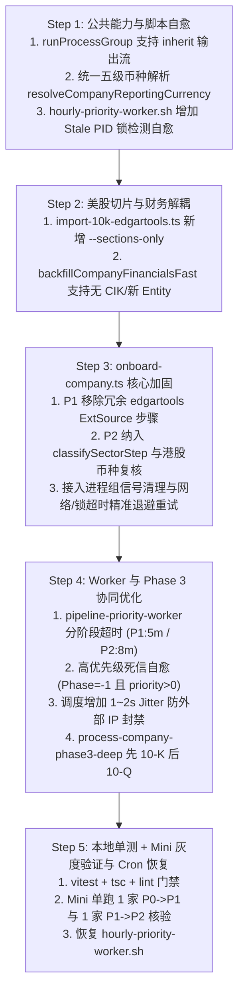

# Buffett Tribe Cron 任务台账与调度分析

> **版本**：v2026-10-18<br>
> **主机**：`mini`（`MINI.local`），项目目录 `/Users/rafael/buffett-tribe`<br>
> **时区**：`Asia/Shanghai`（crontab 按 mini 本地时间执行）<br>
> **口径**：以 2026-10-18 20:00 左右 `rafael` 用户实际执行的 `crontab -l`、脚本内容和近期日志为准；`root` crontab 因无免密 sudo 权限未读取，`launchd` 未发现本项目条目。<br>
> **结论**：当前有 6 个任务：4 个原有任务、1 个本次补上的每周汇率任务、1 个日志轮转任务。周末行情与 worker 的重叠已通过 `data-maintenance` 锁规避，脚本退出状态和日志轮转也已补齐；剩余重点是观察跳过批次对 onboarding 进度的影响，以及最新汇率与历史汇率口径混用的问题。

---

## 1. 当前 crontab 快照

以下是 mini 上当前实际生效的内容。本次修改前的备份在 `mini:~/crontab-backups/buffett-tribe-20261018-200300.cron`。

```cron
PATH=/Users/rafael/node/bin:/usr/bin:/bin:/usr/sbin:/sbin

# buffett-tribe: weekly sync of new listings across CN, HK, and US (Saturday 10:00 CST)
0 10 * * 6 /Users/rafael/buffett-tribe/scripts/cron/weekly-sync-new-listings.sh >> /Users/rafael/logs/buffett-tribe/sync-new-listings.log 2>&1

# buffett-tribe: weekly StockPrice update for onboardPhase >= 1 companies (mini clock is Beijing time)
0 12 * * 6 /Users/rafael/buffett-tribe/scripts/cron/update-stock-prices.sh cn,hk >> /Users/rafael/logs/buffett-tribe/update-stock-prices-cn-hk.log 2>&1
0 1 * * 0 /Users/rafael/buffett-tribe/scripts/cron/update-stock-prices.sh us >> /Users/rafael/logs/buffett-tribe/update-stock-prices-us.log 2>&1
# buffett-tribe: weekly FX refresh after Sunday US stock update (Monday 03:00 CST)
0 3 * * 1 /Users/rafael/buffett-tribe/scripts/cron/update-fx-rates.sh >> /Users/rafael/logs/buffett-tribe/update-fx-rates.log 2>&1

# buffett-tribe: weekly log rotation (Sunday 05:00 CST)
0 5 * * 0 /Users/rafael/buffett-tribe/scripts/cron/rotate-logs.sh >> /Users/rafael/logs/buffett-tribe/rotate-logs.log 2>&1

# buffett-tribe: hourly dual-drive worker (fast-track priority first, then standard pool 10 P0->P1 & 5 P1->P2, batch=15)
15 * * * * /Users/rafael/buffett-tribe/scripts/cron/hourly-priority-worker.sh 15 all >> /Users/rafael/logs/buffett-tribe/priority-worker.log 2>&1
```

`hourly-phase1-worker.sh` 仍保留在仓库里，但已废弃，只是 `hourly-priority-worker.sh` 的兼容包装，不在当前 crontab 中。`update-fx-rates.sh` 此前存在但未注册，本次已补上并测试；`rotate-logs.sh` 是本次新增的日志轮转任务。

## 2. 任务总览

| 任务 | 调度 | 入口 | 近期实际耗时 | 日志 | 写库范围 | 锁 |
| :--- | :--- | :--- | :--- | :--- | :--- | :--- |
| 新股/新上市公司同步 | 周六 10:00 | `weekly-sync-new-listings.sh` | 26～28 秒（10/03、10/10、10/17） | `sync-new-listings.log` | `Entity`（新标的 `onboardPhase=0`） | `data-maintenance` 锁 |
| A股/港股周度行情 | 周六 12:00 | `update-stock-prices.sh cn,hk` | 约 1 小时 39 分（10/17 12:00→13:39） | `update-stock-prices-cn-hk.log` | `StockPrice` | `data-maintenance` 锁 |
| 美股周度行情 | 周日 01:00 | `update-stock-prices.sh us` | 约 1 小时 21 分（10/18 01:00→02:21） | `update-stock-prices-us.log` | `StockPrice` | `data-maintenance` 锁 |
| 最新汇率刷新 | 周一 03:00 | `update-fx-rates.sh` | 7～8 秒（两次实测，21 个币种） | `update-fx-rates.log`（首次 cron 触发时创建） | `FxRate` 最新值 | PID 锁 |
| 日志轮转 | 周日 05:00 | `rotate-logs.sh` | 通常小于 1 秒；有 10 MB 以上日志时多几秒 | `rotate-logs.log` | 只读日志、写归档 | 自身 PID 锁 |
| 每小时增量飞轮 | 每小时第 15 分 | `hourly-priority-worker.sh 15 all` | 20 分 30 秒～22 分 54 秒（10/18 连续 10 次） | `priority-worker.log` | `Entity`、`Financial`、`FilingSection`、`StockPrice` 等 | 维护锁 + PID 锁 |

## 3. 逐项可行性分析

### 3.1 新股/新上市公司同步（周六 10:00）

**运行事实**

- 连续三次在 26～28 秒内完成：10/03 10:00:01→10:00:25，10/10 10:00:01→10:00:28，10/17 10:00:00→10:00:26。
- 10/17 实际新增 A 股 4 家、港股 11 家、美股 30 家，均以 `onboardPhase=0` 写入。
- 脚本先拉取 A 股、港股目录，再调用 `seed:master-universe` 拉取 SEC 美股目录并做差异插入。

**可行性判断：高**

- 运行时间远小于到 10:15 的 15 分钟间隔，正常情况下不会与每小时 worker 重叠。
- 任务只插入新 `Entity`，不改已有公司的财务事实；与后续 worker 的分工清晰。

**已处理**

- 与行情任务共用 `data-maintenance` 锁；手工重跑会等待最多 5 分钟，仍拿不到锁就以 `status=2` 退出。
- worker 在同步运行期间不会启动，10:15 批次会自动跳过。
- 日志末尾有 `END ... status=...`，不再需要靠最后一行猜测是否成功。

**剩余风险**

- 没有单步重试。akshare、SEC 或数据库任一步失败，整次周更失败；下一次要等一周。
- 没有失败告警，失败只能通过日志巡检发现。

**后续可选**

- 对目录拉取失败做 2～3 次重试；失败时保留上一版 `data/all-*-stocks.json`，不要让空文件或半成品覆盖。

### 3.2 A股/港股周度行情（周六 12:00）

**运行事实**

- 10/17 12:00:00 启动，日志最后写入时间为 13:39:17，单次约 1 小时 39 分。
- 12:00 的排期是 2026-09-11 调整后的结果，用来避开周五亚洲收盘后 Yahoo 尚未结算完当日日线、最后一根 bar 为 `NaN` 的问题。
- 日志中存在部分北交所标的 `No data returned`，脚本会继续跑完其他标的，最终以非零状态结束。

**可行性判断：中高**

- 周六中午运行，离周五收盘约 21 小时，能拿到完整日线。
- 与周日美股行情相隔约 11 小时，两个行情任务本身不冲突。
- 任务会持续到 13:39，期间会跨过 12:15 和 13:15 两个 worker 批次。

**已处理的并发风险**

- 行情脚本现在获取 `data-maintenance` 锁；手工重跑会等待最多 5 分钟，仍拿不到锁就以 `status=2` 退出。
- worker 在启动时获取同一把锁；行情任务运行期间，12:15 和 13:15 的批次会记录 `Deferred` 并跳过，不再同时请求 yfinance 或写 `StockPrice`。
- 所有 StockPrice 写入都通过 `update-stock-prices.sh` 或 worker。两者互斥持锁，因此同一 ticker 不会被两个生产任务并发写入。
- 直接运行 `scripts/fetch-stock-prices-yf.py` 会绕过 shell 锁，属于不支持的操作；手工回补也必须使用 `update-stock-prices.sh`。

**剩余风险**

- Python 脚本按 ticker 逐个调用 Node 子进程写库，进程和数据库连接创建频繁；维护锁只保证不和其他长任务并行，不能降低单任务自身的开销。
- 日志末尾现在有 `END ... status=...`，但部分 ticker 的 404/退市仍会让整批以非零状态结束；需要继续用 `mark:delisted-tickers` 清理。
- 每次行情任务会跳过两个 worker 批次，一周约四个批次；如果 onboarding 积压明显，再评估是否把行情任务拆得更短。

### 3.3 美股周度行情（周日 01:00）

**运行事实**

- 10/18 01:00:00 启动，日志最后写入时间为 02:21:31，单次约 1 小时 21 分。
- 周日 01:00 距周五美股收盘约 21 小时，结算余量充足。
- 日志中存在 `CEIX`、`ARCH`、`BK-PK` 等 `No data returned`，属于已退市或代码失效的候选。

**可行性判断：中高**

- 与周六 A股/港股任务相隔约 11 小时，互不重叠。
- 与周一 03:00 的汇率任务相隔约 24 小时，不会冲突。
- 但在 01:15 和 02:15 会与 worker 批次重叠，风险与 3.2 相同。

**已处理**

- 与 3.2 共用 `data-maintenance` 锁和 `END status` 日志。
- 01:15 和 02:15 的 worker 批次会在获取维护锁失败后跳过。
- 若后续调整时间，优先保持“距收盘至少 20 小时”这个条件；worker 重叠已由锁处理，不再依赖启动时间错开。

### 3.4 最新汇率刷新（周一 03:00，本次新增）

**运行事实**

- 两次执行（普通 shell 与模拟 cron 的空环境）分别耗时 8 秒和 7 秒，均刷新 21 个币种并全部成功。
- Frankfurter 对 KZT、TWD、CLP、PEN、ARS、COP、VND 返回 404，自动回退 Yahoo Chart；其余币种走 Frankfurter/ECB。
- 执行后 `FxRate.asOfDate` 为 2026-10-16 或 2026-10-17，`updatedAt` 为 2026-10-18 12:03～12:05 UTC（北京 20:03～20:05）。
- 脚本退出后 `.cache/update-fx-rates.pid` 已自动清理。

**可行性判断：高**

- 只更新 `FxRate` 最新值，不写历史汇率，不改公司财务事实。
- 21 个请求并发执行，实测 8 秒；周一 03:00 到 03:15 worker 启动之间有 15 分钟余量。
- 排在周日美股行情之后，避免与行情任务争用外部 API。

**边界**

- 这个任务解决的是“最新汇率长期不更新”，不解决历史 PE/PB 使用最新汇率折算全部历史财务数据的问题；后者仍属于 BUG-16 的历史汇率口径问题。
- 失败币种会让脚本以非零状态结束，已成功币种仍会更新；cron 目前只把结果写日志，没有告警。
- 日志文件要等第一次 cron 触发后才会创建；本次手工运行是直接输出到终端。

**调度理由**

- 周六 10:00 的新股同步负责发现新公司，周日的行情任务负责价格，周一 03:00 再刷新汇率，顺序符合“实体 → 价格 → 折算”的依赖关系。
- 不放在周六 12:00 或周日 01:00，避免与耗时约 1.5 小时的行情任务重叠。

### 3.5 每小时增量飞轮（每小时第 15 分）

**运行事实**

- 10/18 连续 10 次运行，单次 20 分 30 秒～22 分 54 秒；总计 150 个公司槽位，成功 141 个、失败 9 个。
- 失败主要来自港股年报 `ExtSource` 创建、部分 `edgartools` HTML 下载和招股书导入；worker 会在下一个小时重新尝试。
- 脚本有 PID 锁和 `kill -0` 僵尸 PID 自愈；`--timeout-mins 48`，小于 60 分钟。
- 公司间有 1 秒基础延迟，降低 SEC/东财/Yahoo 的瞬时压力。

**可行性判断：高**

- 20～23 分钟的批次长度与每小时节奏匹配，48 分钟硬超时留有足够余量。
- PID 锁能防止上一批未结束时下一批重复启动。
- 单批 1～2 家失败不会阻塞整批，下一小时可继续。

**已处理的并发风险**

- worker 启动时获取 `data-maintenance` 锁；行情任务运行期间会记录 `Deferred: data-maintenance is running` 并以 `status=2` 退出，不进入候选队列。
- worker 自身仍保留 PID 锁和僵尸 PID 自愈，防止上一批未结束时重复启动。
- 公司间有 1 秒基础延迟，降低 SEC/东财/Yahoo 的瞬时压力。

**日志与剩余风险**

- Node 日志时间统一带 `Z`，shell 日志带 `+08:00`，不再出现无法判断时区的时间。
- `priority-worker.log` 由周日 05:00 的 `rotate-logs.sh` 轮转，单文件超过 10 MB 时压缩归档。
- worker 不再额外写一份 `logs/pipeline-priority.log`，避免同一批日志双写和双倍增长。
- 没有失败告警；连续多批失败仍需人工看日志，但 `END status` 已经能直接区分成功、失败和跳过。

## 4. 潜在冲突矩阵

| 组合 | 时间关系 | 冲突类型 | 判断 |
| :--- | :--- | :--- | :--- |
| 新股同步 × 每小时 worker | 周六 10:00:00～10:00:26，worker 10:15 启动 | 共享维护锁 | 已规避；同步运行期间 worker 会跳过 |
| A股/港股行情 × 每小时 worker | 周六 12:00～13:39，worker 12:15、13:15 启动 | 共享维护锁；worker 主动跳过 | 已规避；不再并发请求 yfinance 或写 StockPrice |
| 美股行情 × 每小时 worker | 周日 01:00～02:21，worker 01:15、02:15 启动 | 同上 | 已规避 |
| A股/港股行情 × 美股行情 | 周六 12:00 与周日 01:00 | 相隔约 11 小时 | 无冲突 |
| 汇率刷新 × 每小时 worker | 周一 03:00～03:00:08，worker 03:15 启动 | 约 15 分钟缓冲 | 低风险 |
| 汇率刷新 × 行情任务 | 周一 03:00 与周末行情 | 相隔 24 小时以上 | 无冲突 |
| 所有任务 × 数据库 | 共享同一个 PostgreSQL | 连接池、行锁、写入事务 | 长任务已串行；FX 仍可与 worker 短时并行 |
| 所有任务 × 日志目录 | 同一个 `~/logs/buffett-tribe` | 磁盘增长 | 周日 05:00 轮转，保留 28 天 |

**关于同一 ticker 的写入冲突**：`replaceStockPriceWindow` 在一个事务里删除并插入某个日期窗口；`StockPrice` 有 `(ticker, date)` 唯一约束。所有生产路径现在都受 `data-maintenance` 锁约束：行情任务持锁时 worker 不启动，worker 持锁时行情任务等待或退出。因此不会出现两个生产任务并发写同一 ticker。直接运行 Python 脚本会绕过 shell 锁，不再作为支持的操作。

## 5. 本次已完成的变更

### 5.1 统一维护锁

新增 [`scripts/cron/lib/cron-common.sh`](/Users/rafael/R129/buffett-tribe/scripts/cron/lib/cron-common.sh)：

- 用 `mkdir` 原子创建 `.cache/cron-locks/data-maintenance.lock`。
- 锁内保存 PID；PID 不存在时自动清理僵尸锁。
- 行情和新股同步最多等待 5 分钟；拿不到锁时输出 `Deferred` 并以 `status=2` 退出。
- worker 启动时获取同一把锁；维护任务运行期间直接跳过，不进入候选队列。
- 直接运行 Python 脚本不属于受支持入口；所有手工回补也必须走 `update-stock-prices.sh`。

### 5.2 统一退出状态

- 行情、新股同步和 worker 通过 `cron_finish` 在退出时输出 `=== END <时间> status=<退出码> ===`。
- 汇率脚本使用自己的 `fx_finish`，同时清理 PID 文件并输出 `END status`。
- 日志轮转脚本使用 `rotate_finish`，输出自己的 `END status`。
- 退出码约定：`0` 成功；`1` 失败；`2` 因维护锁或已有进程而主动跳过。

### 5.3 日志轮转

新增 [`scripts/cron/rotate-logs.sh`](/Users/rafael/R129/buffett-tribe/scripts/cron/rotate-logs.sh)：

- 每周日 05:00 执行。
- 单文件超过 10 MB 才轮转。
- 压缩到 `~/logs/buffett-tribe/archive/`，保留 28 天。
- 原地截断当前日志，保持正在写入的进程文件描述符有效。
- 排除 `rotate-logs.log` 自身，避免轮转脚本截断自己的输出。

同时移除了 worker 对 `logs/pipeline-priority.log` 的重复写盘；生产日志只保留 cron 重定向的 `priority-worker.log`，避免同一批内容双写。

### 5.4 时间格式

- shell 脚本使用 `date -Iseconds`，日志带 `+08:00`。
- Node worker 使用 UTC ISO 时间并补 `Z`，例如 `2026-10-18 12:15:00Z`。
- 两种时间都带明确时区，不再出现相差 8 小时但无法判断来源的时间。

### 5.5 汇率任务

- 已在 mini crontab 中加入周一 03:00 的 `update-fx-rates.sh`。
- 包装脚本显式设置 `PATH`，直接执行 `node --env-file=.env.local ./node_modules/.bin/tsx`。
- 保留 `.cache/update-fx-rates.pid` 锁和僵尸 PID 自愈。
- 两次执行分别 8 秒和 7 秒完成，21 个币种全部更新；第二次使用 `env -i` 模拟 cron 的最小环境。
- `FxRate.asOfDate` 已推进到 2026-10-16/17。

### 5.6 验证

- `bash -n` 通过全部 cron shell 脚本。
- `npm run typecheck:scripts` 通过。
- `vitest` 的 worker/process-group 相关 11 项测试通过。
- 维护锁测试：首次获取成功、第二个进程失败、释放后可重新获取、死 PID 锁会被清理、`cron_finish` 能记录 `status=2`。
- mini 已 fast-forward 到 `fae627f3`；worker 在维护锁被占用时输出 `Deferred` 并返回 `status=2`。
- 汇率脚本在 `env -i` 最小环境下执行成功，输出 `END status=0`。
- 日志轮转在临时目录测试通过：大文件被压缩归档、当前文件被截断、`rotate-logs.log` 自身不被轮转。
- 行情和 worker 脚本用假 `npm` 做了集成测试：获取维护锁、执行命令、释放锁、输出 `END status=0` 均正常。
- mini 上用 `hourly-priority-worker.sh 1 all --dry-run` 做了真实集成验证：获取维护锁、完成候选预览、输出 `END status=0`，锁目录已自动清理。
- 生产 `priority-worker.log` 已实际轮转：26,069,069 字节压缩为 3.3 MB 归档，当前日志重置为 0 字节。
- crontab 已回读确认，共 6 条任务；日志轮转任务已安装。
- 两个完整行情任务没有在本次部署中重跑；耗时和错误样本来自 10/17～10/18 的实际日志。

## 6. 建议的运维检查

### 6.1 每周检查

```bash
ssh mini 'crontab -l'
ssh mini 'ls -lh ~/logs/buffett-tribe'
ssh mini 'tail -n 80 ~/logs/buffett-tribe/sync-new-listings.log'
ssh mini 'tail -n 80 ~/logs/buffett-tribe/update-stock-prices-cn-hk.log'
ssh mini 'tail -n 80 ~/logs/buffett-tribe/update-stock-prices-us.log'
ssh mini 'tail -n 40 ~/logs/buffett-tribe/update-fx-rates.log'
ssh mini 'tail -n 20 ~/logs/buffett-tribe/rotate-logs.log'
ssh mini 'ls -lh ~/logs/buffett-tribe/archive | tail'
```

### 6.2 关键健康信号

- 新股同步：日志出现 `Weekly New Listings Sync Complete`；三家市场的新增数量合理。
- 行情任务：日志末尾有 `END ... status=0`；`status=2` 表示因维护锁跳过；`status=1` 才需要排查。
- 汇率任务：日志列出 `Updated <currency> -> USD`；`FxRate.asOfDate` 不早于上一个交易日。
- 每小时 worker：`BATCH SUMMARY` 的成功/失败数；`Deferred` 行表示行情任务正在运行。
- 锁文件：`.cache/pipeline-priority-worker.pid` 和 `.cache/update-fx-rates.pid` 不应长期残留。
- 日志轮转：`rotate-logs.log` 有 `END status=0`，归档目录按周增长且保留 28 天。

### 6.3 后续改进

- 如果出现必须直接从 Python 脚本回补的场景，再考虑给 StockPrice 写入增加 PostgreSQL 按 ticker advisory lock；当前生产入口已由维护锁串行化。
- 若需要更精确的估值折算，可把汇率任务从每周提高到每日；当前实现只保存最新值，不保存历史日序列。
- 如果 onboarding 积压明显，再评估行情任务期间跳过 worker 的吞吐损失；目前每周约少跑 4 个批次。

## 7. 最终的 crontab

当前 crontab 已按以下内容安装：

```cron
PATH=/Users/rafael/node/bin:/usr/bin:/bin:/usr/sbin:/sbin

0 10 * * 6 /Users/rafael/buffett-tribe/scripts/cron/weekly-sync-new-listings.sh >> /Users/rafael/logs/buffett-tribe/sync-new-listings.log 2>&1

0 12 * * 6 /Users/rafael/buffett-tribe/scripts/cron/update-stock-prices.sh cn,hk >> /Users/rafael/logs/buffett-tribe/update-stock-prices-cn-hk.log 2>&1
0 1 * * 0 /Users/rafael/buffett-tribe/scripts/cron/update-stock-prices.sh us >> /Users/rafael/logs/buffett-tribe/update-stock-prices-us.log 2>&1

0 3 * * 1 /Users/rafael/buffett-tribe/scripts/cron/update-fx-rates.sh >> /Users/rafael/logs/buffett-tribe/update-fx-rates.log 2>&1

0 5 * * 0 /Users/rafael/buffett-tribe/scripts/cron/rotate-logs.sh >> /Users/rafael/logs/buffett-tribe/rotate-logs.log 2>&1

15 * * * * /Users/rafael/buffett-tribe/scripts/cron/hourly-priority-worker.sh 15 all >> /Users/rafael/logs/buffett-tribe/priority-worker.log 2>&1
```

恢复旧版本（仅需要时）：

```bash
ssh mini 'crontab ~/crontab-backups/buffett-tribe-20261018-200300.cron'
```

---

# 附录：2026-10-17 每小时飞轮改造方案（历史）

## 目录

1. [背景与核心目标](#一背景与核心目标)
2. [现状穿透诊断（10 大关键 Gap 分析）](#二现状穿透诊断10-大关键-gap-分析)
3. [五阶段工程改造执行计划](#三五阶段工程改造执行计划)
4. [验证门禁与 Mini 灰度上线 Checklist](#四验证门禁与-mini-灰度上线-checklist)

---

## 一、背景与核心目标

在过去两天的专项治理中，我们完成了：
1. **全库 3,678 家公司（Phase 2: 1,243 家；Phase 1: 2,435 家）法定三大表全量回填**（成功率 99.54%，A 股与港股 Phase 1 达 100% 零失败）；
2. **四大系统性收官治理（`fix.md`）**：
   - 两阶段同源拆股复权（`normalizeFinancialYearsStockSplits`）；
   - 外延并购（`PurchaseSaleOfBusinessNet`）纳入资本配置瀑布流与符号统一；
   - 美股三级数据源 Waterfall（`Tier-1 SEC 10-K REST` $\rightarrow$ `Tier-2 yfinance` $\rightarrow$ `Tier-3 SEC 10-Q`）与独立最新季报通道 `getLatestInterimFinancial()`；
   - 季报滚动窗口生命周期（YTD 原生口径 + `upsertFinancialRows` 年报入库自动 GC 清理过时季报）。

下一步即将重新激活 `mini` 主机上的每小时增量飞轮。整套增量更新系统的脚本执行矩阵分为三层：

| 层次 | 核心脚本 | 职责与改造重点 |
| :--- | :--- | :--- |
| **第 1 层：Cron 外部驱动层**<br>(Crontab Shell 入口) | • [`hourly-priority-worker.sh`](file:///Users/rafael/R129/buffett-tribe/scripts/cron/hourly-priority-worker.sh)<br>• [`hourly-phase1-worker.sh`](file:///Users/rafael/R129/buffett-tribe/scripts/cron/hourly-phase1-worker.sh)<br>• [`weekly-sync-new-listings.sh`](file:///Users/rafael/R129/buffett-tribe/scripts/cron/weekly-sync-new-listings.sh) | 1. 移除硬编码 `--company-timeout-mins 4`，放开由 Worker 内部按阶段动态控制；<br>2. 增加 `kill -0 "$OLD_PID"` 僵尸 PID 锁探测自愈；<br>3. 废弃旧版 `hourly-phase1-worker.sh`，统领至 `hourly-priority-worker.sh`。 |
| **第 2 层：调度总控层**<br>(Queue & Lifecycle Worker) | • [`pipeline-priority-worker.ts`](file:///Users/rafael/R129/buffett-tribe/scripts/pipeline-priority-worker.ts)<br>• [`process-company-phase3-deep.ts`](file:///Users/rafael/R129/buffett-tribe/scripts/process-company-phase3-deep.ts) | 1. 动态分阶段单公司超时（P0 $\to$ P1 给 5 分钟，P1 $\to$ P2 / P2 $\to$ P3 给 8 分钟）；<br>2. 高优先级死信自愈（`onboardPhase = -1` 且 `priority > 0` 自动重置）；<br>3. 调度循环间隙增加 1~2s Jitter 保护外部 API 频控；<br>4. P3 深度更新调整为先 10-K（GC旧季报）后 10-Q。 |
| **第 3 层：Onboard 核心与执行层**<br>(Pipeline & Sub-scripts) | • [`onboard-company.ts`](file:///Users/rafael/R129/buffett-tribe/scripts/onboard-company.ts)<br>• [`import-10k-edgartools.ts`](file:///Users/rafael/R129/buffett-tribe/scripts/import-10k-edgartools.ts)<br>• [`backfill-company-financials-fast.ts`](file:///Users/rafael/R129/buffett-tribe/scripts/backfill-company-financials-fast.ts)<br>• [`onboard-pending-companies.ts`](file:///Users/rafael/R129/buffett-tribe/scripts/onboard-pending-companies.ts) | 1. P2 切片新增 `--sections-only` 彻底剥离财务覆写；<br>2. US P1 由 `backfillCompanyFinancialsFast` 一步闭环，移除冗余 Python ExtSource；<br>3. 下沉五级币种解析并增加 P2 交叉复核；<br>4. P2 纳入 `classifySectorStep` 行业分类门禁；<br>5. 全面使用 `runProcessGroup` 替换裸 `spawn`，接入单步网络/锁重试。 |

通过对整条调用链的代码穿透审查，若直接启动现有 Cron 脚本，会触发 **旧逻辑覆写新财务数据、港股币种解析死锁、次新股/ADR 校验拦截、超时孤儿进程泄漏、命令行写死 4 分钟超时暴力覆盖** 等问题。本方案旨在启动 Cron 前彻底闭环上述隐患。

---

## 二、现状穿透诊断（10 大关键 Gap 分析）

### 1. 🔴 P0：美股 Phase 2 切片步骤 (`import:10k --latest-only`) 会用旧逻辑覆写/劣化 Phase 1 已回填的高质量财务数据
* **病灶位置**：[`scripts/onboard-company.ts`](file:///Users/rafael/R129/buffett-tribe/scripts/onboard-company.ts#L688-L733) $\rightarrow$ [`scripts/import-10k-edgartools.ts`](file:///Users/rafael/R129/buffett-tribe/scripts/import-10k-edgartools.ts#L431-L502)
* **根因分析**：
  1. 当公司从 `P1 -> P2` 晋级时，`onboard-company.ts` 执行 `import10kFullStep`（即 `import:10k --latest-only`），本意仅是提取最新年报的 `FilingSection` 原文切片，供后续生成商业画布与护城河使用。
  2. 但 [`importEdgarToolsAnnualReports`](file:///Users/rafael/R129/buffett-tribe/scripts/import-10k-edgartools.ts#L225-L508) 在切完章节后，仍会执行第 431–502 行的旧版逐条 `db.financial.upsert`（`mapLimit(..., 5)` 并发，无 `upsertFinancialRows` 短事务锁超时保护、无季报自动 GC，且缺少 `GrossProfit / TotalLiabilities / NetInterestIncome / NonInterestIncome / IncomeTaxExpense` 等 5 大会计恒等式推导）。
  3. 此外，对于**场外 ADR（仅有 `yfinance` 财报，无 SEC 10-K/20-F 且无招股书）**，`import10kFullStep.verify` 硬性要求 `kind: { in: ["10k", "20f", "40f", "us-prospectus"] }` 必须存在 `FilingSection`，会导致此类公司在 `P1 -> P2` 永久卡死。
* **修复策略**：
  * 为 [`scripts/import-10k-edgartools.ts`](file:///Users/rafael/R129/buffett-tribe/scripts/import-10k-edgartools.ts) 新增 `--sections-only`（或 `--skip-financials`）标志；Phase 2 调用时**只负责提取 `FilingSection` 原文切片与附件元数据**，绝不触碰 `Financial` 表（财务数据写入统一收口至 [`backfillCompanyFinancialsFast`](file:///Users/rafael/R129/buffett-tribe/scripts/backfill-company-financials-fast.ts#L159)）。
  * 在 `import10kFullStep.verify` 中，若该公司属于无 SEC 申报的场外 ADR（库内已有 `yfinance` 财务记录但 SEC 无 `10k/20f/40f/us-prospectus`），允许优雅降级通过，直接基于财务数据与概览生成后续分析。

---

### 2. 🔴 P0：美股 Phase 1 财务与 ExtSource 步骤冗余，且对无 CIK / 次新股不兼容
* **病灶位置**：[`scripts/onboard-company.ts`](file:///Users/rafael/R129/buffett-tribe/scripts/onboard-company.ts#L621-L686) 与 [`createUsAnnualExtSourceStep`](file:///Users/rafael/R129/buffett-tribe/scripts/onboard-company.ts#L736-L750)
* **根因分析**：
  1. **重复包装与漏建 Entity**：[`backfillCompanyFinancialsFast`](file:///Users/rafael/R129/buffett-tribe/scripts/backfill-company-financials-fast.ts#L198-L241) 内部已内置完整的三级 Waterfall（`Tier-1 SEC 10-K REST` $\rightarrow$ `Tier-2 yfinance` $\rightarrow$ `Tier-3 SEC 10-Q`），但其 CLI 入口 [`backfill-company-financials-fast.ts`](file:///Users/rafael/R129/buffett-tribe/scripts/backfill-company-financials-fast.ts#L516-L525) 却要求 `Entity` 必须已存在且 `cik: { not: null }` 才放行，否则报错退出，导致 `onboard-company.ts` 外层又写了一遍重复的 fallback 并回退到缓慢的 Python `import:10k --fast`。
  2. **`createUsAnnualExtSourceStep` 冗余且会拦截次新股/ADR**：[`backfillCompanyFinancialsFast`](file:///Users/rafael/R129/buffett-tribe/scripts/backfill-company-financials-fast.ts#L300-L343) 已经在纯 TS 中通过 SEC `submissions` API 批量创建了所有 `10k/20f/40f` 的 `ExtSource` 记录；而 `createUsAnnualExtSourceStep` 不仅又启动一次 Python `edgartools` 重复建表，且其 `verify` 强制要求存在 `kind: { in: ["10k", "20f", "40f"] }`——导致**仅有 `10-Q` 的次新股（如 `SPCX`）或仅有 `yfinance` 的 ADR（如 `BMWKY`）在 Step 2 验证直接失败**。
* **修复策略**：
  * 在 `onboard-company.ts` 的 `importFinancialsFastStep` 中，若库内尚无该美股 `Entity` 则先自动创建基础 `Entity`；直接调用 [`backfillCompanyFinancialsFast`](file:///Users/rafael/R129/buffett-tribe/scripts/backfill-company-financials-fast.ts#L159)（支持无 CIK 自动走 Tier-2 `yfinance`），移除旧版 `import:10k --fast` 回退与外层重复的财务 fallback 代码。
  * 移除美股 Phase 1 中多余的 Python `createUsAnnualExtSourceStep`（将其 `ExtSource` 存在性校验合并进 `importFinancialsFastStep`，允许 `10k / 20f / 40f / 10q / yfinance / us-prospectus` 任一有效 `ExtSource` 通过验证）。

---

### 3. 🔴 P0：港股（HK）Phase 1 币种解析顺序错位与死锁隐患
* **病灶位置**：[`scripts/onboard-company.ts`](file:///Users/rafael/R129/buffett-tribe/scripts/onboard-company.ts#L372-L385) 中的 [`resolveCnHkCurrency`](file:///Users/rafael/R129/buffett-tribe/scripts/onboard-company.ts#L372)
* **根因分析**：
  1. 港股建档流程已拆分为：Phase 1 只建 `ExtSource` URL（**不下载 PDF、不切 `FilingSection`**），Phase 2 才执行 `slice_annual_report` 切出 `FilingSection`。
  2. 但 [`resolveCnHkCurrency`](file:///Users/rafael/R129/buffett-tribe/scripts/onboard-company.ts#L372) 在 Phase 1 执行 `import_financials` 时，既**没有先读 `Entity.reportingCurrency`**，也**没有读已有 `Financial.unit`**，而是直接调用 [`resolveHkCurrencyFromAnnualReport(entityId)`](file:///Users/rafael/R129/buffett-tribe/scripts/lib/cn-hk-currency-resolve.ts#L97)。
  3. 由于 Phase 1 尚无 `FilingSection`，该函数 **100% 抛错**，完全退化为单次同步调用 `resolveHkCurrencyViaYfinance(ticker)`。一旦 Yahoo Finance 偶发超时或对小盘港股未返回 `financialCurrency`，Phase 1 会直接因 `FilingSection text is empty` 报错崩溃。
* **修复策略**：
  * 将 [`batch-backfill-phase12-financials.ts`](file:///Users/rafael/R129/buffett-tribe/scripts/batch-backfill-phase12-financials.ts#L247-L275) 中经过 1,025 家港股 100% 验证的五级币种解析链路下沉至 [`scripts/lib/cn-hk-currency-resolve.ts`](file:///Users/rafael/R129/buffett-tribe/scripts/lib/cn-hk-currency-resolve.ts)（① `CN_HK_SEEDS` $\rightarrow$ ② `Entity.reportingCurrency` $\rightarrow$ ③ 现有 `Financial.unit` $\rightarrow$ ④ `resolveHkCurrencyFromAnnualReport` $\rightarrow$ ⑤ 带重试的 `resolveHkCurrencyViaYfinance`），供 `onboard-company.ts` 与 `process-company-phase3-deep.ts` 统一调用。
  * 在港股 **Phase 2 完成 `slice_annual_report`（生成年报正文 `FilingSection`）后**，增加一步轻量级**年报币种交叉复核**：用 `resolveHkCurrencyFromAnnualReport` 核对 Phase 1 写入的 `reportingCurrency`；若发现不一致（例如 Phase 1 被误标为 HKD 但年报正文实为 CNY），自动触发一次 `import:cn-hk-financials` 修正币种，严守“港股 40% 非港币报表零错配”红线。

---

### 4. 🟠 P1：子进程组孤儿进程与数据库连接泄漏防护（2026-10-12 事故复盘教训）
* **病灶位置**：[`scripts/onboard-company.ts`](file:///Users/rafael/R129/buffett-tribe/scripts/onboard-company.ts#L154-L159) 与 [`scripts/process-company-phase3-deep.ts`](file:///Users/rafael/R129/buffett-tribe/scripts/process-company-phase3-deep.ts#L60-L65) 的 `runCommand`
* **根因分析**：
  * 10-12 事故复盘（`handoff.md` 第八节 5.1）证明：当外层 Worker 触发超时向 `onboard-company.ts` 发送 `SIGTERM` 时，普通 `spawn` 启动的多层子进程（`npm -> python akshare/edgartools -> tsx import`）若不按进程组清理，会变成孤儿进程在后台继续写库并占用连接池与行锁。
  * 回填脚本已使用 [`runProcessGroup`](file:///Users/rafael/R129/buffett-tribe/scripts/lib/run-process-group.ts#L29)，但 `onboard-company.ts` 和 `process-company-phase3-deep.ts` 仍在使用裸 `spawn`。
* **修复策略**：
  * 扩展 [`scripts/lib/run-process-group.ts`](file:///Users/rafael/R129/buffett-tribe/scripts/lib/run-process-group.ts) 支持实时流式输出（`inheritStdio`），并在 `onboard-company.ts` 与 `process-company-phase3-deep.ts` 中全面替换裸 `spawn`，绑定全局 `AbortController`，确保父进程收到 `SIGINT`/`SIGTERM` 时 100% 干净终止整个子进程树后再断开 Prisma。

---

### 5. 🟠 P1：单步骤网络偶发抖动缺乏自动重试与退避，且需精准过滤“可重试错误”
* **病灶位置**：[`scripts/onboard-company.ts`](file:///Users/rafael/R129/buffett-tribe/scripts/onboard-company.ts#L850-L872) Step 执行循环
* **根因分析**：
  * Phase 1 (2,435 家) 回补之所以在 A 股（648 家）和港股（744 家）实现 0 失败，关键在于引入了 **指数退避自动重试（2,000ms / 4,000ms backoff）** 吸收东财/新浪/Yahoo/SEC 的瞬时网络抖动。
  * 目前 `onboard-company.ts` 中任意一步（如 `import_price` 或 `import_financials`）网络偶发报错即整家公司直接失败退出，白白消耗 `onboardPhase1Attempts` 配额（满 3 次即打入 `-1` 死信池）。
  * 但若盲目粗暴重试所有错误，遇到确定性的 4xx 错误（如第三方数据源明确返回“404 Not Found / 无该财报”），会白白消耗 6 秒退避等待时间，拖慢整体批次流转。
* **修复策略**：
  * 在 `onboard-company.ts` 单步执行器中引入带错误分类的重试机制（最多 2 次，`2000ms * attempt` 退避）：
    * **可重试错误**：瞬时网络抖动（`ECONNRESET`、`ETIMEDOUT`、502/503/504、Fetch Error）与数据库瞬时锁争用（Prisma `P2028`）；
    * **不可重试错误**：确定性 4xx 业务错误（如数据不存在、参数校验失败）立即抛出或转入降级分支，杜绝无谓等待。

---

### 6. 🟡 P1：`P1 -> P2` 晋级缺少 13 类行业分类前置保障 + 单公司 4 分钟超时过短
* **病灶位置**：
  * [`scripts/onboard-company.ts`](file:///Users/rafael/R129/buffett-tribe/scripts/onboard-company.ts#L763-L766) & [`L791-L794`](file:///Users/rafael/R129/buffett-tribe/scripts/onboard-company.ts#L791-L794) (`phase2Steps`)
  * [`scripts/cron/hourly-priority-worker.sh`](file:///Users/rafael/R129/buffett-tribe/scripts/cron/hourly-priority-worker.sh#L24) & [`scripts/pipeline-priority-worker.ts`](file:///Users/rafael/R129/buffett-tribe/scripts/pipeline-priority-worker.ts#L521)
* **根因分析**：
  1. **行业分类缺失风险**：`classifySectorStep` 目前只在 `phase1Steps` 中。对于早期已处于 `onboardPhase = 1` 但尚未完成最新 13 类行业分类（或分类状态为 `invalid`）的存量公司，直接跑 `--phase 2` 会跳过 `classifySectorStep`，导致后续 `generate_business_model` 与 `generate_value_analysis` 无法注入正确的 6 大财务模板与行业专属指标。
  2. **超时矛盾**：`hourly-priority-worker.sh` 传入了 `--company-timeout-mins 4`（4 分钟），而 `onboard-company.ts` 内部给 `import:10k` 配了 15 分钟超时。对于 `P1 -> P2`（需下载解析数十 MB 的 20-F HTML 或港股/A股 PDF 年报切片 + 连续 2 次深度 LLM 生成），4 分钟极易在切片或第二次 LLM 调用时被 Worker 强行熔断误杀。
* **修复策略**：
  * 将 `classifySectorStep`（自带 `revalidateOnResume: true`，若已有效分类则毫秒级自动跳过）一并纳入 `phase2Steps`（位于切片之后、深度分析之前）。
  * 在 [`scripts/pipeline-priority-worker.ts`](file:///Users/rafael/R129/buffett-tribe/scripts/pipeline-priority-worker.ts) 中支持按阶段动态超时：`P0 -> P1` 默认 **5 分钟**，`P1 -> P2` / `P2 -> P3` 默认 **8 分钟**，总批次超时设为 **48 分钟**（避免跨小时重叠）。
  * 同步修改 [`scripts/cron/hourly-priority-worker.sh`](file:///Users/rafael/R129/buffett-tribe/scripts/cron/hourly-priority-worker.sh#L24)：**移除硬编码的 `--company-timeout-mins 4`**，不再强行覆盖 Worker 内部的按阶段动态超时规划。

---

### 7. 🟡 P2：Phase 3 深度更新 (`process-company-phase3-deep.ts`) 美股 10-K 与 10-Q 抓取顺序倒置
* **病灶位置**：[`scripts/process-company-phase3-deep.ts`](file:///Users/rafael/R129/buffett-tribe/scripts/process-company-phase3-deep.ts#L163-L187)
* **根因分析**：
  * 当前代码先跑 `Step 1: importUsQuarterlyFinancialsForEntity`（10-Q），再跑 `Step 2: backfillCompanyFinancialsFast`（10-K）。
  * 当一家公司刚披露新财年 10-K 时，若先跑 10-Q，此时库内 `max(FY.periodEnd)` 仍是上一年的旧日期，10-Q 脚本会先把已完结财年的 Q1~Q3 抓下来写库，几秒后 Step 2 写入新 10-K 时又通过 `upsertFinancialRows` 的自动 GC 把它们删掉。
* **修复策略**：
  * 对调 Step 1 与 Step 2 顺序：**先跑 `backfillCompanyFinancialsFast`（入库最新 `FY` 并自动 GC 历史季报），再跑 `importUsQuarterlyFinancialsForEntity`（此时 `max(FY.periodEnd)` 已是最新，仅拉取 `periodEnd > 最新 FY` 的未完结当期 YTD 季报）**。

---

### 8. 🟠 P1：死信队列（`onboardPhase = -1`）缺乏高优先级自愈策略
* **病灶位置**：[`scripts/pipeline-priority-worker.ts`](file:///Users/rafael/R129/buffett-tribe/scripts/pipeline-priority-worker.ts#L427-L445)
* **根因分析**：
  * 过去因旧逻辑 Bug（如美股无 CIK、港股币种解析死锁等），导致部分高优先级标的（如 SPCX、部分次新股）累计失败 3 次被打入 `onboardPhase = -1`。
  * 若 Worker 恢复运行后仅消费 `onboardPhase >= 0` 的公司，这些被误杀的优质公司将永久被死信池抛弃。
* **修复策略**：
  * 在 Worker 启动或调度时增加高优先级死信自愈逻辑：若某公司处于 `onboardPhase = -1`，但拥有人工/规则赋予的高优先级（`priority > 0`）且距上次失败更新已超过 24 小时（或传入 `--heal-deadletter` 参数），自动重置 `onboardPhase1Attempts = 0` 并将其拉回候选池重新消费。

---

### 9. 🟡 P2：Cron 脚本 PID 锁文件缺乏僵尸进程自愈（Stale Lock Detection）
* **病灶位置**：[`scripts/cron/hourly-priority-worker.sh`](file:///Users/rafael/R129/buffett-tribe/scripts/cron/hourly-priority-worker.sh#L12-L17)
* **根因分析**：
  * 现脚本仅通过 `if [ -f "$PID_FILE" ]; then exit 0; fi` 判断是否已有任务在跑。若 `mini` 上次发生 OOM、系统重启或异常被杀未清理该文件，会导致后续每个整点的定时任务静默退出。
* **修复策略**：
  * 在 Shell 脚本中增加 `kill -0 "$OLD_PID" 2>/dev/null` 存活性探测。若进程已死，输出警告并自动移除残留锁文件，保障飞轮永不因偶发异常停摆。

---

### 10. 🟡 P2：连续调度缺少 API 频控保护 Jitter
* **病灶位置**：[`scripts/pipeline-priority-worker.ts`](file:///Users/rafael/R129/buffett-tribe/scripts/pipeline-priority-worker.ts#L320-L330) 公司循环间隙
* **根因分析**：
  * 在单个批次内连续处理 5~10 家公司时，若完全无间隔调度，对 SEC EDGAR（严控 $\le 10$ req/s）和东方财富/新浪（突发高频易触发临时封 IP 5~10 分钟）造成脉冲式冲击。
* **修复策略**：
  * 在 Worker 每处理完一家公司后，强制增加 1,000ms ~ 2,000ms 的随机延时 Jitter，使全天每小时持续运行平滑安全。

---

## 三、五阶段工程改造执行计划



| 阶段 | 涉及文件 | 具体改动内容 |
| :--- | :--- | :--- |
| **Step 1**<br>公共组件与脚本自愈 | • [`scripts/lib/run-process-group.ts`](file:///Users/rafael/R129/buffett-tribe/scripts/lib/run-process-group.ts)<br>• [`scripts/lib/cn-hk-currency-resolve.ts`](file:///Users/rafael/R129/buffett-tribe/scripts/lib/cn-hk-currency-resolve.ts)<br>• [`scripts/cron/hourly-priority-worker.sh`](file:///Users/rafael/R129/buffett-tribe/scripts/cron/hourly-priority-worker.sh) | 1. 扩展 `runProcessGroup` 支持 `inheritStdio` 选项，兼顾实时日志输出与进程组 `-pid` 信号清理；<br>2. 封装统一的 `resolveCompanyReportingCurrency()`（整合 `CN_HK_SEEDS` $\rightarrow$ `Entity.reportingCurrency` $\rightarrow$ `Financial.unit` $\rightarrow$ 年报正文 $\rightarrow$ 带重试 `yfinance`）；<br>3. `hourly-priority-worker.sh` 增加 `kill -0 "$OLD_PID"` 僵尸锁检测清除，并**移除硬编码的 `--company-timeout-mins 4`**，放开由 Worker 内部动态分阶段超时控制。 |
| **Step 2**<br>美股导入解耦 | • [`scripts/import-10k-edgartools.ts`](file:///Users/rafael/R129/buffett-tribe/scripts/import-10k-edgartools.ts)<br>• [`scripts/backfill-company-financials-fast.ts`](file:///Users/rafael/R129/buffett-tribe/scripts/backfill-company-financials-fast.ts) | 1. 为 `import-10k-edgartools.ts` 增加 `--sections-only` 参数，Phase 2 切片时跳过逐行 `db.financial.upsert`；<br>2. `backfill-company-financials-fast.ts` CLI 入口支持无 CIK 标的进入 Tier-2 `yfinance` 兜底，若 Entity 未创建则自动初始化。 |
| **Step 3**<br>`onboard-company.ts` 重构 | • [`scripts/onboard-company.ts`](file:///Users/rafael/R129/buffett-tribe/scripts/onboard-company.ts) | 1. **美股 P1**：由 `backfillCompanyFinancialsFast` 一步完成 `Entity + ExtSource + 三级财务 Waterfall`，移除重复调用 Python 的 `createUsAnnualExtSourceStep`；<br>2. **美股 P2**：调用 `import:10k --latest-only --sections-only`，并对无 SEC 申报的场外 ADR 允许跳过原文切片验证（其他市场严守切片门禁）；<br>3. **港股 P1/P2**：P1 使用统一五级币种解析，P2 切完年报后自动交叉复核币种；<br>4. **P2 分类保障**：在 `phase2Steps` 中包含 `classifySectorStep`（已分类自动跳过）；<br>5. **韧性加固**：全步骤接入 `runProcessGroup` 信号转发与单步错误分类重试（仅网络抖动与瞬时锁争用重试 2 次，确定性 4xx 不重试）。 |
| **Step 4**<br>Worker 与 P3 调整 | • [`scripts/pipeline-priority-worker.ts`](file:///Users/rafael/R129/buffett-tribe/scripts/pipeline-priority-worker.ts)<br>• [`scripts/cron/hourly-priority-worker.sh`](file:///Users/rafael/R129/buffett-tribe/scripts/cron/hourly-priority-worker.sh)<br>• [`scripts/cron/hourly-phase1-worker.sh`](file:///Users/rafael/R129/buffett-tribe/scripts/cron/hourly-phase1-worker.sh)<br>• [`scripts/process-company-phase3-deep.ts`](file:///Users/rafael/R129/buffett-tribe/scripts/process-company-phase3-deep.ts) | 1. Worker 支持区分 `P0->P1`（5 分钟）与 `P1->P2 / P2->P3`（8 分钟）的单公司超时，总超时设为 48 分钟；<br>2. 增加高优先级死信自愈：`onboardPhase = -1` 且 `priority > 0`（距上次失败 > 24h 或传入 `--heal-deadletter`）自动重置 attempts 恢复调度；<br>3. 公司调度循环加入 1~2 秒 Jitter 延时，保护 SEC 与东财 API 频控；<br>4. `process-company-phase3-deep.ts` 调整为先跑 10-K `backfillCompanyFinancialsFast`（触发旧季报 GC），再跑 10-Q `importUsQuarterlyFinancialsForEntity`，并复用统一币种解析与 `runProcessGroup`；<br>5. 废弃/收敛旧版 `hourly-phase1-worker.sh`，统一由 `hourly-priority-worker.sh` 接管全流程。 |
| **Step 5**<br>Mini 灰度与恢复 | • 远程主机 `mini` | 1. 本地通过 `tsc`、`eslint` 与单元测试；<br>2. `mini` 同步代码，排查后台进程与 `crontab -l`；<br>3. 在 `mini` 上跑一次 `--dry-run` 队列预览 + 1 家 `P0->P1` 与 1 家 `P1->P2` 实测验收；<br>4. 正式启用 `hourly-priority-worker.sh`。 |

---

## 四、验证门禁与 Mini 灰度上线 Checklist

- [x] **门禁 1：本地静态检查与单元测试**
  - `npx tsc --noEmit` 与 `npm run typecheck:scripts` 0 错误通过
  - `npm run lint` 0 报错通过
  - 新增/更新 `onboard` 与 `worker` 相关单元测试，`npx vitest run` 全绿通过 (477 passed)
- [x] **门禁 2：Mini 机器环境核查**
  - SSH 检查 `mini` 当前 `crontab -l` 与 `ps aux | grep -E "node|python"`，确认无残留孤儿进程或锁文件（`.cache/pipeline-priority-worker.pid`）
  - `mini` 拉取最新 `main` 分支代码 (`7dde4cdc`)
- [x] **门禁 3：Mini 单点实测验收**
  - 运行 `npm run worker:priority -- --dry-run` 核对候选队列（Fast-Track + P1->P2 + P0->P1 跨市场均衡度，含死信高优先级自愈验证）
  - 手动触发实测 1 家 `P0->P1`（药明康德 603259.SS，1m29s 成功）与 1 家 `P1->P2`（AMERICA MOVIL AMX，1m56s 成功）：
    1. 财务事实通过 `upsertFinancialRows` 短事务写入且历史季报 0 残留；
    2. `reportingCurrency` (CNY / MXN) 与 `sectorModelType` (healthcare / telecommunications) 准确落库；
    3. `P1->P2` 切片激活 `--sections-only`，不覆盖已有 `Financial` 记录，商业画布与护城河正常生成；
    4. 调度间隙 1~2s Jitter 正常生效。
- [x] **门禁 4：正式激活每小时 Cron 飞轮**
  - 恢复 `mini` Crontab 中的 `hourly-priority-worker.sh 15 all`，定于每小时第 15 分钟触发运行。
