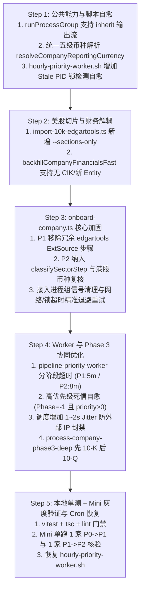

# 每小时增量飞轮 (Hourly Cron Job) 与 Onboard 脚本重构执行方案 (cron.md)

> **版本**：v2026-10-17  
> **定位**：结合四大财务收官治理与全库 3,678 家公司（Phase 1 + Phase 2）30 小时回填实战经验（详见 [GOLDEN.md](file:///Users/rafael/R129/buffett-tribe/GOLDEN.md)），在重启远程主机 `mini` 上的每小时定时任务（`hourly-priority-worker.sh`）前，对 `onboard-company.ts`、`pipeline-priority-worker.ts` 及子脚本进行防回退、防孤儿进程与防死锁的系统性改造方案。  
> **关联文档**：[GOLDEN.md](file:///Users/rafael/R129/buffett-tribe/GOLDEN.md)（黄金测试集与全链路治理总纲） ｜ [DATA.md](file:///Users/rafael/R129/buffett-tribe/DATA.md)（顶层数据与模型字典宪章）

---

## 目录

1. [背景与核心目标](#一背景与核心目标)
2. [现状穿透诊断（10 大关键 Gap 分析）](#二现状穿透诊断10-大关键-gap-分析)
3. [五阶段工程改造执行计划](#三五阶段工程改造执行计划)
4. [验证门禁与 Mini 灰度上线 Checklist](#四验证门禁与-mini-灰度上线-checklist)

---

## 一、背景与核心目标

在过去两天的专项治理中，我们完成了：
1. **全库 3,678 家公司（Phase 2: 1,243 家；Phase 1: 2,435 家）法定三大表全量回填**（成功率 99.54%，A 股与港股 Phase 1 达 100% 零失败）；
2. **四大系统性收官治理（`fix.md`）**：
   - 两阶段同源拆股复权（`normalizeFinancialYearsStockSplits`）；
   - 外延并购（`PurchaseSaleOfBusinessNet`）纳入资本配置瀑布流与符号统一；
   - 美股三级数据源 Waterfall（`Tier-1 SEC 10-K REST` $\rightarrow$ `Tier-2 yfinance` $\rightarrow$ `Tier-3 SEC 10-Q`）与独立最新季报通道 `getLatestInterimFinancial()`；
   - 季报滚动窗口生命周期（YTD 原生口径 + `upsertFinancialRows` 年报入库自动 GC 清理过时季报）。

下一步即将重新激活 `mini` 主机上的每小时增量飞轮。整套增量更新系统的脚本执行矩阵分为三层：

| 层次 | 核心脚本 | 职责与改造重点 |
| :--- | :--- | :--- |
| **第 1 层：Cron 外部驱动层** (Crontab Shell 入口) | • [`hourly-priority-worker.sh`](file:///Users/rafael/R129/buffett-tribe/scripts/cron/hourly-priority-worker.sh) • [`hourly-phase1-worker.sh`](file:///Users/rafael/R129/buffett-tribe/scripts/cron/hourly-phase1-worker.sh) • [`weekly-sync-new-listings.sh`](file:///Users/rafael/R129/buffett-tribe/scripts/cron/weekly-sync-new-listings.sh) | 1. 移除硬编码 `--company-timeout-mins 4`，放开由 Worker 内部按阶段动态控制； 2. 增加 `kill -0 "$OLD_PID"` 僵尸 PID 锁探测自愈； 3. 废弃旧版 `hourly-phase1-worker.sh`，统领至 `hourly-priority-worker.sh`。 |
| **第 2 层：调度总控层** (Queue & Lifecycle Worker) | • [`pipeline-priority-worker.ts`](file:///Users/rafael/R129/buffett-tribe/scripts/pipeline-priority-worker.ts) • [`process-company-phase3-deep.ts`](file:///Users/rafael/R129/buffett-tribe/scripts/process-company-phase3-deep.ts) | 1. 动态分阶段单公司超时（P0 $\to$ P1 给 5 分钟，P1 $\to$ P2 / P2 $\to$ P3 给 8 分钟）； 2. 高优先级死信自愈（`onboardPhase = -1` 且 `priority > 0` 自动重置）； 3. 调度循环间隙增加 1~2s Jitter 保护外部 API 频控； 4. P3 深度更新调整为先 10-K（GC旧季报）后 10-Q。 |
| **第 3 层：Onboard 核心与执行层** (Pipeline & Sub-scripts) | • [`onboard-company.ts`](file:///Users/rafael/R129/buffett-tribe/scripts/onboard-company.ts) • [`import-10k-edgartools.ts`](file:///Users/rafael/R129/buffett-tribe/scripts/import-10k-edgartools.ts) • [`backfill-company-financials-fast.ts`](file:///Users/rafael/R129/buffett-tribe/scripts/backfill-company-financials-fast.ts) • [`onboard-pending-companies.ts`](file:///Users/rafael/R129/buffett-tribe/scripts/onboard-pending-companies.ts) | 1. P2 切片新增 `--sections-only` 彻底剥离财务覆写； 2. US P1 由 `backfillCompanyFinancialsFast` 一步闭环，移除冗余 Python ExtSource； 3. 下沉五级币种解析并增加 P2 交叉复核； 4. P2 纳入 `classifySectorStep` 行业分类门禁； 5. 全面使用 `runProcessGroup` 替换裸 `spawn`，接入单步网络/锁重试。 |

通过对整条调用链的代码穿透审查，若直接启动现有 Cron 脚本，会触发 **旧逻辑覆写新财务数据、港股币种解析死锁、次新股/ADR 校验拦截、超时孤儿进程泄漏、命令行写死 4 分钟超时暴力覆盖** 等问题。本方案旨在启动 Cron 前彻底闭环上述隐患。

---

## 二、现状穿透诊断（10 大关键 Gap 分析）

### 1. 🔴 P0：美股 Phase 2 切片步骤 (`import:10k --latest-only`) 会用旧逻辑覆写/劣化 Phase 1 已回填的高质量财务数据
* **病灶位置**：[`scripts/onboard-company.ts`](file:///Users/rafael/R129/buffett-tribe/scripts/onboard-company.ts#L688-L733) $\rightarrow$ [`scripts/import-10k-edgartools.ts`](file:///Users/rafael/R129/buffett-tribe/scripts/import-10k-edgartools.ts#L431-L502)
* **根因分析**：
  1. 当公司从 `P1 -> P2` 晋级时，`onboard-company.ts` 执行 `import10kFullStep`（即 `import:10k --latest-only`），本意仅是提取最新年报的 `FilingSection` 原文切片，供后续生成商业画布与护城河使用。
  2. 但 [`importEdgarToolsAnnualReports`](file:///Users/rafael/R129/buffett-tribe/scripts/import-10k-edgartools.ts#L225-L508) 在切完章节后，仍会执行第 431–502 行的旧版逐条 `db.financial.upsert`（`mapLimit(..., 5)` 并发，无 `upsertFinancialRows` 短事务锁超时保护、无季报自动 GC，且缺少 `GrossProfit / TotalLiabilities / NetInterestIncome / NonInterestIncome / IncomeTaxExpense` 等 5 大会计恒等式推导）。
  3. 此外，对于**场外 ADR（仅有 `yfinance` 财报，无 SEC 10-K/20-F 且无招股书）**，`import10kFullStep.verify` 硬性要求 `kind: { in: ["10k", "20f", "40f", "us-prospectus"] }` 必须存在 `FilingSection`，会导致此类公司在 `P1 -> P2` 永久卡死。
* **修复策略**：
  * 为 [`scripts/import-10k-edgartools.ts`](file:///Users/rafael/R129/buffett-tribe/scripts/import-10k-edgartools.ts) 新增 `--sections-only`（或 `--skip-financials`）标志；Phase 2 调用时**只负责提取 `FilingSection` 原文切片与附件元数据**，绝不触碰 `Financial` 表（财务数据写入统一收口至 [`backfillCompanyFinancialsFast`](file:///Users/rafael/R129/buffett-tribe/scripts/backfill-company-financials-fast.ts#L159)）。
  * 在 `import10kFullStep.verify` 中，若该公司属于无 SEC 申报的场外 ADR（库内已有 `yfinance` 财务记录但 SEC 无 `10k/20f/40f/us-prospectus`），允许优雅降级通过，直接基于财务数据与概览生成后续分析。

---

### 2. 🔴 P0：美股 Phase 1 财务与 ExtSource 步骤冗余，且对无 CIK / 次新股不兼容
* **病灶位置**：[`scripts/onboard-company.ts`](file:///Users/rafael/R129/buffett-tribe/scripts/onboard-company.ts#L621-L686) 与 [`createUsAnnualExtSourceStep`](file:///Users/rafael/R129/buffett-tribe/scripts/onboard-company.ts#L736-L750)
* **根因分析**：
  1. **重复包装与漏建 Entity**：[`backfillCompanyFinancialsFast`](file:///Users/rafael/R129/buffett-tribe/scripts/backfill-company-financials-fast.ts#L198-L241) 内部已内置完整的三级 Waterfall（`Tier-1 SEC 10-K REST` $\rightarrow$ `Tier-2 yfinance` $\rightarrow$ `Tier-3 SEC 10-Q`），但其 CLI 入口 [`backfill-company-financials-fast.ts`](file:///Users/rafael/R129/buffett-tribe/scripts/backfill-company-financials-fast.ts#L516-L525) 却要求 `Entity` 必须已存在且 `cik: { not: null }` 才放行，否则报错退出，导致 `onboard-company.ts` 外层又写了一遍重复的 fallback 并回退到缓慢的 Python `import:10k --fast`。
  2. **`createUsAnnualExtSourceStep` 冗余且会拦截次新股/ADR**：[`backfillCompanyFinancialsFast`](file:///Users/rafael/R129/buffett-tribe/scripts/backfill-company-financials-fast.ts#L300-L343) 已经在纯 TS 中通过 SEC `submissions` API 批量创建了所有 `10k/20f/40f` 的 `ExtSource` 记录；而 `createUsAnnualExtSourceStep` 不仅又启动一次 Python `edgartools` 重复建表，且其 `verify` 强制要求存在 `kind: { in: ["10k", "20f", "40f"] }`——导致**仅有 `10-Q` 的次新股（如 `SPCX`）或仅有 `yfinance` 的 ADR（如 `BMWKY`）在 Step 2 验证直接失败**。
* **修复策略**：
  * 在 `onboard-company.ts` 的 `importFinancialsFastStep` 中，若库内尚无该美股 `Entity` 则先自动创建基础 `Entity`；直接调用 [`backfillCompanyFinancialsFast`](file:///Users/rafael/R129/buffett-tribe/scripts/backfill-company-financials-fast.ts#L159)（支持无 CIK 自动走 Tier-2 `yfinance`），移除旧版 `import:10k --fast` 回退与外层重复的财务 fallback 代码。
  * 移除美股 Phase 1 中多余的 Python `createUsAnnualExtSourceStep`（将其 `ExtSource` 存在性校验合并进 `importFinancialsFastStep`，允许 `10k / 20f / 40f / 10q / yfinance / us-prospectus` 任一有效 `ExtSource` 通过验证）。

---

### 3. 🔴 P0：港股（HK）Phase 1 币种解析顺序错位与死锁隐患
* **病灶位置**：[`scripts/onboard-company.ts`](file:///Users/rafael/R129/buffett-tribe/scripts/onboard-company.ts#L372-L385) 中的 [`resolveCnHkCurrency`](file:///Users/rafael/R129/buffett-tribe/scripts/onboard-company.ts#L372)
* **根因分析**：
  1. 港股建档流程已拆分为：Phase 1 只建 `ExtSource` URL（**不下载 PDF、不切 `FilingSection`**），Phase 2 才执行 `slice_annual_report` 切出 `FilingSection`。
  2. 但 [`resolveCnHkCurrency`](file:///Users/rafael/R129/buffett-tribe/scripts/onboard-company.ts#L372) 在 Phase 1 执行 `import_financials` 时，既**没有先读 `Entity.reportingCurrency`**，也**没有读已有 `Financial.unit`**，而是直接调用 [`resolveHkCurrencyFromAnnualReport(entityId)`](file:///Users/rafael/R129/buffett-tribe/scripts/lib/cn-hk-currency-resolve.ts#L97)。
  3. 由于 Phase 1 尚无 `FilingSection`，该函数 **100% 抛错**，完全退化为单次同步调用 `resolveHkCurrencyViaYfinance(ticker)`。一旦 Yahoo Finance 偶发超时或对小盘港股未返回 `financialCurrency`，Phase 1 会直接因 `FilingSection text is empty` 报错崩溃。
* **修复策略**：
  * 将 [`batch-backfill-phase12-financials.ts`](file:///Users/rafael/R129/buffett-tribe/scripts/batch-backfill-phase12-financials.ts#L247-L275) 中经过 1,025 家港股 100% 验证的五级币种解析链路下沉至 [`scripts/lib/cn-hk-currency-resolve.ts`](file:///Users/rafael/R129/buffett-tribe/scripts/lib/cn-hk-currency-resolve.ts)（① `CN_HK_SEEDS` $\rightarrow$ ② `Entity.reportingCurrency` $\rightarrow$ ③ 现有 `Financial.unit` $\rightarrow$ ④ `resolveHkCurrencyFromAnnualReport` $\rightarrow$ ⑤ 带重试的 `resolveHkCurrencyViaYfinance`），供 `onboard-company.ts` 与 `process-company-phase3-deep.ts` 统一调用。
  * 在港股 **Phase 2 完成 `slice_annual_report`（生成年报正文 `FilingSection`）后**，增加一步轻量级**年报币种交叉复核**：用 `resolveHkCurrencyFromAnnualReport` 核对 Phase 1 写入的 `reportingCurrency`；若发现不一致（例如 Phase 1 被误标为 HKD 但年报正文实为 CNY），自动触发一次 `import:cn-hk-financials` 修正币种，严守“港股 40% 非港币报表零错配”红线。

---

### 4. 🟠 P1：子进程组孤儿进程与数据库连接泄漏防护（2026-10-12 事故复盘教训）
* **病灶位置**：[`scripts/onboard-company.ts`](file:///Users/rafael/R129/buffett-tribe/scripts/onboard-company.ts#L154-L159) 与 [`scripts/process-company-phase3-deep.ts`](file:///Users/rafael/R129/buffett-tribe/scripts/process-company-phase3-deep.ts#L60-L65) 的 `runCommand`
* **根因分析**：
  * 10-12 事故复盘（`handoff.md` 第八节 5.1）证明：当外层 Worker 触发超时向 `onboard-company.ts` 发送 `SIGTERM` 时，普通 `spawn` 启动的多层子进程（`npm -> python akshare/edgartools -> tsx import`）若不按进程组清理，会变成孤儿进程在后台继续写库并占用连接池与行锁。
  * 回填脚本已使用 [`runProcessGroup`](file:///Users/rafael/R129/buffett-tribe/scripts/lib/run-process-group.ts#L29)，但 `onboard-company.ts` 和 `process-company-phase3-deep.ts` 仍在使用裸 `spawn`。
* **修复策略**：
  * 扩展 [`scripts/lib/run-process-group.ts`](file:///Users/rafael/R129/buffett-tribe/scripts/lib/run-process-group.ts) 支持实时流式输出（`inheritStdio`），并在 `onboard-company.ts` 与 `process-company-phase3-deep.ts` 中全面替换裸 `spawn`，绑定全局 `AbortController`，确保父进程收到 `SIGINT`/`SIGTERM` 时 100% 干净终止整个子进程树后再断开 Prisma。

---

### 5. 🟠 P1：单步骤网络偶发抖动缺乏自动重试与退避，且需精准过滤“可重试错误”
* **病灶位置**：[`scripts/onboard-company.ts`](file:///Users/rafael/R129/buffett-tribe/scripts/onboard-company.ts#L850-L872) Step 执行循环
* **根因分析**：
  * Phase 1 (2,435 家) 回补之所以在 A 股（648 家）和港股（744 家）实现 0 失败，关键在于引入了 **指数退避自动重试（2,000ms / 4,000ms backoff）** 吸收东财/新浪/Yahoo/SEC 的瞬时网络抖动。
  * 目前 `onboard-company.ts` 中任意一步（如 `import_price` 或 `import_financials`）网络偶发报错即整家公司直接失败退出，白白消耗 `onboardPhase1Attempts` 配额（满 3 次即打入 `-1` 死信池）。
  * 但若盲目粗暴重试所有错误，遇到确定性的 4xx 错误（如第三方数据源明确返回“404 Not Found / 无该财报”），会白白消耗 6 秒退避等待时间，拖慢整体批次流转。
* **修复策略**：
  * 在 `onboard-company.ts` 单步执行器中引入带错误分类的重试机制（最多 2 次，`2000ms * attempt` 退避）：
    * **可重试错误**：瞬时网络抖动（`ECONNRESET`、`ETIMEDOUT`、502/503/504、Fetch Error）与数据库瞬时锁争用（Prisma `P2028`）；
    * **不可重试错误**：确定性 4xx 业务错误（如数据不存在、参数校验失败）立即抛出或转入降级分支，杜绝无谓等待。

---

### 6. 🟡 P1：`P1 -> P2` 晋级缺少 13 类行业分类前置保障 + 单公司 4 分钟超时过短
* **病灶位置**：
  * [`scripts/onboard-company.ts`](file:///Users/rafael/R129/buffett-tribe/scripts/onboard-company.ts#L763-L766) & [`L791-L794`](file:///Users/rafael/R129/buffett-tribe/scripts/onboard-company.ts#L791-L794) (`phase2Steps`)
  * [`scripts/cron/hourly-priority-worker.sh`](file:///Users/rafael/R129/buffett-tribe/scripts/cron/hourly-priority-worker.sh#L24) & [`scripts/pipeline-priority-worker.ts`](file:///Users/rafael/R129/buffett-tribe/scripts/pipeline-priority-worker.ts#L521)
* **根因分析**：
  1. **行业分类缺失风险**：`classifySectorStep` 目前只在 `phase1Steps` 中。对于早期已处于 `onboardPhase = 1` 但尚未完成最新 13 类行业分类（或分类状态为 `invalid`）的存量公司，直接跑 `--phase 2` 会跳过 `classifySectorStep`，导致后续 `generate_business_model` 与 `generate_value_analysis` 无法注入正确的 6 大财务模板与行业专属指标。
  2. **超时矛盾**：`hourly-priority-worker.sh` 传入了 `--company-timeout-mins 4`（4 分钟），而 `onboard-company.ts` 内部给 `import:10k` 配了 15 分钟超时。对于 `P1 -> P2`（需下载解析数十 MB 的 20-F HTML 或港股/A股 PDF 年报切片 + 连续 2 次深度 LLM 生成），4 分钟极易在切片或第二次 LLM 调用时被 Worker 强行熔断误杀。
* **修复策略**：
  * 将 `classifySectorStep`（自带 `revalidateOnResume: true`，若已有效分类则毫秒级自动跳过）一并纳入 `phase2Steps`（位于切片之后、深度分析之前）。
  * 在 [`scripts/pipeline-priority-worker.ts`](file:///Users/rafael/R129/buffett-tribe/scripts/pipeline-priority-worker.ts) 中支持按阶段动态超时：`P0 -> P1` 默认 **5 分钟**，`P1 -> P2` / `P2 -> P3` 默认 **8 分钟**，总批次超时设为 **48 分钟**（避免跨小时重叠）。
  * 同步修改 [`scripts/cron/hourly-priority-worker.sh`](file:///Users/rafael/R129/buffett-tribe/scripts/cron/hourly-priority-worker.sh#L24)：**移除硬编码的 `--company-timeout-mins 4`**，不再强行覆盖 Worker 内部的按阶段动态超时规划。

---

### 7. 🟡 P2：Phase 3 深度更新 (`process-company-phase3-deep.ts`) 美股 10-K 与 10-Q 抓取顺序倒置
* **病灶位置**：[`scripts/process-company-phase3-deep.ts`](file:///Users/rafael/R129/buffett-tribe/scripts/process-company-phase3-deep.ts#L163-L187)
* **根因分析**：
  * 当前代码先跑 `Step 1: importUsQuarterlyFinancialsForEntity`（10-Q），再跑 `Step 2: backfillCompanyFinancialsFast`（10-K）。
  * 当一家公司刚披露新财年 10-K 时，若先跑 10-Q，此时库内 `max(FY.periodEnd)` 仍是上一年的旧日期，10-Q 脚本会先把已完结财年的 Q1~Q3 抓下来写库，几秒后 Step 2 写入新 10-K 时又通过 `upsertFinancialRows` 的自动 GC 把它们删掉。
* **修复策略**：
  * 对调 Step 1 与 Step 2 顺序：**先跑 `backfillCompanyFinancialsFast`（入库最新 `FY` 并自动 GC 历史季报），再跑 `importUsQuarterlyFinancialsForEntity`（此时 `max(FY.periodEnd)` 已是最新，仅拉取 `periodEnd > 最新 FY` 的未完结当期 YTD 季报）**。

---

### 8. 🟠 P1：死信队列（`onboardPhase = -1`）缺乏高优先级自愈策略
* **病灶位置**：[`scripts/pipeline-priority-worker.ts`](file:///Users/rafael/R129/buffett-tribe/scripts/pipeline-priority-worker.ts#L427-L445)
* **根因分析**：
  * 过去因旧逻辑 Bug（如美股无 CIK、港股币种解析死锁等），导致部分高优先级标的（如 SPCX、部分次新股）累计失败 3 次被打入 `onboardPhase = -1`。
  * 若 Worker 恢复运行后仅消费 `onboardPhase >= 0` 的公司，这些被误杀的优质公司将永久被死信池抛弃。
* **修复策略**：
  * 在 Worker 启动或调度时增加高优先级死信自愈逻辑：若某公司处于 `onboardPhase = -1`，但拥有人工/规则赋予的高优先级（`priority > 0`）且距上次失败更新已超过 24 小时（或传入 `--heal-deadletter` 参数），自动重置 `onboardPhase1Attempts = 0` 并将其拉回候选池重新消费。

---

### 9. 🟡 P2：Cron 脚本 PID 锁文件缺乏僵尸进程自愈（Stale Lock Detection）
* **病灶位置**：[`scripts/cron/hourly-priority-worker.sh`](file:///Users/rafael/R129/buffett-tribe/scripts/cron/hourly-priority-worker.sh#L12-L17)
* **根因分析**：
  * 现脚本仅通过 `if [ -f "$PID_FILE" ]; then exit 0; fi` 判断是否已有任务在跑。若 `mini` 上次发生 OOM、系统重启或异常被杀未清理该文件，会导致后续每个整点的定时任务静默退出。
* **修复策略**：
  * 在 Shell 脚本中增加 `kill -0 "$OLD_PID" 2>/dev/null` 存活性探测。若进程已死，输出警告并自动移除残留锁文件，保障飞轮永不因偶发异常停摆。

---

### 10. 🟡 P2：连续调度缺少 API 频控保护 Jitter
* **病灶位置**：[`scripts/pipeline-priority-worker.ts`](file:///Users/rafael/R129/buffett-tribe/scripts/pipeline-priority-worker.ts#L320-L330) 公司循环间隙
* **根因分析**：
  * 在单个批次内连续处理 5~10 家公司时，若完全无间隔调度，对 SEC EDGAR（严控 $\le 10$ req/s）和东方财富/新浪（突发高频易触发临时封 IP 5~10 分钟）造成脉冲式冲击。
* **修复策略**：
  * 在 Worker 每处理完一家公司后，强制增加 1,000ms ~ 2,000ms 的随机延时 Jitter，使全天每小时持续运行平滑安全。

---

## 三、五阶段工程改造执行计划

| 阶段 | 涉及文件 | 具体改动内容 |
| :--- | :--- | :--- |
| **Step 1** 公共组件与脚本自愈 | • [`scripts/lib/run-process-group.ts`](file:///Users/rafael/R129/buffett-tribe/scripts/lib/run-process-group.ts) • [`scripts/lib/cn-hk-currency-resolve.ts`](file:///Users/rafael/R129/buffett-tribe/scripts/lib/cn-hk-currency-resolve.ts) • [`scripts/cron/hourly-priority-worker.sh`](file:///Users/rafael/R129/buffett-tribe/scripts/cron/hourly-priority-worker.sh) | 1. 扩展 `runProcessGroup` 支持 `inheritStdio` 选项，兼顾实时日志输出与进程组 `-pid` 信号清理； 2. 封装统一的 `resolveCompanyReportingCurrency()`（整合 `CN_HK_SEEDS` $\rightarrow$ `Entity.reportingCurrency` $\rightarrow$ `Financial.unit` $\rightarrow$ 年报正文 $\rightarrow$ 带重试 `yfinance`）； 3. `hourly-priority-worker.sh` 增加 `kill -0 "$OLD_PID"` 僵尸锁检测清除，并**移除硬编码的 `--company-timeout-mins 4`**，放开由 Worker 内部动态分阶段超时控制。 |
| **Step 2** 美股导入解耦 | • [`scripts/import-10k-edgartools.ts`](file:///Users/rafael/R129/buffett-tribe/scripts/import-10k-edgartools.ts) • [`scripts/backfill-company-financials-fast.ts`](file:///Users/rafael/R129/buffett-tribe/scripts/backfill-company-financials-fast.ts) | 1. 为 `import-10k-edgartools.ts` 增加 `--sections-only` 参数，Phase 2 切片时跳过逐行 `db.financial.upsert`； 2. `backfill-company-financials-fast.ts` CLI 入口支持无 CIK 标的进入 Tier-2 `yfinance` 兜底，若 Entity 未创建则自动初始化。 |
| **Step 3** `onboard-company.ts` 重构 | • [`scripts/onboard-company.ts`](file:///Users/rafael/R129/buffett-tribe/scripts/onboard-company.ts) | 1. **美股 P1**：由 `backfillCompanyFinancialsFast` 一步完成 `Entity + ExtSource + 三级财务 Waterfall`，移除重复调用 Python 的 `createUsAnnualExtSourceStep`； 2. **美股 P2**：调用 `import:10k --latest-only --sections-only`，并对无 SEC 申报的场外 ADR 允许跳过原文切片验证（其他市场严守切片门禁）； 3. **港股 P1/P2**：P1 使用统一五级币种解析，P2 切完年报后自动交叉复核币种； 4. **P2 分类保障**：在 `phase2Steps` 中包含 `classifySectorStep`（已分类自动跳过）； 5. **韧性加固**：全步骤接入 `runProcessGroup` 信号转发与单步错误分类重试（仅网络抖动与瞬时锁争用重试 2 次，确定性 4xx 不重试）。 |
| **Step 4** Worker 与 P3 调整 | • [`scripts/pipeline-priority-worker.ts`](file:///Users/rafael/R129/buffett-tribe/scripts/pipeline-priority-worker.ts) • [`scripts/cron/hourly-priority-worker.sh`](file:///Users/rafael/R129/buffett-tribe/scripts/cron/hourly-priority-worker.sh) • [`scripts/cron/hourly-phase1-worker.sh`](file:///Users/rafael/R129/buffett-tribe/scripts/cron/hourly-phase1-worker.sh) • [`scripts/process-company-phase3-deep.ts`](file:///Users/rafael/R129/buffett-tribe/scripts/process-company-phase3-deep.ts) | 1. Worker 支持区分 `P0->P1`（5 分钟）与 `P1->P2 / P2->P3`（8 分钟）的单公司超时，总超时设为 48 分钟； 2. 增加高优先级死信自愈：`onboardPhase = -1` 且 `priority > 0`（距上次失败 > 24h 或传入 `--heal-deadletter`）自动重置 attempts 恢复调度； 3. 公司调度循环加入 1~2 秒 Jitter 延时，保护 SEC 与东财 API 频控； 4. `process-company-phase3-deep.ts` 调整为先跑 10-K `backfillCompanyFinancialsFast`（触发旧季报 GC），再跑 10-Q `importUsQuarterlyFinancialsForEntity`，并复用统一币种解析与 `runProcessGroup`； 5. 废弃/收敛旧版 `hourly-phase1-worker.sh`，统一由 `hourly-priority-worker.sh` 接管全流程。 |
| **Step 5** Mini 灰度与恢复 | • 远程主机 `mini` | 1. 本地通过 `tsc`、`eslint` 与单元测试； 2. `mini` 同步代码，排查后台进程与 `crontab -l`； 3. 在 `mini` 上跑一次 `--dry-run` 队列预览 + 1 家 `P0->P1` 与 1 家 `P1->P2` 实测验收； 4. 正式启用 `hourly-priority-worker.sh`。 |

---

## 四、验证门禁与 Mini 灰度上线 Checklist

- [ ] **门禁 1：本地静态检查与单元测试**
  - `npx tsc --noEmit` 与 `npm run typecheck:scripts` 0 错误通过
  - `npm run lint` 0 报错通过
  - 新增/更新 `onboard` 与 `worker` 相关单元测试，`npx vitest run` 全绿通过
- [ ] **门禁 2：Mini 机器环境核查**
  - SSH 检查 `mini` 当前 `crontab -l` 与 `ps aux | grep -E "node|python"`，确认无残留孤儿进程或锁文件（`.cache/pipeline-priority-worker.pid`）
  - `mini` 拉取最新 `main` 分支代码
- [ ] **门禁 3：Mini 单点实测验收**
  - 运行 `npm run worker:priority -- --dry-run` 核对候选队列（Fast-Track + P1->P2 + P0->P1 跨市场均衡度，含死信高优先级自愈验证）
  - 手动触发 `--batch-size 2` 实测 1 家 `P0->P1` 与 1 家 `P1->P2`，验证：
    1. 财务事实通过 `upsertFinancialRows` 短事务写入且历史季报 0 残留；
    2. `reportingCurrency` 与 `sectorModelType`（13 类行业分类）准确落库；
    3. `P1->P2` 切片不覆盖已有 `Financial` 记录，商业画布与护城河正常生成；
    4. 调度间隙 1~2s Jitter 正常生效。
- [ ] **门禁 4：正式激活每小时 Cron 飞轮**
  - 恢复 `mini` Crontab 中的 `hourly-priority-worker.sh`，观察首个整点自动触发日志。
