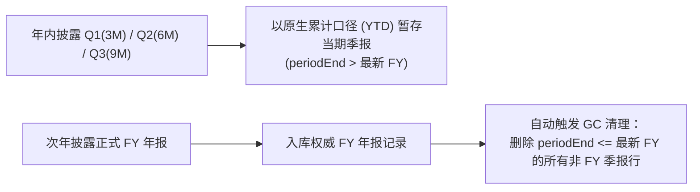

# 财务数据模型与资本配置体系收官治理方案 (fix.md)

> **版本**：v2026-10-17 (Rev.2 - 经 Reviewer 严格代码与测试门禁穿透审查修订版)  
> **定位**：基于全库 3,678 家公司（Phase 1 + Phase 2）全量回填完成后的真实数据审计与代码穿透审查，针对 **拆股历史口径撕裂**、**外延并购 (M&A) 资本配置拼图缺失**、**场外 ADR 与新近 IPO 次新股断层**、以及 **历史季报冗余膨胀（占库 65.4%）** 四大核心问题的第一性原理根因分析、6 大工程防坑补丁与分步实施规约。  
> **关联顶层规范**：[DATA.md](file:///Users/rafael/R129/buffett-tribe/DATA.md) ｜ [handoff.md](file:///Users/rafael/R129/buffett-tribe/handoff.md)

---

## 目录

1. [全景诊断摘要与四大工程决断](#一全景诊断摘要与四大工程决断)
2. [Reviewer 穿透审查拦截的 6 大工程陷阱与防护补丁](#二reviewer-穿透审查拦截的-6-大工程陷阱与防护补丁)
3. [专项一 (Step 1)：拆股（Stock Split）历史股数与每股指标口径撕裂根治方案](#三专项一-step-1拆股stock-split历史股数与每股指标口径撕裂根治方案)
4. [专项二 (Step 2)：外延并购（M&A）纳入巴菲特资本配置框架实施方案](#四专项二-step-2外延并购ma纳入巴菲特资本配置框架实施方案)
5. [专项三 (Step 3)：场外 ADR 与新近 IPO 次新股（招股书/10-Q）三级兜底方案](#五专项三-step-3场外-adr-与新近-ipo-次新股招股书10-q三级兜底方案)
6. [专项四 (Step 4)：季报滚动窗口生命周期（年报接管即清理）与数据库瘦身方案](#六专项四-step-4季报滚动窗口生命周期年报接管即清理与数据库瘦身方案)
7. [分步实施 Checklist 与量化验收标准](#七分步实施-checklist-与量化验收标准)

---

## 一、全景诊断摘要与四大工程决断

在完成全库 3,678 家公司（Phase 2: 1,243 家；Phase 1: 2,435 家）的三大财务报表全量回填后，通过对生产数据库 `Financial` 表（共 **3,135,710 行**）与前端渲染链路的穿透式体检，定位出以下四大系统性结构问题，并确立对应的根治决断：

| 编号 | 核心问题领域 | 生产库实证与病灶根因 | 架构决断与修复策略（含 Reviewer 修正） | 是否需重跑全库？ |
| :--- | :--- | :--- | :--- | :--- |
| **Step 1** | **拆股历史股数断崖**<br>（如 `AVGO`、`NVDA`、`AMZN`、`DECK`） | SEC 10-K **利润表回溯 3 年**（$T, T-1, T-2$ 已复权），但**资产负债表仅回溯 2 年**（$T, T-1$ 已复权，$T-2$ 留在旧 10-K 未复权），导致拆股前第 2 年必现**同一年内期末股数未复权、加权股数与 EPS 已复权**的撕裂；且 `valuation-metrics.ts` 旁路直查未复权 EPS 导致拆股前历史 PE 分位算小 10 倍。 | **两阶段同源复权 + 同年锚点对齐 + 全链路收口**：<br>① 利润表内部用加权股数与同币种 EPS 自洽复权建立全历史 Post-Split 锚点；<br>② 资产负债表期末股数向同年加权股数锚点对齐；<br>③ 抽离公共纯函数同时接入 `getCompanyFinancials`、`valuation-metrics.ts` 与 Agent 工具，移除 `value-line-data.ts` 重复实现。 | **否**<br>（读取层纯函数归一化，即时生效） |
| **Step 2** | **并购 (M&A) 缺席资本配置**<br>（如 `AVGO` 259.8 亿并购 VMware） | 标准字典已定义 `PurchaseSaleOfBusinessNet`，且**库内已成功抓取 1,658 家公司共 6,630 行年度并购现金流数据**，但前端未接入展示；且 SEC 与 `yfinance` 的并购正负号方向相反。 | **打通巴菲特五大资本配置杠杆 + 统一符号契约**：<br>① 确立入库与读取符号契约：**正数 = 外延并购净现金支出，负数 = 剥离出售业务净现金回笼**（严禁无脑 `Math.abs`）；<br>② 接入 `value-line-data.ts`、`capital-allocation-metrics.ts` 与 `CapitalAllocationView.tsx`（瀑布流卡片 + 历年明细表新增「外延并购」列）。 | **否**<br>（库内已有 6,630 行现成数据，直接点亮） |
| **Step 3** | **17 家美股特殊标的断层**<br>（10 家 ADR/非XBRL + 7 家 2026 新 IPO） | ① 10 家 ADR（`BMWKY`、`GALDY` 等）`fetch-us-financials-yf.py` 写了旧字段名且存在母国币种/ADR 换股比例错配；<br>② 7 家新 IPO（`SPCX`、`CBRS` 等）尚无首份 `10-K` (`FY`)，仅在库内有招股书与 `10-Q` (`Q1/Q2`)。 | **三级数据源 Waterfall + 独立季报快照通道**：<br>① 修正 `fetch-us-financials-yf.py` 标准字典映射、真实 `financialCurrency` 标记与 ADR 份额对齐；<br>② **保持 `getCompanyFinancials()` 仅返回 `FY` 的契约纯粹性**，新增独立 `getLatestInterimFinancial()` 承载新 IPO / 当年最新季报快照，严防单季数据混入年度序列导致 PE 虚高 4 倍、ROE 缩水 3/4。 | **仅需重跑 17 家**<br>（耗时约 1 分钟） |
| **Step 4** | **季度数据冗余膨胀**<br>（占全库 65.4%，共 204.8 万行） | `Financial` 表中 `Q1~Q4/H1~H2` 高达 **2,048,868 行**，生产环境 0 处消费历史季报（`ttm-metrics.ts` 为死代码），但黄金测试集 `eval-golden-18.ts` 规则 D5 仍硬性检查历史 `Q1~Q4`。 | **滚动窗口生命周期 + 黄金门禁同步升级**：<br>① 历史已完结财年只存 `FY`，最新未完结财年统一以**年初至今累计（YTD）**暂存最新季报；<br>② 当年 `FY` 入库自动 GC 清理该年过往季报；<br>③ 同步升级 `eval-golden-18.ts` (D5) 与 `golden-benchmark-18.test.ts`，移除 `ttm-metrics.ts` 及其单测。 | **否**<br>（1 条 SQL 瘦身 + 门禁与脚本收口） |

---

## 二、Reviewer 穿透审查拦截的 6 大工程陷阱与防护补丁

在实施编码前，通过对照全量代码与测试集进行严格 Reviewer 审查，拦截并修正以下 6 个隐藏陷阱：

| 陷阱编号 | 严重度 | 涉及步骤与代码位置 | 隐藏工程陷阱描述 | 强制防护补丁（已合入本方案） |
| :--- | :---: | :--- | :--- | :--- |
| **Trap 1** | 🔴 **P0** | **Step 4**<br>[`scripts/eval-golden-18.ts:1378`](file:///Users/rafael/R129/buffett-tribe/scripts/eval-golden-18.ts#L1378-L1435)<br>[`tests/golden-benchmark-18.test.ts:121`](file:///Users/rafael/R129/buffett-tribe/tests/golden-benchmark-18.test.ts#L121)<br>[`tests/ttm-metrics.test.ts`](file:///Users/rafael/R129/buffett-tribe/tests/ttm-metrics.test.ts) | 直接清理历史 `Q1~Q4` 和删除 `src/lib/ttm-metrics.ts`，会立刻触发 `eval-golden-18.ts` 中 **D5 门禁（要求 8 家 A 股 + 2 家港股必须具备完整历史 `Q1~Q4` 且和等于 `FY`）P0 报错**，并导致 `tests/ttm-metrics.test.ts` 编译失败。 | 1. 删除 `src/lib/ttm-metrics.ts` 时同步删除 `tests/ttm-metrics.test.ts`；<br>2. 将 `eval-golden-18.ts` 与 `golden-benchmark-18.test.ts` 中的 **D5 规则升级为「季报滚动生命周期契约校验」**：断言已完结 `FY` 的历史年份 `0` 残留冗余季报行。 |
| **Trap 2** | 🔴 **P0** | **Step 3**<br>[`src/lib/company-data.ts:413`](file:///Users/rafael/R129/buffett-tribe/src/lib/company-data.ts#L413-L485)<br>[`src/lib/value-line-data.ts:596`](file:///Users/rafael/R129/buffett-tribe/src/lib/value-line-data.ts#L596-L606) | 若在 `getCompanyFinancials()` 无 `FY` 时直接把 `Q1/Q2` 混入返回：① 同年 `Q1` 与 `Q2` 按 `year` 分组会发生 Map 覆盖碰撞；② 下游 `value-line-data.ts` 默认每项均为 12M 全年数据，拿 3M 单季 `EPS` 和 `NetIncome` 直接算出的 **PE 会虚高 4 倍、ROE 会缩水至 1/4**！ | **严禁把季报伪装成 `FY` 混入 `getCompanyFinancials()`**！<br>保持 `getCompanyFinancials()` 严格只返回 `FY`；新增独立函数 `getLatestInterimFinancial(companyId)` 读取最新未完结季报快照，在看板与新 IPO 页面中明确标注报告期（如 `2026 Q2 (YTD)`），且不参与非年化的 5Y ROE / 历史 PE 分位计算。 |
| **Trap 3** | 🔴 **P0** | **Step 1**<br>[`src/lib/valuation-metrics.ts:112`](file:///Users/rafael/R129/buffett-tribe/src/lib/valuation-metrics.ts#L112-L210)<br>[`src/lib/value-line-data.ts:642`](file:///Users/rafael/R129/buffett-tribe/src/lib/value-line-data.ts#L642) | ① `valuation-metrics.ts` 的 `fetchAnnualFundamentals()` 绕过 `getCompanyFinancials()` 直查 `prisma.financial.findMany`，拿**未复权历史 EPS** 与 Yahoo 前复权股价算历史 PE，导致拆股公司历史 PE 算小 10 倍；<br>② 若阶段 2（同年期末股数对齐）独立允许 `1.5x`（$\pm 15\%$ 容差），会把年内真实定增/配股/换股并购 30% 的公司误判为拆股抹平。 | 1. 将 `normalizeFinancialYearsStockSplits` 抽为公共纯函数，**同时接入 `getCompanyFinancials()`、`valuation-metrics.ts` 与 `pi-gateway`**，移除 `value-line-data.ts` 重复实现；<br>2. **阶段 1 支持正向拆股与逆向合股（Reverse Split）**；**阶段 2 严禁独立触发 `1.5x` 小因子**，仅使用阶段 1 已证实的拆股因子（或 $\ge 2\text{x}$ 整数倍），100% 保护真实增发稀释记录。 |
| **Trap 4** | 🟡 **P1** | **Step 2**<br>[`scripts/fetch-us-financials-yf.py`](file:///Users/rafael/R129/buffett-tribe/scripts/fetch-us-financials-yf.py)<br>[`src/components/CapitalAllocationView.tsx:379`](file:///Users/rafael/R129/buffett-tribe/src/components/CapitalAllocationView.tsx#L379-L501) | ① SEC 的 `PaymentsToAcquireBusinessesNetOfCashAcquired` 以正数表示并购流出，而 `yfinance` 的 `Net Business Purchase And Sale` 以负数表示并购流出、正数表示变卖子公司回笼；<br>② 若将未采到的并购强行填 `0` 会把“未单列披露”粉饰成“零并购”；若瀑布流不扣减并购，会严重高估 FCF 结余。 | 1. 统一 `PurchaseSaleOfBusinessNet` 符号契约：**正数 = 外延并购净现金支出，负数 = 处置业务净现金回笼**（`yfinance` 入库取反 `-val`，**严禁底层强填 `0` 或无脑 `Math.abs`**）；<br>2. 瀑布流恒等式升级为 `FCF - 外延并购 - 回购 - 分红 = 自由现金流净结余`，并联动解释换股并购/股权激励对期末股本的影响。 |
| **Trap 5** | 🟡 **P1** | **Step 3**<br>[`scripts/fetch-us-financials-yf.py`](file:///Users/rafael/R129/buffett-tribe/scripts/fetch-us-financials-yf.py)<br>[`src/lib/fx-rates-core.ts`](file:///Users/rafael/R129/buffett-tribe/src/lib/fx-rates-core.ts) | 10 家美股 ADR/OTC（如 `BMWKY` 欧元、`NDEKF` 日元、`IBN` 印度卢比）在 `yfinance` 中的财报为**母国记账币种 + 母公司普通股数**，而美股股价为 **USD + ADR 份额**；且若直接拿两处股数相除，会因多类别股/优先股差异算出 `1.18` 等怪异非标浮点数污染 EPS。 | 1. `fetch-us-financials-yf.py` 强制从 `ticker.info["financialCurrency"]` 提取真实财报币种写入 `unit`；<br>2. **ADR Ratio 强制吸附至金融市场标准整数/简单分数集合** $\{0.1, 0.2, 0.25, 0.5, 1, 2, 3, 4, 5, 8, 10, 20\}$（误差 $\le 5\%$），未命中标准值时保持 `1:1` 不做人为缩放。 |
| **Trap 6** | 🟡 **P1** | **Step 4**<br>[`scripts/import-us-quarterly-financials.ts`](file:///Users/rafael/R129/buffett-tribe/scripts/import-us-quarterly-financials.ts)<br>[`scripts/fetch-cn-hk-financials-ak.py`](file:///Users/rafael/R129/buffett-tribe/scripts/fetch-cn-hk-financials-ak.py) | 原美股 `10-Q` 脚本把 `Q2/Q3` 差分成了 3 个月单季值，而 A/港股季报原生为年初至今累计值（YTD：一季报 3M、中报 6M、三季报 9M），跨市场同一 `periodType` 语义分裂。 | 全市场（US / CN / HK）针对最新未完结财年的暂存季报，**统一采用「年初至今累计（YTD：Q1=3M, Q2=6M, Q3=9M）」原生披露口径**，零人工减法差分，消除跨市场口径分裂。 |

---

## 三、专项一 (Step 1)：拆股（Stock Split）历史股数与每股指标口径撕裂根治方案

### 1. 问题现象

以博通（Broadcom, `AVGO`，2024 年 7 月实施 1 拆 10 拆股）为例，在公司主页《历年资本配置与股本变化明细》中，股数出现非自然的 10 倍断崖跳变：

| 财年 | 经营现金流 (OCF) | 资本开支 (CapEx) | 自由现金流 (FCF) | 股票回购 | 现金分红 | 股数 (亿股) | ROE | 口径状态 |
| :--- | ---: | ---: | ---: | ---: | ---: | ---: | ---: | :--- |
| **FY2025** | 275.4 | -6.2 | 269.1 | 24.5 | 111.4 | **47.4** | 31.0% | 拆股后口径 (Post-split) |
| **FY2024** | 199.6 | -5.5 | 194.1 | 71.8 | 98.1 | **46.9** | 12.9% | 拆股后口径 (含收购 VMware 增发 ~5.5 亿股) |
| **FY2023** | 180.9 | -4.5 | 176.3 | 58.2 | 76.5 | **41.4** | 60.3% | 拆股后口径 (Post-split) |
| **FY2022** | 167.4 | -4.2 | 163.1 | 70.0 | 70.3 | **4.2** | 47.1% | ❌ **拆股前口径 (Pre-split，未复权)** |
| **FY2021** | 137.6 | -4.4 | 133.2 | 0.0 | 62.1 | **4.1** | 26.4% | ❌ **拆股前口径 (Pre-split，未复权)** |

### 2. 第一性原理根因（First-Principles Root Cause）

#### (1) SEC 10-K「利润表 3 年 vs 资产负债表 2 年」的非对称追溯规则
系统在从 SEC EDGAR `companyfacts` 提取各年度财务事实时（`selectBestFactCandidate`），对每个科目独立选取 `latestFiled`（即最新一份 10-K 年报中披露的该期数值）。根据 SEC 10-K 法定披露规则：
- **利润表（Income Statement）** 强制披露 **3 个财年**（$T, T-1, T-2$）；
- **资产负债表（Balance Sheet）** 只强制披露 **2 个财年**（$T, T-1$）。

当一家公司在第 $T$ 年发生 $1:k$ 拆股时，第 $T$ 年的 10-K 会追溯重述（Retrospectively Restate）报表中涵盖的所有历史对比期：
1. **利润表科目**（加权平均股数 `WeightedAverageShares`、`WeightedAverageSharesDiluted` 及 `EPSBasic`、`EPSDiluted`）被往前追溯重述了 **2 年**（即 $T-1$ 和 $T-2$ 均已按拆股后口径调整）；
2. **资产负债表科目**（期末流通股数 `CommonStockSharesOutstanding`）只被往前追溯重述了 **1 年**（只有 $T-1$ 按拆股后口径调整；而 **$T-2$ 根本不在第 $T$ 年的资产负债表上**，它在 SEC XBRL 中的最新记录停留在第 $T-1$ 年尚未拆股时提交的 10-K 中）。

#### (2) 数据库铁证：全市场拆股标的普遍存在「$T-2$ 年同年口径撕裂」

##### 案例 1：博通 `AVGO`（2024 年 7 月 1 拆 10）
| 报告期 (`periodEnd`) | 资产负债表期末股数<br>`CommonStockSharesOutstanding` | 利润表稀释加权股数<br>`WeightedAverageSharesDiluted` | 稀释每股收益<br>`EPSDiluted` | 现象解析 |
| :--- | ---: | ---: | ---: | :--- |
| `2025-11-02` (FY25) | `4,741,000,000` (47.41亿) | `4,853,000,000` (48.53亿) | `4.77` | 全部为拆股后口径 |
| `2024-11-03` (FY24) | `4,686,000,000` (46.86亿) | `4,778,000,000` (47.78亿) | `1.23` | 全部为拆股后口径 |
| `2023-10-29` (FY23) | `4,139,000,000` (41.39亿) | `4,272,000,000` (42.72亿) | `3.30` | 由 FY24 10-K 追溯为拆股后口径 |
| **`2022-10-30` (FY22)** | **`418,000,000` (4.18亿)** ❌ | **`4,232,000,000` (42.32亿)** ✅ | **`2.65`** ✅ | **同年撕裂：期末股数差 10 倍** |
| `2021-10-31` (FY21) | `413,000,000` (4.13亿) ❌ | `429,000,000` (4.29亿) ❌ | `15.00` ❌ | 全部停留在拆股前口径 |
| `2020-11-01` (FY20) | `407,000,000` (4.07亿) ❌ | `421,000,000` (4.21亿) ❌ | `6.33` ❌ | 全部停留在拆股前口径 |

##### 案例 2：英伟达 `NVDA`（2024 年 6 月 1 拆 10，2021 年 7 月 1 拆 4）
| 报告期 (`periodEnd`) | `CommonStockSharesOutstanding` | `WeightedAverageSharesDiluted` | `EPSDiluted` | 现象解析 |
| :--- | ---: | ---: | ---: | :--- |
| `2026-01-25` | `24,304,000,000` (243.0亿) | `24,514,000,000` (245.1亿) | `4.90` | 全部为最新口径 |
| `2025-01-26` | `24,477,000,000` (244.8亿) | `24,804,000,000` (248.0亿) | `2.94` | 全部为最新口径 |
| `2024-01-28` | `24,643,000,000` (246.4亿) | `24,940,000,000` (249.4亿) | `1.19` | 全部为最新口径 |
| **`2023-01-29`** | **`2,466,000,000` (24.7亿)** ❌ | **`25,070,000,000` (250.7亿)** ✅ | **`0.17`** ✅ | **同年撕裂：期末股数未复权 10x** |
| `2022-01-30` | `2,506,000,000` (25.1亿) ❌ | `2,535,000,000` (25.4亿) ❌ | `3.85` ❌ | 全部未复权 10x |
| **`2020-01-26`** | **`612,000,000` (6.1亿)** ❌ | **`2,472,000,000` (24.7亿)** ⚠️ | **`1.13`** ⚠️ | **二次撕裂：期末股数连 2021 的 4x 也没复权** |

##### 案例 3：亚马逊 `AMZN`（2022 年 6 月 1 拆 20）与 Deckers `DECK`（2024 年 9 月 1 拆 6）
- **AMZN (`2020-12-31`)**：`CommonStockSharesOutstanding` = `5.03 亿`（拆股前），而同年 `WeightedAverageSharesDiluted` = `101.98 亿`（拆股后），**同年相差 20 倍**。
- **DECK (`2023-03-31`)**：`CommonStockSharesOutstanding` = `0.262 亿`（拆股前），而同年 `WeightedAverageSharesDiluted` = `1.601 亿`（拆股后），**同年相差 6 倍**。

#### (3) 现有拆股检测失效的四大原因
1. **错误的同年度口径一致性假设**：[`src/lib/financial-math.ts`](file:///Users/rafael/R129/buffett-tribe/src/lib/financial-math.ts#L38-L66) 用 `CommonStockSharesOutstanding`（断崖在 $T-2 \to T-1$）去和 `EPSDiluted`（断崖在 $T-3 \to T-2$）做跨年交叉验证，两边断崖错位 1 年，导致算法误判“非拆股”并丢弃拆股因子。
2. **字段名遗留拼写 Bug**：[`src/lib/value-line-data.ts`](file:///Users/rafael/R129/buffett-tribe/src/lib/value-line-data.ts#L449) 尝试读取 `"WeightedAverageNumberOfDilutedSharesOutstanding"`，而标准字典 key 为 `"WeightedAverageSharesDiluted"` 和 `"WeightedAverageShares"`。
3. **旁路直查导致历史 PE 分位失真**：[`src/lib/valuation-metrics.ts`](file:///Users/rafael/R129/buffett-tribe/src/lib/valuation-metrics.ts#L112-L210) 的 `fetchAnnualFundamentals()` 绕过了 `getCompanyFinancials()` 直接查库，拿未复权的 `EPSDiluted` 与前复权股价计算 5 年历史 PE，导致拆股前历史 PE 被算小 $k$ 倍。
4. **复权位置过浅**：三大报表视图（`company-financial-dashboard.ts`）与 AI Agent 工具（`get-company-financials.ts`）均未受益。

### 3. 具体修复步骤（两阶段同源复权 + 同年受控锚点对齐 + 全链路收口）

1. **阶段 1：利润表序列自洽复权（支持正向拆股与逆向合股，建立全历史 Post-Split 基准锚点）**
   - 对每一年 $t$，构建利润表同源参考股数：`refWeightedShares = WeightedAverageSharesDiluted ?? WeightedAverageShares ?? impliedShares`（仅当 `NetIncome` 与 `EPSDiluted` 同币种且同正负时才允许计算 `impliedShares = NetIncome / EPSDiluted`）。
   - 从最新财年向历史财年逐年回溯（$i = N-2 \dots 0$），使用同属 3 年回溯期的 `(refWeightedShares, EPSDiluted, NetIncome)` 检测相邻年份 $i \to i+1$ 的拆股/合股因子 $k \in \text{SPLIT\_CANDIDATES}$（正向拆股 $\{1.5, 2, 3, 4, 5, 6, 7, 8, 10, 15, 20, 25, 50\}$，逆向合股 $\{0.5, 0.25, 0.2, 0.125, 0.1, 0.05\}$，要求股数跳变与 EPS 反向跳变双重验证）。
   - 一旦确认因子 $k$，记录进该公司的已证实拆股因子集合，并将 $\le i$ 的所有历史年份的 `WeightedAverageShares`、`WeightedAverageSharesDiluted` 乘以 $k$，将 `EPSBasic`、`EPSDiluted`、`DividendPerShare` 除以 $k$（支持 NVDA 等多次累积拆股）。
2. **阶段 2：资产负债表期末流通股向同年基准锚点受控对齐（严防误伤年内增发稀释）**
   - 对每一年 $t$ 的 `CommonStockSharesOutstanding`，与阶段 1 复权后的同年加权股数锚点 $\text{AnchorShares}_t$ 计算比值 $r_t = \frac{\text{AnchorShares}_t}{\text{CommonStockSharesOutstanding}_t}$。
   - **金融风控护栏（防止把年内增发/配股 30% 误判为 `1.5x` 拆股）**：阶段 2 仅允许匹配 **阶段 1 已证实的拆股因子（及其累积乘积，如 $4 \times 10 = 40$）** 或 **$\ge 2\text{x}$ 的整数拆股/合股因子**（严禁在阶段 2 独立触发 `1.5x`），允许 $\pm 15\%$ 年内自然股本变动容差；命中后将该年的 `CommonStockSharesOutstanding` 乘以 $k$。
   - 若某年无加权股数/EPS 锚点，则回退至相邻年份 `CommonStockSharesOutstanding` 跳变检测（同样限定 $\ge 2\text{x}$ 因子）。
3. **阶段 3：下沉至所有数据出口并消除重复调用**
   - 在 [`src/lib/financial-math.ts`](file:///Users/rafael/R129/buffett-tribe/src/lib/financial-math.ts) 实现统一的 `normalizeFinancialYearsStockSplits(years)`；
   - 在 [`src/lib/company-data.ts`](file:///Users/rafael/R129/buffett-tribe/src/lib/company-data.ts#L413) 的 `getCompanyFinancials()` 返回前统一执行；
   - 在 [`src/lib/valuation-metrics.ts`](file:///Users/rafael/R129/buffett-tribe/src/lib/valuation-metrics.ts#L112) 的 `fetchAnnualFundamentals()` 中同步调用该复权函数，彻底修复拆股标的的 5 年历史 PE 分位计算；
   - 在 [`src/lib/value-line-data.ts`](file:///Users/rafael/R129/buffett-tribe/src/lib/value-line-data.ts) 中修正 `"WeightedAverageSharesDiluted"` 字段名，并移除 `L642` 冗余的旧版 `normalizeAnnualsStockSplits` 调用；
   - 在 [`services/pi-gateway/src/tools/get-company-financials.ts`](file:///Users/rafael/R129/buffett-tribe/services/pi-gateway/src/tools/get-company-financials.ts) 中同步调用。

---

## 四、专项二 (Step 2)：外延并购（M&A）纳入巴菲特资本配置框架实施方案

### 1. 背景、数据基础与符号/缺失值契约（Trap 4 防护）

在巴菲特资本配置框架中，企业经营现金流（OCF）的核心去向包含 **内生资本开支（CapEx）**、**外延并购（M&A）**、**股票回购（Buybacks）** 与 **现金分红（Dividends）**。
- **生产库现状**：标准字典 [`src/lib/canonical-financial-dictionary.ts`](file:///Users/rafael/R129/buffett-tribe/src/lib/canonical-financial-dictionary.ts#L2398-L2421) 已定义 `PurchaseSaleOfBusinessNet`（收购与处置业务/子公司净现金），**生产库已有 1,658 家公司的 6,630 行 `PurchaseSaleOfBusinessNet` 年度记录**（如博通 `AVGO` FY2024 收购 VMware 支付净现金 **259.78 亿美元**，FY2020 收购 Symantec 支付 **108.72 亿美元**）。
- **强制符号与防污染契约**：
  1. **符号约定**：统一规定 `PurchaseSaleOfBusinessNet` 的标准方向与 `ShareRepurchaseAmt`、`DividendsPaid` 对齐——**正数（`> 0`）表示外延并购净现金支出**，**负数（`< 0`）表示出售/剥离业务净现金回笼**。SEC XBRL 的 `PaymentsToAcquireBusinessesNetOfCashAcquired` 天然以正数表示并购现金流出；`yfinance` 的 `"Net Business Purchase And Sale"` 以负数表示并购现金流出、正数表示出售回笼，因此在 `scripts/fetch-us-financials-yf.py` 入库时必须**取反（`-val`）**，严禁在前端无脑调用 `Math.abs()`。
  2. **未披露不强填 `0`**：**不将** `PurchaseSaleOfBusinessNet` 加入 `OPTIONAL_ZERO_DEFAULT_CASH_FLOW_ITEMS`，严格保持未披露年份为 `null`（明细表显示 `—`），杜绝把“未单列披露”粉饰成“零并购”。

### 2. 具体实现步骤

1. **数据提取层（[`src/lib/value-line-data.ts`](file:///Users/rafael/R129/buffett-tribe/src/lib/value-line-data.ts)）**：
   - 在 `ValueLineAnnualData` 类型中新增 `acquisitionsAmt: number | null`，从 `items.PurchaseSaleOfBusinessNet` 提取并经 `normalizeFinancialItems` 汇率对齐。
2. **指标计算层（[`src/lib/capital-allocation-metrics.ts`](file:///Users/rafael/R129/buffett-tribe/src/lib/capital-allocation-metrics.ts)）**：
   - 在 `CapitalAllocationAnnualInput` 中支持 `acquisitionsAmt?: number | null`；
   - 在 `CapitalAllocationStats` 中新增：
     - `cumAcquisitions: number | null`（区间已披露外延并购净支出合计）；
     - `acquisitionsCoverage: number`（有效披露财年数）；
     - `acquisitionsPct: number | null`（当 `cumAcquisitions > 0` 且 `cumFcf > 0` 时，计算累计并购占累计 FCF 的比例）；
     - 升级瀑布流终端结余 `fcfAfterDistributions` 计算：当存在外延并购净支出（`cumAcquisitions > 0`）时，从 `cumFcf` 中一并扣减已披露并购净支出（$\text{FCF} - \text{外延并购} - \text{回购} - \text{分红}$），真实反映内生自由现金流在覆盖外延并购与股东返还后的净结余或外部融资缺口。
3. **视图展示层（[`src/components/CapitalAllocationView.tsx`](file:///Users/rafael/R129/buffett-tribe/src/components/CapitalAllocationView.tsx)）**：
   - **《经营现金流 (OCF) 资本去向》瀑布流**：当区间存在外延并购净支出（`cumAcquisitions != null && cumAcquisitions > 0`）时，在 `3. 自由现金流 (FCF)` 后新增 **`外延并购 (M&A)`** 扣减卡（显示金额与 `占 FCF X%`），并纳入最终结余扣减；
   - **《历年资本配置与股本变化明细》表格**：在 `自由现金流 (FCF)` 与 `股票回购` 之间新增 **`外延并购 (M&A)`** 列（正数展示并购净支出，负数展示剥离净回笼，未披露显示 `—`），并在股本走势说明中点明“股数净变动综合反映股票回购注销、换股并购增发与股权激励稀释”（直观解释博通 FY24 支付 259.8 亿现金并购 + 换股增发使股本升至 46.9 亿股）。

---

## 五、专项三 (Step 3)：场外 ADR 与新近 IPO 次新股（招股书/10-Q）三级兜底方案

### 1. 17 家特殊标的断层诊断

全库 1,678 家美股中，未通过 SEC 10-K XBRL 标准通道获取年报的 **17 家公司** 分为两类：
1. **A 类：场外 ADR / 外国非 XBRL 发行人（10 家）**：
   - 标的：`BMWKY`, `CSLLY`, `DLMAY`, `EONGY`, `GALDY`, `GWLIF`, `NDEKF`, `IBN`, `BSP`, `PSUS`。
   - 根因：库内已通过 [`scripts/import-us-financials-yf.ts`](file:///Users/rafael/R129/buffett-tribe/scripts/import-us-financials-yf.ts) 导入了 `yfinance` 财报，但 [`scripts/fetch-us-financials-yf.py`](file:///Users/rafael/R129/buffett-tribe/scripts/fetch-us-financials-yf.py) 存在三处缺陷：① 使用了非标字段名（`DilutedEPS`、`BasicEPS`、`StockholdersEquity`）；② 缺失股数、回购、并购映射；③ 未区分母国记账币种（`financialCurrency`，如欧元 `EUR`、日元 `JPY`、印度卢比 `INR`）与美股 ADR 换股比例（ADR Ratio）。
2. **B 类：2026 新近 IPO / 分拆上市次新股（7 家）**：
   - 标的：`SPCX`, `CBRS`, `FRVO`, `HONA`, `INIO`, `QNT`, `USDE`。
   - 根因：库内已有 `us-prospectus`（招股书章节）及 `10-Q`（`Q1/Q2` 财务行），但尚无首份 `10-K` (`FY`)。

### 2. 具体实现步骤（含 Trap 2 & Trap 5 防护）

1. **升级 `fetch-us-financials-yf.py`（标准字典映射 + 真实财报币种 + 标准 ADR 比例吸附）**：
   - **对齐标准字段名**：
     - `"Diluted EPS"` $\to$ `"EPSDiluted"`、`"Basic EPS"` $\to$ `"EPSBasic"`、`"Stockholders Equity"` / `"Common Stock Equity"` $\to$ `"ShareholdersEquity"`；
     - `"Ordinary Shares Number"` / `"Share Issued"` $\to$ `"CommonStockSharesOutstanding"`、`"Diluted Average Shares"` $\to$ `"WeightedAverageSharesDiluted"`、`"Basic Average Shares"` $\to$ `"WeightedAverageShares"`；
     - `"Repurchase Of Capital Stock"` $\to$ `"ShareRepurchaseAmt"`（取绝对值正数）、`"Net Business Purchase And Sale"` $\to$ `"PurchaseSaleOfBusinessNet"`（取反 `-val`，正数代表并购支出）。
   - **写入真实财报币种 (`financialCurrency`)**：
     - 从 `ticker.info.get("financialCurrency") or ticker.info.get("currency") or "USD"` 读取真实记账币种（如 `EUR`, `JPY`, `INR`, `CHF`, `CAD`, `AUD`）写入金额科目的 `unit`，并将公司实体的 `reportingCurrency` 同步更新为该币种，由下游 [`src/lib/fx-rates.ts`](file:///Users/rafael/R129/buffett-tribe/src/lib/fx-rates.ts) 自动通过 `${CODE}USD=X` 折算为交易币种 `USD`。
   - **ADR 换股比例（ADR Ratio）标准值吸附与修正**：
     - 比对 `ticker.info.get("sharesOutstanding")`（ADR 股数）与最新财报 `Ordinary Shares Number`（母公司普通股数）的原始比值，**强制向金融市场标准 ADR 比例集合 $\{0.1, 0.2, 0.25, 0.5, 1, 2, 3, 4, 5, 8, 10, 20\}$ 吸附（仅当相对误差 $\le 5\%$ 时生效）**；若命中标准非 1 比例 $\text{adrFactor}$，将入库股数乘以 $\text{adrFactor}$、每股指标除以 $\text{adrFactor}$；若未命中任何标准比例（如多类别股/优先股差异），严格保持 `1:1` 不做人为缩放。
   - **重跑 17 家美股标的**：清理旧的错误 key（`DilutedEPS`/`BasicEPS`/`StockholdersEquity`）并重新导入。
2. **在 `backfill-company-financials-fast.ts` 中接入 Tier-2 自动 Fallback**：
   - 当 SEC `companyfacts` 返回 404 或有效年报数为 0 时，自动降级调用 `importUsFinancialsFromYfinance(ticker)`，若仍无 `FY` 数据则自动提取最新 `10-Q` 季报。
3. **新增独立季报快照通道 `getLatestInterimFinancial()`（严守 `getCompanyFinancials` 年报契约纯粹性）**：
   - **保持 `getCompanyFinancials(companyId)` 严格只返回 `periodType: "FY"`**，绝不将 3M/6M 季报混入 `annuals` 数组（彻底杜绝同一年份 `Q1/Q2` 碰撞覆盖以及下游用单季 EPS/NetIncome 算错 4 倍 PE 和 1/4 ROE）；
   - 在 [`src/lib/company-data.ts`](file:///Users/rafael/R129/buffett-tribe/src/lib/company-data.ts) 中新增 `getLatestInterimFinancial(companyId)`：查询 `periodType != "FY"` 且 `periodEnd > max(FY.periodEnd)`（若无 `FY` 则取最新一期季报）的单期报表快照（携带明确的 `periodType` 如 `"Q2"` 与 `periodEnd`）；
   - 在三大财务报表看板（[`src/lib/company-financial-dashboard.ts`](file:///Users/rafael/R129/buffett-tribe/src/lib/company-financial-dashboard.ts)）与 Agent 工具中：若存在最新未结转季报快照（或次新股仅有季报快照），作为明确标注 `2026 Q2` 列独立追加在报表最右侧，供用户查阅最新财报进展与 LLM 分析，但不掺入历史 `FY` 年化比率均值计算。

---

## 六、专项四 (Step 4)：季报滚动窗口生命周期（年报接管即清理）与数据库瘦身方案

### 1. 现状病灶与黄金门禁冲突（Trap 1 & Trap 6 防护）

- 生产库 `Financial` 表总计 **3,135,710 行**，其中 `FY` 年报 **1,086,842 行（34.6%）**，而 `Q1~Q4 / H1~H2` 季度/半年度数据高达 **2,048,868 行（65.4%）**。
- 全站生产功能均基于 `FY` 年度序列构建，[`src/lib/ttm-metrics.ts`](file:///Users/rafael/R129/buffett-tribe/src/lib/ttm-metrics.ts) 在生产代码中 **0 处被调用**。
- 但 [`tests/ttm-metrics.test.ts`](file:///Users/rafael/R129/buffett-tribe/tests/ttm-metrics.test.ts) 仍测试该文件，且 [`scripts/eval-golden-18.ts`](file:///Users/rafael/R129/buffett-tribe/scripts/eval-golden-18.ts#L1378-L1435) 的 **D5 规则**和 [`tests/golden-benchmark-18.test.ts`](file:///Users/rafael/R129/buffett-tribe/tests/golden-benchmark-18.test.ts#L121) 仍硬性校验“历史年份必须具备 `Q1~Q4` 且四季之和等于 `FY`”。

### 2. 「年报永久锚定 + 当期季报 YTD 滚动暂存 + 年报就绪即清理」架构



### 3. 具体实现步骤

1. **统一全市场当期季报为「年初至今累计（YTD）」原生口径并改造采集脚本**：
   - 在 [`scripts/fetch-cn-hk-financials-ak.py`](file:///Users/rafael/R129/buffett-tribe/scripts/fetch-cn-hk-financials-ak.py) 中：历史已完结财年（已有 `12-31` / `001` 年报的年份）**只生成 `periodType = 'FY'` 记录**，彻底移除历史年份 `Q1~Q4` 和 `H1~H2` 的人工减法拆分逻辑；仅当存在 `periodEnd > max_fy_date`（或无 `FY` 的次新股）时，保留最新未完结财年的原生 YTD 季报快照；
   - 在 [`scripts/import-us-quarterly-financials.ts`](file:///Users/rafael/R129/buffett-tribe/scripts/import-us-quarterly-financials.ts) 中：仅拉取 `periodEnd > max_fy_date` 的最新未完结财年 `10-Q`，并保留原生披露值，不再对历史已完结年份生成 `Q1~Q3` 记录。
2. **在导入管线中内置“年报接管自动清理（GC on FY Arrival）”**：
   - 在 [`scripts/lib/upsert-financial-rows.ts`](file:///Users/rafael/R129/buffett-tribe/scripts/lib/upsert-financial-rows.ts) 中，当本次写入包含 `periodType === 'FY'` 的记录时，查询该实体在库内的最大 `FY` 报告期 $D_{\text{max\_fy}}$，自动执行清理：
     ```sql
     DELETE FROM "Financial"
     WHERE "entityId" = $1
       AND "periodType" <> 'FY'
       AND "periodEnd" <= $2;
     ```
3. **同步升级黄金测试集门禁与移除死代码（Trap 1 关键步骤）**：
   - 删除死代码 [`src/lib/ttm-metrics.ts`](file:///Users/rafael/R129/buffett-tribe/src/lib/ttm-metrics.ts) 及其对应的单元测试 [`tests/ttm-metrics.test.ts`](file:///Users/rafael/R129/buffett-tribe/tests/ttm-metrics.test.ts)；
   - 升级 [`scripts/eval-golden-18.ts`](file:///Users/rafael/R129/buffett-tribe/scripts/eval-golden-18.ts#L1378-L1435) 中的 **D5 规则**与 [`tests/golden-benchmark-18.test.ts`](file:///Users/rafael/R129/buffett-tribe/tests/golden-benchmark-18.test.ts#L121)：将原来的“强制要求历史 `Q1+Q2+Q3+Q4 = FY`”更新为**「D5 季报滚动生命周期洁净度门禁：凡已具备 `FY` 年报的历史财年（`periodEnd <= max_fy_date`），库内不得残留任何 `Q1~Q4 / H1~H2` 冗余记录」**。
4. **存量数据库一次性瘦身**：
   - 编写并执行受控清理脚本（支持 `--dry-run` 与 `--execute`）：全库删除所有满足 `periodType <> 'FY'` 且 `periodEnd <= 该公司最新 FY periodEnd` 的历史过时季报行（完整保留无 `FY` 次新股的季报以及任何 `periodEnd > 最新 FY periodEnd` 的当期最新季报）。

---

## 七、分步实施 Checklist 与量化验收标准

- [ ] **Step 1：拆股复权全链路落地与测试**
  - 实现两阶段同源复权（含逆向合股）与同年受控锚点对齐（阶段 2 严禁独立触发 `1.5x` 小因子，防误伤真实增发稀释），同时接入 `getCompanyFinancials`、`valuation-metrics.ts` 与 Agent 工具，移除 `value-line-data.ts` 重复实现；
  - 新增单元测试覆盖 `AVGO` (1:10)、`NVDA` (1:4 + 1:10)、`AMZN` (1:20)、`DECK` (1:6)、逆向合股及年内增发 30% 不误判场景。
- [ ] **Step 2：外延并购 (M&A) 接入资本配置**
  - 统一 `PurchaseSaleOfBusinessNet` 符号契约（正数=并购净支出，负数=出售业务净回笼，未披露保持 `null` 不强填 `0`）；
  - 打通 `value-line-data.ts` $\to$ `capital-allocation-metrics.ts`（纳入 FCF 瀑布流扣减） $\to$ `CapitalAllocationView.tsx`，验证 `AVGO`、`MSFT`、`DHR` 瀑布流与明细表准确展示并购金额及股本变动说明。
- [ ] **Step 3：17 家 ADR 与次新股修复**
  - 升级 `fetch-us-financials-yf.py`（标准字段映射 + `financialCurrency` 真实币种 + 标准 ADR Ratio 吸附），重跑 17 家公司；
  - 新增 `getLatestInterimFinancial()` 独立通道支持无 `FY` 次新股及当年最新季报展示，严保 `getCompanyFinancials` 年度序列纯粹性。
- [ ] **Step 4：季报生命周期收口、黄金门禁升级与数据库瘦身**
  - 升级 `eval-golden-18.ts` (D5) 与 `tests/golden-benchmark-18.test.ts`，删除 `src/lib/ttm-metrics.ts` 与 `tests/ttm-metrics.test.ts`；
  - 改造 `fetch-cn-hk-financials-ak.py` 与 `upsert-financial-rows.ts` 内置年报入库自动 GC（`periodEnd <= max_fy_date`）；
  - 执行存量历史冗余季报清理（释放 ~190 万+ 行冗余记录）；
  - 全量通过 `npm run lint`、`npm test`、`npm run build`。
