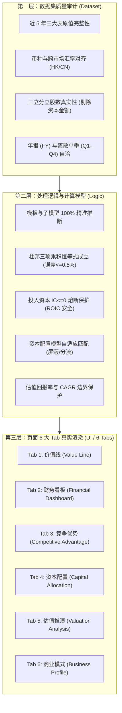
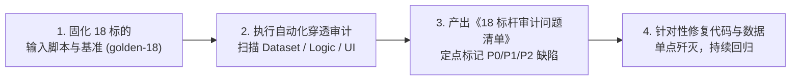

# 黄金测试集：18 标杆全链路穿透测试规范 (golden.md)

> **版本**：v2026-10-16  
> **核心原则**：**3 市场 × 6 模板精准正交；全量选自 Phase 2 深度标的；穿透「数据集 → 处理逻辑 → 页面展示」三层；杜绝假绿灯**  
> **关联设计**：[DATA.md](file:///Users/rafael/R129/buffett-tribe/DATA.md) | [handoff.md](file:///Users/rafael/R129/buffett-tribe/handoff.md)

---

## 目录

1. [设计定位与核心原则](#一设计定位与核心原则)
2. [18 家黄金标的遴选矩阵 (3 市场 × 6 模板)](#二18-家黄金标的遴选矩阵-3-市场--6-模板)
3. [三层穿透审计指标体系](#三三层穿透审计指标体系)
   - [第一层：数据集质量审计 (Dataset Layer)](#1-第一层数据集质量审计-dataset-layer)
   - [第二层：处理逻辑与计算模型审计 (Processing Logic Layer)](#2-第二层处理逻辑与计算模型审计-processing-logic-layer)
   - [第三层：页面 6 大 Tab 端到端渲染验收 (Page & UI Layer)](#3-第三层页面-6-大-tab-端到端渲染验收-page--ui-layer)
4. [缺陷分级与假绿灯识别标准](#四缺陷分级与假绿灯识别标准)
5. [自动化测试与落地执行计划](#五自动化测试与落地执行计划)

---

## 一、设计定位与核心原则

以往基于 100 家或 30 家晨星快照的泛化对比，容易陷入“局部对账、表面绿灯，但真实页面展示错漏百出”的陷阱。  
本测试集确立为 **Buffett-Tribe 核心黄金基准（Golden 18 Matrix）**，具备四大核心纪律：

1. **精准正交，拒绝偏颇**：
   严格覆盖 **美股 (US) / A 股 (CN) / 港股 (HK)** 三大核心市场，每个市场各选出代表 **6 类标准财务模板** 的 1 家典型旗舰标的，构建 $3 \times 6 = 18$ 家正交矩阵。
2. **全部依托 Phase 2 深度完备标的**：
   18 家公司全部选自已完成全量财报回补、具备 10-K 切片归档与深度研报的 Phase 2 实体库，基础事实层 100% 就绪。
3. **三层全链路穿透验收**：
   不只测“数据库有没有数”，而是从 **① 底层法定事实与币种（数据集） $\longrightarrow$ ② 模板推断与模型计算（逻辑） $\longrightarrow$ ③ 前台 6 大 Tab 真实渲染（页面展示）** 做全链路穿透，任何一环断裂即判定为 Fail。
4. **拒绝假绿灯**：
   模板不匹配必须判失败，严禁降级为警告；必需报表行必须严格断言存在；极端财务状态（如负净资产、投入资本 $\le 0$）必须有安全熔断。

---

## 二、18 家黄金标的遴选矩阵 (3 市场 × 6 模板)

| 模板代码 (`FinancialTemplate`) | 市场 | 标的代码及名称 | 库内事实行数 | 适用的子模型 (`subModel`) | 典型业务特征与极端检验点 |
| :--- | :---: | :--- | :---: | :---: | :--- |
| **`industrial`**<br>*(工商业制造/消费/科技)* | **US** | **AAPL**<br>Apple Inc. | 619 行 (FY: 367) | — | • 持续巨额回购导致**负净资产/负权益**极限用例<br>• 投入资本 $\text{IC} \le 0$ 时 ROIC 必须安全熔断返回 `null`<br>• 10-K 毛利润智能恒等式推导 |
| | **CN** | **600519.SS**<br>贵州茅台 | 2,236 行 (FY: 535) | `consumer_brand` | • 超高毛利（90%+）、无有息负债、高分红、零回购<br>• 近 5 年三大表原值及离散单季 `Q1~Q4` 做差做核验 |
| | **HK** | **0700.HK**<br>腾讯控股 | 1,274 行 (FY: 524) | `software_platform` | • 大额联营合营投资收益<br>• 港币股价与人民币（CNY）报表币种跨币折算核验 |
| **`bank`**<br>*(商业银行)* | **US** | **JPM**<br>JPMorgan Chase | 269 行 (FY: 269) | — | • **严禁计算毛利率与展示传统工商业现金流**<br>• 专属报表行：净利息收入、非利息收入、贷款总额、存款总额<br>• 资本配置切换为金融回报模式 |
| | **CN** | **600036.SS**<br>招商银行 | 1,734 行 (FY: 421) | — | • 零售银行标杆，利息净收入与信贷减值拨备核验<br>• 账面净资产 (PB - ROE) 核心估值通道验证 |
| | **HK** | **2388.HK**<br>中银香港 | 512 行 (FY: 221) | — | • 港股成熟商业信贷体系，高派息与信贷周期<br>• 报表币种（HKD）自洽核验 |
| **`insurance`**<br>*(保险精算)* | **US** | **PGR**<br>Progressive Corp | 252 行 (FY: 252) | `property_casualty` | • 美股纯财产险（P&C）标杆<br>• **专属核验赔付率/综合成本率（ClaimsRatio）**，禁止出现传统存货/毛利 |
| | **CN** | **601318.SS**<br>中国平安 | 1,692 行 (FY: 408) | `life_health` | • 综合金融与人身险/寿险标杆<br>• 浮存金与投资收益核验，**严格屏蔽财险专属赔付率** |
| | **HK** | **1299.HK**<br>友邦保险 | 564 行 (FY: 241) | `life_health` | • 跨国纯寿险巨头，新业务价值 (NBV) 与内含价值模式<br>• 多币种报表核验（USD 报表） |
| **`financial_services`**<br>*(非银金融/资管/交易所)* | **US** | **BX**<br>Blackstone Inc. | 248 行 (FY: 248) | `asset_mgmt` | • 轻资产资管旗舰，**专属核验 AUM 管理规模与平均费率**<br>• 业绩提成费与自由现金流波动模式 |
| | **CN** | **000776.SZ**<br>广发证券 | 1,651 行 (FY: 398) | `broker_exchange` | • 综合券商投行，佣金、承销与自营投资收益<br>• **严禁强套资管 AUM 考查** |
| | **HK** | **0388.HK**<br>香港交易所 | 479 行 (FY: 215) | `broker_exchange` | • 纯特许垄断交易平台，极高净利率，非 AUM 逻辑<br>• 交易费、结算费与投资净收益 |
| **`real_estate`**<br>*(房地产/REITs)* | **US** | **SPG**<br>Simon Property | 242 行 (FY: 242) | `reit_property` | • 商业持有型 REITs 标杆，重资产折旧<br>• **价值线必须屏蔽受折旧扭曲的传统工业 FCF**，专属呈现投资性物业与 FFO/NAV |
| | **CN** | **000069.SZ**<br>华侨城 A | 2,305 行 (FY: 561) | `developer` | • 典型开发商模式，**测试巨额合同负债/预收款与净负债率**<br>• 严禁套用持有型 REITs 的 FFO 估值 |
| | **HK** | **0016.HK**<br>新鸿基地产 | 542 行 (FY: 236) | `developer` | • 港股龙头地产旗舰（开发销售 + 商业租金双轮驱动）<br>• 合同负债、土地储备与投资物业综合呈现 |
| **`conglomerate`**<br>*(多元控股实业)* | **US** | **BRK-B**<br>Berkshire Hathaway | 373 行 (FY: 373) | — | • 巴菲特多元控股实业旗舰（保险浮存金 + 能源公用 + 铁路 + 制造零售）<br>• 考查 BPS 复合增速与分部加总 (SOTP) 逻辑 |
| | **CN** | **000009.SZ**<br>中国宝安 | 2,509 行 (FY: 610) | — | • A 股老牌多元实业控股（高科技、医药、生物等控股并表）<br>• 资本配置总账跨板块合并核验 |
| | **HK** | **0001.HK**<br>长和 | 485 行 (FY: 212) | — | • 李嘉诚全球多元控股旗舰（港口 + 零售 + 基建 + 电讯）<br>• 控股折价率与各分部现金流对冲 |

---

## 三、三层穿透审计指标体系



### 1. 第一层：数据集质量审计 (Dataset Layer)
- **D1. 法定科目覆盖度**：
  近 5 年年报必须完整包含该模板所必需的科目（工业类必需：`Revenue`, `NetIncome`, `OperatingCashFlow`, `TotalAssets`, `TotalLiabilities`, `ShareholdersEquity`, `CapEx`；银行类必需：`NetInterestIncome`, `NonInterestIncome`, `TotalDeposits`, `NetLoans` 等）。
- **D2. 币种与汇率审计**：
  港股人民币报表标的（如腾讯 `0700.HK`）必须正确登记 `reportingCurrency = CNY`，并在与港币股价联动计算市值与比率时使用当期基准汇率，严禁发生约 +17% 的系统性估值偏差。
- **D3. 股数防污染审计**：
  期末披露股数（`disclosed_period_end`）与加权股数（`weighted_average`）分立，A 股严禁将实收资本/股本金额当做股数。
- **D4. 离散单季做差自洽**：
  A 股及部分港股包含的 `Q1~Q4` 离散单季数据，四季度之和必须与全年 `FY` 误差在 $0.1\%$ 以内。

### 2. 第二层：处理逻辑与计算模型审计 (Processing Logic Layer)
- **L1. 模板与子模型判定**：
  `resolveFinancialModel` 对 18 家标的推断结果必须 100% 命中预期模板；SPG 必须为 `reit_property`，华侨城必须为 `developer`；BX 必须为 `asset_mgmt`，港交所必须为 `broker_exchange`；前进保险必须为 `property_casualty`，友邦必须为 `life_health`。
- **L2. 杜邦分析恒等式闭环**：
  工业类标的必须满足杜邦分解恒等式：  
  $$\left|\text{ROE} - (\text{净利率} \times \text{总资产周转率} \times \text{权益乘数})\right| \le 0.5\%$$
- **L3. 投入资本 (IC) 与 ROIC 熔断保护**：
  当投入资本 $\text{IC} = \text{有息债务} + \text{股东权益} - \text{超额现金} \le 0$（例如苹果负净资产）时，计算函数必须安全返回 `null`，严禁在前台呈现荒谬的负 ROIC 或除以零异常。
- **L4. 资本配置总账自适应**：
  银行、保险切换为金融回报模式（屏蔽传统工商业自由现金流）；REITs 切换为持有物业回报模式。

### 3. 第三层：页面 6 大 Tab 端到端渲染验收 (Page & UI Layer)
- **Tab 1: 价值线 (Value Line)**
  - EPS / BPS / DPS 历史趋势曲线无断裂、无 `NaN` 或 `Infinity`；
  - PB 通道下限严格为正；
  - 持有型 REITs（SPG）自适应屏蔽受折旧扭曲的传统工业 FCF CAGR，呈现真实的营收与资产复合增长。
- **Tab 2: 财务看板 (Financial Dashboard)**
  - 六大模板专属报表行自适应切换生效（银行无毛利、资管有费率、券商无 AUM、地产开发商有合同负债、REIT 有投资性物业）；
  - 严禁出现空白错位行或格式化溢出。
- **Tab 3: 竞争优势 (Competitive Advantage)**
  - 杜邦分析三层拆解图表与历史走势完整；
  - 适用 ROIC 标的正常展示超额收益率，不适用标的自适应展示解释文案。
- **Tab 4: 资本配置 (Capital Allocation)**
  - 股东回报总额（回购支出 + 现金分红）柱状对比图与现金流量表事实 100% 对齐；
  - 严禁无事实依据地给成熟企业打上“举债掏空”负面标签。
- **Tab 5: 估值推演 (Valuation Analysis)**
  - 情景预期年化回报率（乐观 / 中性 / 悲观）计算正常，折现率边界在安全区间；
  - 金融与周期企业自动切换为 PB-ROE 或周期中枢盈利锚。
- **Tab 6: 商业模式 (Business Profile)**
  - 行业模型定位、核心估值锚（Valuation Anchor）展示准确，说明文字专业严谨。
- **全站 UI 视觉红线**：
  - 彻底清理前台“尚未接入”、“指标缺失”等开发占位横幅；
  - 严禁任何组件出现 `NaN`、`undefined` 或移动端排版破损。

---

## 四、缺陷分级与假绿灯识别标准

任何在测试中发现的问题，按以下标准严格定级：

| 级别 | 定义与判定依据 | 典型案例 |
| :---: | :--- | :--- |
| **P0 (阻断级)** | • 页面崩溃、白屏或组件报错抛出未捕获异常<br>• 模板识别错误（如把银行判定为工业，导致报表行错位）<br>• 底层核心科目严重数值错位（如金额当股数、单位差 100 万倍） | 招行看板出现毛利率；茅台每股收益变成 0.0001 |
| **P1 (严重级)** | • 杜邦恒等式误差 $> 0.5\%$<br>• 投入资本 $\le 0$ 时未熔断导致算出生理不可达的 ROIC<br>• 币种未换算导致跨市场估值指标系统性偏差<br>• 页面出现突兀的废弃占位横幅（如“尚未接入”） | 腾讯 PE 被人民币/港币未换算放大 17%；前台出现开发调试横幅 |
| **P2 (体验级)** | • 个别次要辅助指标缺失<br>• 数字小数位或百分比格式化展示不统<br>• 极端宽度下的文本换行折断 | 某些年份 CapEx 缺失但有说明；百分比多了一位小数 |

---

## 五、自动化测试与落地执行计划



1. **构建专用自动化穿透测试脚本**：
   编写 `scripts/eval-golden-18.ts`，内置上述 18 家标的在三大层级的全部断言，替代原有松散的评测脚本。
2. **生成《18 标杆全链路审计与问题台账》**：
   运行评测，收集当前代码与库藏事实在 18 家公司上的真实表现，分类整理为：
   - `[Dataset]` 数据层缺失或口径问题
   - `[Logic]` 逻辑计算与边界熔断问题
   - `[UI]` 页面渲染与视觉展示问题
3. **定点闭环修复**：
   依 P0 $\to$ P1 $\to$ P2 优先级定点修复，直至 18 家标的在三层测试中实现 **18 / 18 全绿通过**。

---

## 六、真实数据价值释放成果与指标拓扑 (Value Release)

经过对 18 家黄金标的在 2020~2025 财年库藏事实的全面穿透审计，针对以往“底层数据已入库但前台未透出、行业专属核心指标缺失”的脱节问题，全面释放了休眠高价值指标，并完成全模板自适应映射：

| 行业模板 (`FinancialTemplate`) | 新增释放的高价值行 (`Dashboard Row`) | 库内实际事实与代表标的验证 | 核心投资分析与护城河价值 |
| :--- | :--- | :--- | :--- |
| **`bank`** (商业银行) | • `ProvisionForCreditLosses`<br>• `NetFeeAndCommissionIncome`<br>• `DividendsPaid`<br>• `ShareRepurchaseAmt` | • **JPM**: 拨备计提 $14.2B，分红 $16.6B，回购 $31.6B<br>• **招商银行**: 减值损失 395.9亿，手续费及佣金 752.6亿，分红 617.5亿<br>• **中银香港**: 手续费 101.8亿，分红 220.7亿 | 洞察资产质量与拨备调节平滑利润空间；展现财富管理与零售轻资本能力；全览高股息分红回报总账。 |
| **`insurance`** (保险精算) | • `TotalInvestments`<br>• `InvestmentIncome`<br>• `InsuranceContractLiabilities`<br>• `DividendsPaid` / `ShareRepurchaseAmt` | • **友邦保险**: 投资组合 2.15万亿，准备金负债 1.85万亿，分红 171.6亿，回购 160.2亿<br>• **中国平安**: 投资收益 1,528.6亿，分红 467.0亿<br>• **PGR**: 投资收益 $4.28B，分红 $2.87B | 完整呈现保险“承保端 + 浮存金投资端”两大核心引擎；透出万亿级保单准备金底池与投资组合配置规模。 |
| **`financial_services`** (非银金融/券商/交易所) | • `NetFeeAndCommissionIncome`<br>• `InvestmentIncome`<br>• `TotalInvestments`<br>• `DividendsPaid` / `ShareRepurchaseAmt` | • **广发证券**: 经纪与投行佣金 188.7亿，自营投资收益 84.2亿，分红 38.0亿<br>• **香港交易所**: 自营投资 51.0亿，合同负债 2,431.9亿，分红 124.5亿 (90%+ 派息率)<br>• **Blackstone**: 现金分红 $6.01B | 券商彻底摆脱传统 AUM 误导，清晰呈现佣金经纪、自营投资收益支柱；交易所展现极高派息与保证金投资底池。 |
| **`real_estate`** (房地产/REITs) | • `ContractLiabilities`<br>• `Inventory`<br>• `InvestmentProperty`<br>• `NetDebtRatio`<br>• `DividendsPaid` | • **华侨城 A**: 预售合同负债 231.4亿，存货 1,280.5亿，投资性物业 180.6亿<br>• **新鸿基地产**: 投资物业 3,721.8亿，预售负债 90.7亿，分红 98.4亿<br>• **SPG**: 投资性物业 $50.95B，股票回购 $226.8M | 开发商专属透出预售定金蓄水池、土地/开发成本存货、净负债率安全边际；持有型标的透出商场/写字楼巨额租金资产。 |
| **`industrial`** (工商业/科技/消费) | • `RnDExpense` & `RnDToRevenue`<br>• `ContractLiabilities`<br>• `Inventory` | • **AAPL**: 研发支出 $34.55B，合同负债 $9.06B，存货 $5.72B<br>• **贵州茅台**: 合同负债 80.1亿 (经销商打款蓄水池)，基酒存货 614.3亿，分红 646.7亿<br>• **腾讯控股**: 投资资产 5,647.5亿，分红 399.1亿，回购 781.8亿 | 揭示科技龙头研发强度护城河；直击茅台“经销商打款定金”与“数万吨老酒基酒存货”的最核心商业壁垒。 |
| **`conglomerate`** (多元控股实业) | • `TotalInvestments`<br>• `InvestmentIncome`<br>• `InsuranceContractLiabilities`<br>• `TotalAssets` / `ShareholdersEquity` | • **BRK-B**: 保险准备金负债 $17.89B，存货 $24.42B，股票回购 $2.5B+<br>• **长和**: 投资资产 68.3亿，投资收益 80.4亿，分红 122.6亿<br>• **中国宝安**: 研发 10.5亿，存货 128.6亿，投资收益 1.36亿 | 伯克希尔全景展现跨板块总资产、股东权益、股票回购与保险浮存金底池；长和展现跨国多元控股分红对冲。 |

### 验收结果

```
================================================================================
📊 18 标杆全链路穿透审计执行结果总览 (3 市场 × 6 模板正交)
================================================================================
✅ PASS   | US  | AAPL       | Apple Inc.   | industrial | 事实:619行 (FY:6) | 缺陷:0项
✅ PASS   | CN  | 600519.SS  | 贵州茅台         | industrial | 事实:2236行 (FY:6) | 缺陷:0项
✅ PASS   | HK  | 0700.HK    | 腾讯控股         | industrial | 事实:1274行 (FY:6) | 缺陷:0项
✅ PASS   | US  | JPM        | JPMorgan Chase & Co. | bank | 事实:269行 (FY:6) | 缺陷:0项
✅ PASS   | CN  | 600036.SS  | 招商银行         | bank | 事实:1734行 (FY:6) | 缺陷:0项
✅ PASS   | HK  | 2388.HK    | 中银香港         | bank | 事实:512行 (FY:6) | 缺陷:0项
✅ PASS   | US  | PGR        | Progressive Corp | insurance (property_casualty) | 事实:252行 (FY:6) | 缺陷:0项
✅ PASS   | CN  | 601318.SS  | 中国平安         | insurance (life_health) | 事实:1692行 (FY:6) | 缺陷:0项
✅ PASS   | HK  | 1299.HK    | 友邦保险         | insurance (life_health) | 事实:564行 (FY:6) | 缺陷:0项
✅ PASS   | US  | BX         | Blackstone Inc. | financial_services (asset_mgmt) | 事实:248行 (FY:6) | 缺陷:0项
✅ PASS   | CN  | 000776.SZ  | 广发证券         | financial_services (broker_exchange) | 事实:1651行 (FY:6) | 缺陷:0项
✅ PASS   | HK  | 0388.HK    | 香港交易所        | financial_services (broker_exchange) | 事实:479行 (FY:6) | 缺陷:0项
✅ PASS   | US  | SPG        | Simon Property Group | real_estate (reit_property) | 事实:242行 (FY:6) | 缺陷:0项
✅ PASS   | CN  | 000069.SZ  | 华侨城 A        | real_estate (developer) | 事实:2305行 (FY:6) | 缺陷:0项
✅ PASS   | HK  | 0016.HK    | 新鸿基地产        | real_estate (developer) | 事实:542行 (FY:7) | 缺陷:0项
✅ PASS   | US  | BRK-B      | Berkshire Hathaway Inc. | conglomerate | 事实:373行 (FY:6) | 缺陷:0项
✅ PASS   | CN  | 000009.SZ  | 中国宝安         | conglomerate | 事实:2509行 (FY:6) | 缺陷:0项
✅ PASS   | HK  | 0001.HK    | 长和           | conglomerate | 事实:485行 (FY:6) | 缺陷:0项
================================================================================
全部 18 家标杆在「数据集 → 处理逻辑 → 页面展示」三层穿透审计中 100% 通过（0 项 P0/P1/P2 缺陷）。
```

