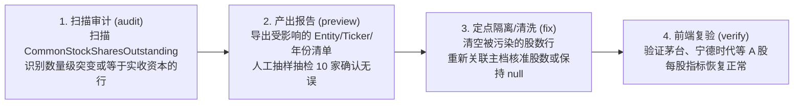

# 财务数据体系治理与自动化重构执行计划 (handoff.md)

> **版本**：v2026-10-15 (工程可执行与安全加固版)  
> **核心原则**：**拒绝虚假命令与不可控写入；数据防污染先行；测试集收敛聚焦；先单点核验再全量回填**  
> **关联设计规范**：[data.md](file:///Users/rafael/R129/buffett-tribe/data.md)

---

## 目录

1. [执行原则与安全红线](#一执行原则与安全红线)
2. [黄金测试集重塑方案（30 家全场景双轨测试矩阵）](#二黄金测试集重塑方案30-家全场景双轨测试矩阵)
3. [五阶段工程任务拆解与可执行清单](#三五阶段工程任务拆解与可执行清单)
4. [存量脏数据定点审计与修复方案](#四存量脏数据定点审计与修复方案)
5. [批次追踪与精准回滚技术方案](#五批次追踪与精准回滚技术方案)
6. [全流程质量门禁与验收 Checklist](#六全流程质量门禁与验收-checklist)

---

## 一、执行原则与安全红线

为了彻底杜绝“方案看着漂亮，实际执行缺乏支撑甚至引发数据灾难”的问题，本次重构执行严格遵守以下四大红线：

1. **不可回滚，严禁写入**：
   在批次追踪参数（`--batch-id`）与精准回滚机制开发并测试通过之前，**严禁执行任何带有 `--all --execute` 的全库写入命令**。
2. **拒绝盲目补齐冲突 ID**：
   晨星快照中的净额项（如 `IFIS002367` 利息收支净额、`IFIS001917` 营业外收支净额）严禁同时粗暴填入毛额收入与毛额支出；未经核实确认的映射宁缺毋滥，保持留空。
3. **区分三级股数用途，严禁金额当股数**：
   * 彻底拔除 A/H 股资产负债表“实收资本/股本金额”映射为发行股数的隐患；
   * 明确三级股数梯队：①期末披露股数（`disclosed_period_end`，优先用于估值基准日市值） $\rightarrow$ ②期间加权股数（`weighted_average`，用于 EPS 联动与历史趋势） $\rightarrow$ ③公式估算股数（`derived` = NetIncome/EPS，仅作无披露时的兜底估算，正常参与趋势，内部打上来源标记，不在前台展示混淆标签）。
4. **测试集服务于业务价值，而非服务于晨星**：
   将测试集从 100 家盲目对账缩减为 **30 家全场景典型标的**，重心聚焦于：**① 财务数据是否采集正确；② 前台 6 大 Tab 页面展示是否如期望**。

---

## 二、黄金测试集重塑方案（30 家全场景双轨测试矩阵）

### 1. 30 家标的遴选矩阵（覆盖 6 模板 $\times$ 3 市场 $\times$ 热门+冷门极限）

文件归档路径：`scripts/lib/golden-benchmark-30.json`

| 模板代码 (`FinancialTemplate`) | 市场 | 候选标的及名称 | 遴选考点与业务特征 |
| :--- | :---: | :--- | :--- |
| **`industrial`**<br>*(工商业通用 - 8家)* | **US** | **AAPL** (苹果)<br>**MSFT** (微软)<br>**CAT** (卡特彼勒)<br>**NEE** (新纪元能源) | • 苹果：巨额持续回购、多次拆股历史、净资产为负（资本配置极限用例）。<br>• 微软：高毛利软件平台、极充沛净现金。<br>• 卡特彼勒：强周期制造重工，曾发生营业成本抓取错位千分之一（冷门硬核防线）。<br>• 新纪元能源：公用事业重资产、高负债运营典型。 |
| | **CN** | **600519** (贵州茅台)<br>**300750** (宁德时代)<br>**600019** (宝钢股份) | • 茅台：超高毛利（90%+）、无有息债、高分红、零回购（A股消费标杆）。<br>• 宁德时代：高端制造、高 CapEx、产业链上下游占款模式。<br>• 宝钢股份：强周期钢铁材料，低估值、周期性亏损与恢复。 |
| | **HK** | **0700.HK** (腾讯控股) | • 腾讯：大额联营投资、回购+分红双轮、跨币种（CNY/HKD）报告对齐。 |
| **`bank`**<br>*(商业银行 - 5家)* | **US** | **JPM** (摩根大通)<br>**USB** (合众银行) | • 摩根大通：全能大行标杆，存贷款与非利息综合收益。<br>• 合众银行：美股纯区域零售信贷银行（冷门纯存贷业务）。 |
| | **CN** | **600036** (招商银行)<br>**601398** (工商银行) | • 招商银行：零售之王，高净息差，资产质量与拨备指标验证。<br>• 工商银行：国有特大行，巨人体量存贷款，账面权益资产比测试。 |
| | **HK** | **0011.HK** (恒生银行) | • 恒生银行：港股成熟商业银行体系，高派息与信贷周期。 |
| **`insurance`**<br>*(保险精算 - 4家)* | **US** | **PGR** (前进保险)<br>**MET** (大都会人寿) | • 前进保险：美股纯财产险（P&C）标杆，测试赔付率与保费承保质量。<br>• 大都会人寿：典型寿险，测试长期准备金负债与浮存金。 |
| | **CN** | **601318** (中国平安) | • 中国平安：综合金融与人身险，浮存金与投资收益双轮驱动。 |
| | **HK** | **1299.HK** (友邦保险) | • 友邦保险：跨国纯寿险巨头，新业务价值与内含价值典型。 |
| **`financial_services`**<br>*(金融服务 - 5家)* | **US** | **BX** (黑石集团)<br>**CME** (芝加哥交易所) | • 黑石：轻资产资管（`asset_mgmt`），测试 AUM 与平均管理费率。<br>• 芝加哥交易所：交易平台（`broker_exchange`），**测试严禁强加 AUM 考核**。 |
| | **CN** | **600030** (中信证券) | • 中信证券：综合券商（`broker_exchange`），佣金、承销与自营投资收益。 |
| | **HK** | **0388.HK** (香港交易所) | • 港交所：轻资产特许垄断交易平台，高净利率，非 AUM 逻辑。 |
| **`real_estate`**<br>*(地产/REITs - 5家)* | **US** | **SPG** (西蒙地产)<br>**PLD** (安博) | • 西蒙地产：商业持有型 REIT（`reit_property`），重资产折旧，**测试 FFO/NAV**。<br>• 安博：物流仓储 REIT，高分红派息率。 |
| | **CN** | **000002** (万科 A)<br>**600048** (保利发展) | • 万科：典型开发商（`developer`），**测试巨额合同负债预售款与净负债率**。<br>• 保利：央企开发商，土地储备存货周期。 |
| | **HK** | **0823.HK** (领展房产基金) | • 领展：港股最大商业收租 REIT（`reit_property`），稳定租金分红。 |
| **`conglomerate`**<br>*(多元控股 - 3家)* | **US** | **BRK.B** (伯克希尔) | • 伯克希尔：跨行业多元控股典范，测试 BPS 复合增长与 SOTP 逻辑。 |
| | **HK** | **0001.HK** (长和)<br>**0019.HK** (太古股份) | • 长和：李嘉诚多元控股（港口+零售+基建+电讯），测试控股折价。<br>• 太古：老牌多元实业控股（航空+地产+饮料）。 |

### 2. 双轨验收断言机制

1. **底层数据正确性断言 (Data Assertion)**：
   * 营收、利润、现金流、资产负债必须与官方年报（10-K / 港交所年报 / 巨潮原件）严格对齐；
   * 股数：期末股数、加权股数分立，无金额当股数；
   * 派生毛利：与已披露年份无缝贴合；
   * 回购分红：来源于现金流量表或权威分红历史，严禁将合并项随意倒推。
2. **前台 6 大 Tab 端到端渲染断言 (E2E UI Assertion)**：
   * **价值线**：30 家标的价值线平滑无断档，四宫格 100% 呈现，无 NaN/除以零；
   * **竞争优势**：杜邦三项乘积 100% 严格等于 ROE；ROIC 对负投入资本有保护；
   * **资本配置**：现金流与股东回报全景总账正常渲染，无大面积无意义占位符；
   * **财务分析**：各模板自适应展示专属科目（银行无毛利、资管有费率、地产有合同负债/FFO）。

---

## 三、五阶段工程任务拆解与可执行清单

---

### 第一阶段：防污染拦截、字典对齐与存量脏数据审计 (P0)

#### 任务 1.1：字典与采集脚本股数清理（三立分立）
* **涉及文件**：
  * `scripts/lib/canonical-financial-dictionary.json`
  * `src/lib/canonical-financial-dictionary.ts`（同步更新 TS 镜像）
  * `scripts/fetch-cn-hk-financials-ak.py`
* **具体动作**：
  1. 从 `CommonStockSharesOutstanding` 的别名中彻底删除“实收资本”、“股本”、“实收资本(或股本)”等金额列名；
  2. 字典中正规定义三项：`CommonStockSharesOutstanding` (期末股数)、`WeightedAverageSharesDiluted` (期间加权股数)、`ShareCapital` (实收资本金额)；
  3. 修改 Python 采集脚本，停止将实收资本金额强转写入股数；
  4. 运行 TS/JSON 字典一致性检查。

#### 任务 1.2：晨星 ID 逐项甄别核准（剔除冲突项）
* **涉及文件**：`scripts/lib/canonical-financial-dictionary.json`
* **具体动作**：
  * **暂不写入** 存在 1:N 认领冲突的净额项：
    * `IFIS002367`（净利息收支，不能同时作为利息收入与利息支出）；
    * `IFIS001917`（营业外收支总额，不能同时作为收入与支出）；
    * `IFBS003308`（Paid in Capital，不能同时作为股数与资本公积）；
    * `IFIS001877`（资产处置，跨表不可直接当作收入）；
  * **安全补齐** 经过确认无歧义的 ID：
    * `EPSBasic` $\rightarrow$ `IFIS101198`
    * `OtherReceivables` $\rightarrow$ `IFBS002709`
    * `LongTermEquityInvestments` $\rightarrow$ `IFBS001320`
    * `InvestmentProperty` $\rightarrow$ `IFBS100681`
    * `OtherPayables` $\rightarrow$ `IFBS002867`
    * `MinorityInterest` $\rightarrow$ `IFBS001381`
  * 同步至 `src/lib/canonical-financial-dictionary.ts`。

#### 任务 1.3：存量脏数据定点审计脚本
* **新建脚本**：`scripts/audit-polluted-financials.ts`
* **具体动作**：
  * 扫描全库 `Financial` 表中 `lineItem = 'CommonStockSharesOutstanding'` 的现有记录；
  * 识别“数值与最新股价相乘得出市值达到数万亿/数万万亿”、“或等于实收资本金额”的异常记录；
  * 产出审计报告：受影响的 Entity ID、代码、财年及当前数值，**只查不改**，供下一步定点修复。

---

### 第二阶段：模板重构、子模型规则与前端边界纠偏 (P0/P1)

#### 任务 2.1：`financial-model.ts` 升级 6 大标准模板与子模型判定
* **涉及文件**：`src/lib/financial-model.ts`
* **具体动作**：
  1. `FINANCIAL_MODEL_TEMPLATES` 扩展为 6 种：`["industrial", "bank", "insurance", "financial_services", "real_estate", "conglomerate"]`；
  2. 统一定义 `financial_services`（彻底废除 `capital_markets`）；
  3. 独立声明 `real_estate` 模板骨架；
  4. 增加子模型（`subModel`）确定性判定规则：
     * `real_estate`：根据 SIC / 行业关键词判断：若包含 "reit"、"real estate investment trust" 或主营为租金收租，判定为 `reit_property`；若包含 "development"、"builder" 或有大额合同负债，判定为 `developer`；
     * `financial_services`：若为公募/私募/资管公司判定为 `asset_mgmt`；若为券商/投行/交易所判定为 `broker_exchange`；
     * 无法确定时走安全默认值，不参与不适用指标计算。

#### 任务 2.2：财务看板与专属报表行重构
* **涉及文件**：`src/lib/company-financial-dashboard.ts`
* **具体动作**：
  * 为 `real_estate` 增补报表行（合同负债、投资性物业、租金收入、预售锁定度）；
  * 修正 `ClaimsRatio` 仅在财险生效；
  * `EquityToAssets` 严格命名为“账面权益资产比”，与 CET1 脱钩。

#### 任务 2.3：资本配置总账与估值指标修正
* **涉及文件**：
  * `src/components/CapitalAllocationView.tsx`
  * `src/lib/valuation-analysis-metrics.ts`
* **具体动作**：
  * 规范为“现金流与股东回报全景总账”，仅呈现客观对比，剔除无依据的举债掏空断言；
  * 估值推演命名为“情景预期年化回报率 (Projected Annualized Return)”；
  * ROIC 增加投入资本 $\text{IC} \le 0$ 时标记 `N/A` 的保护，税率异常时常态归一。

---

### 第三阶段：回填脚本能力补齐、批次追踪与安全回滚 (P0)

#### 任务 3.1：增强 `backfill-derived-metrics.ts` 参数与能力
* **涉及文件**：`scripts/backfill-derived-metrics.ts`
* **具体动作**：
  1. 增加 `--market <us|cn|hk>` 参数支持，支持按市场真实分批；
  2. 增加 `--batch-id <string>` 参数支持，当带 `--execute` 写入时，在 `mappingRule` 字段中附加 `|batch:<batchId>` 溯源标记；
  3. 增加 `--dry-run` 明确提示与统计输出（预估写入行数、涉及公司数、抽样详情）；
  4. 整合全站派生毛利逻辑，成为全库派生唯一出口。

#### 任务 3.2：编写精准回滚脚本与回滚单元测试
* **新建脚本**：`scripts/rollback-batch-financials.ts`
* **新建测试**：`tests/backfill-rollback.test.ts`
* **具体动作**：
  * 编写 `rollback-batch-financials.ts`：接收 `--batch-id <id>` 参数，精准删除该批次写入的记录，**绝不触碰历史已有的正常数据**；
  * 编写单元测试：在一个测试 entity 上写入带 batchId 的记录，执行回滚，断言该记录被准确删除且其他记录完好。

---

### 第四阶段：存量脏数据定点修复与分批受控回填 (P1/P2)

#### 任务 4.1：执行存量错误股数定点清洗
* **新建脚本**：`scripts/fix-polluted-shares.ts`
* **具体动作**：
  * 依据任务 1.3 产出的审计报告，对确认被金额污染的 `CommonStockSharesOutstanding` 旧记录进行置空（清除或更新为 `null`）；
  * 重新通过官方证券主档核准值或在必要时由公式估算股数兜底（打上 `sharesSource = derived`）。

#### 任务 4.2：30 家黄金测试集回归验收
* **新建基准文件**：`scripts/lib/golden-benchmark-30.json`（写入第二节确立的 30 家公司名单）
* **新建评测脚本**：`scripts/eval-golden-suite-30.ts`
* **具体动作**：
  * 执行 `npx tsx scripts/eval-golden-suite-30.ts`；
  * 断言 30 家公司数据完整性、股数正确性；
  * 断言 30 家公司前台 6 大 Tab 计算逻辑无 NaN、无破损。

#### 任务 4.3：分市场受控 Dry-Run 与分批写入
* **具体执行顺序**：
  ```bash
  # 1. US 市场 dry-run
  npx tsx scripts/backfill-derived-metrics.ts --market us --dry-run
  # 2. US 市场写入
  npx tsx scripts/backfill-derived-metrics.ts --market us --execute --batch-id "bf-20261015-us"

  # 3. CN 市场 dry-run
  npx tsx scripts/backfill-derived-metrics.ts --market cn --dry-run
  # 4. CN 市场写入
  npx tsx scripts/backfill-derived-metrics.ts --market cn --execute --batch-id "bf-20261015-cn"

  # 5. HK 市场 dry-run
  npx tsx scripts/backfill-derived-metrics.ts --market hk --dry-run
  # 6. HK 市场写入
  npx tsx scripts/backfill-derived-metrics.ts --market hk --execute --batch-id "bf-20261015-hk"
  ```

---

### 第五阶段：Mini 机器核查与增量 Cron 飞轮激活 (P2)

#### 任务 5.1：Mini 机器运行状态核查
* **具体动作**：
  * SSH 登录 Mac mini 机器，检查现有 crontab 与后台进程：
    ```bash
    crontab -l
    ps aux | grep node
    ```
  * 核实 `scripts/cron/hourly-priority-worker.sh` 是否仍在运行或处于暂停状态；
  * 检查最近的日志文件（`logs/`），确认无卡死孤儿进程。

#### 任务 5.2：单标的手动增量测试与自动化恢复
* **具体动作**：
  1. Mini 机器 `git pull` 同步最新代码；
  2. 手动指定 1 家新公司跑一次单点建档（Phase 1 抓取入库）；
  3. 核查该新公司入库数据是否自带正确模板、Tag 与派生标记；
  4. 验证通过后，正式恢复 mini 上的 hourly priority worker 定时任务。

---

## 四、存量脏数据定点审计与修复方案



---

## 五、批次追踪与精准回滚技术方案

### 1. 批次写入机制（无须改动 Prisma Schema）
利用现有 `Financial.mappingRule` 字符串字段存储批次标签：
* 派生毛利写入格式：`mappingRule = "derived:Revenue - CostOfRevenue|batch:bf-20261015-v2"`
* 派生股数写入格式：`mappingRule = "derived:NetIncome / EPS|batch:bf-20261015-v2"`

### 2. 精准回滚实现逻辑 (`scripts/rollback-batch-financials.ts`)
```ts
import { PrismaClient } from "@prisma/client";
const prisma = new PrismaClient();

export async function rollbackBatch(batchId: string) {
  if (!batchId || batchId.trim() === "") {
    throw new Error("必须提供明确的 batchId，严禁全量清空！");
  }
  const tag = `batch:${batchId}`;
  const count = await prisma.financial.count({
    where: { mappingRule: { contains: tag } }
  });
  console.log(`找到批次 [${batchId}] 相关的财务记录共 ${count} 行。准备安全回滚...`);

  const result = await prisma.financial.deleteMany({
    where: { mappingRule: { contains: tag } }
  });
  console.log(`✅ 成功回滚批次 [${batchId}]，共删除 ${result.count} 行数据。未影响其他数据。`);
}
```

---

## 六、全流程质量门禁与验收 Checklist

在任何代码合并或全库执行前，必须依次通过以下门禁：

- [ ] **门禁 1：类型安全与代码规范**
  * `npx tsc --noEmit` 0 错误通过
  * `npm run lint` 0 报错通过
  * `npm run build` 成功通过
- [ ] **门禁 2：字典一致性与单测**
  * TS 字典与 JSON 字典完全同步，无遗漏别名
  * `npx vitest run tests/derived-metrics.test.ts` 全部通过
  * `npx vitest run tests/backfill-rollback.test.ts` 回滚测试全部通过
- [ ] **门禁 3：数据防污染核验**
  * 确认 A/H 股资产负债表“实收资本/股本”已移出期末发行股数映射
  * 确认未采集的分红回购保持 `null`，无任何伪造零值写入
- [ ] **门禁 4：30 家黄金测试集双轨验收**
  * 30 家公司底层数据与官方年报 100% 对齐
  * 30 家公司前台 6 大 Tab 打开正常（无白屏、无 NaN、无破损）
- [ ] **门禁 5：受控分批回填执行**
  * US、CN、HK 分市场 dry-run 抽样核对无误
  * 带明确 `--batch-id` 执行分批写入，记录写入日志
- [ ] **门禁 6：Mini 机器恢复验收**
  * Mini 现有 crontab 与进程已核实无冲突
  * 单公司增量测试建档成功，数据符合 6 模板新规
  * Hourly Priority Worker 恢复运行，增量飞轮转动
